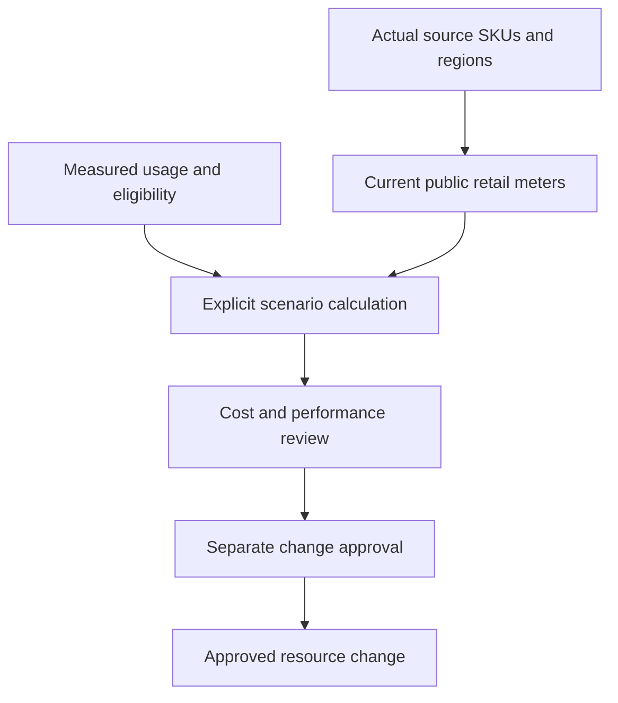
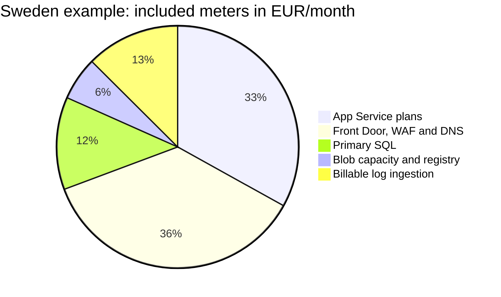
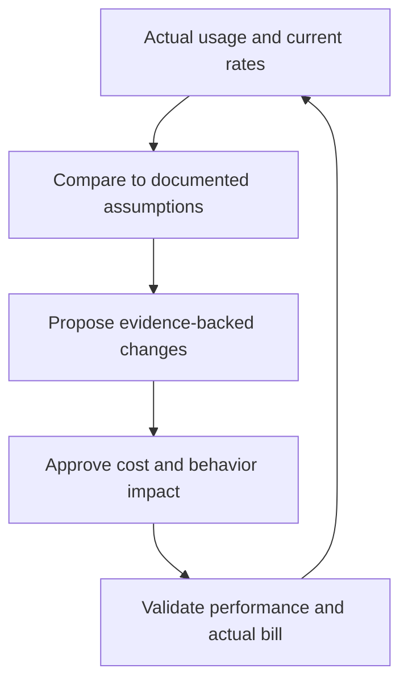

# 💰 Cost Optimization Guide

Current public retail meters for the source-defined resource profile, with explicit volume assumptions rather than a claimed production
bill. Prices were queried from the Azure Retail Prices API on **28 October 2026 UTC**, currency **EUR**, consumption pricing.

> These are public list prices, not negotiated prices, tax-inclusive totals, observed usage, or cost approval. The Bicep parameter profile
> uses France Central; the restored legacy JSON profile uses Sweden Central. AI remains Sweden Central and Static Web Apps West Europe.

## 📋 **Table of Contents**

- [💡 Cost Overview](#-cost-overview)
- [📊 Resource Cost Breakdown](#-resource-cost-breakdown)
- [🎯 Optimization Strategies](#-optimization-strategies)
- [📈 Monitoring & Alerts](#-monitoring--alerts)
- [⚙️ Right-Sizing Guidelines](#️-right-sizing-guidelines)
- [🔄 Automation & Scheduling](#-automation--scheduling)
- [📅 Regular Review Process](#-regular-review-process)

## 🗺️ **Cost Flow Overview**



## 💡 **Cost Overview**

### **Estimated Monthly Costs**

The fixed-core example uses **730 plan hours** and **730/24 registry/database days**. Global Zone 1 meters correspond to the public-cloud
European traffic example. Totals use unrounded rates; displayed rows may differ by a cent when added.

| Service / source SKU              | Retail meter and unit                                    | France Central EUR/month | Sweden Central EUR/month |
| --------------------------------- | -------------------------------------------------------- | -----------------------: | -----------------------: |
| Production Linux B2 plan          | EUR 0.0308/hour FR; EUR 0.0317/hour SE                   |                    22.48 |                    23.14 |
| Development Linux B1 plan         | EUR 0.0158/hour                                          |                    11.53 |                    11.53 |
| Basic ACR                         | EUR 0.1466/day                                           |                     4.46 |                     4.46 |
| Primary SQL Standard 10 DTUs / S0 | EUR 0.5324/day FR; EUR 0.4258/day SE                     |                    16.19 |                    12.95 |
| Front Door Standard base          | EUR 30.799/month                                         |                    30.80 |                    30.80 |
| WAF Standard policy               | EUR 4.3999/month/policy                                  |                     4.40 |                     4.40 |
| One public DNS zone               | EUR 0.44/zone/month                                      |                     0.44 |                     0.44 |
| **Fixed-core subtotal**           | **Excludes the usage/eligibility-dependent items below** |                **90.31** |                **87.72** |

This includes the primary SQL database and Basic registry omitted from the old small estimate. It is not the whole platform cost.

### **Cost Factors**

An illustrative usage addition assumes 100 GB hot LRS blobs, 5 **billable** Analytics Logs GB after any applicable allowance, one million
Front Door requests, 10 GB Front Door data out, one million DNS queries, and one million billable WAF requests:

| Usage                                           | Current rate                                   | France Central EUR | Sweden Central EUR |
| ----------------------------------------------- | ---------------------------------------------- | -----------------: | -----------------: |
| 100 GB hot LRS block blobs, first capacity tier | EUR 0.0169/GB-month FR; EUR 0.0162/GB-month SE |               1.69 |               1.62 |
| 5 billable Analytics Logs GB                    | EUR 2.4287/GB FR; EUR 2.6311/GB SE             |              12.14 |              13.16 |
| 1M Front Door Standard requests                 | EUR 0.0079/10K, modern Front Door product      |               0.79 |               0.79 |
| 10 GB Front Door Standard data out              | EUR 0.0726/GB, Zone 1 first tier               |               0.73 |               0.73 |
| 1M public DNS queries                           | EUR 0.352/M, first tier                        |               0.35 |               0.35 |
| 1M billable WAF requests                        | EUR 0.528/M                                    |               0.53 |               0.53 |
| **Illustrative usage addition**                 |                                                |          **16.23** |          **17.17** |
| **Illustrative included-meter subtotal**        | **Not a complete bill**                        |         **106.54** |         **104.90** |

Do not charge the first 5 GB twice: the API publishes a zero-price ingestion tier followed by the billable tier. Eligibility and other
workspace/account consumption determine the actual allowance. This example explicitly assumes five GB are billable; it does not assert that
five total GB cost this amount. A 3 GB/day workspace cap is a safety limit, not a free allowance.

## 🧩 **Resource Cost Breakdown**

### **High-Impact Cost Components**



### **Cost by Category**

| Category               | Sweden example EUR/month | Important dependency                                                             |
| ---------------------- | -----------------------: | -------------------------------------------------------------------------------- |
| Compute                |                    34.68 | Two shared plans, not a plan per app.                                            |
| Network/WAF/DNS        |                    38.04 | Explicit request/transfer assumptions above.                                     |
| Primary SQL            |                    12.95 | S0; not the secondary serverless database.                                       |
| Blob capacity/registry |                     6.08 | Does not include operations, versions, backups, or registry overage.             |
| Monitoring             |                    13.16 | Five billable GB; do not double-count the same App Insights/workspace ingestion. |

### **Usage-Dependent and Excluded Meters**

| Component                           | Current source / pricing treatment                                                                                                                                                                                                                             |
| ----------------------------------- | -------------------------------------------------------------------------------------------------------------------------------------------------------------------------------------------------------------------------------------------------------------- |
| Secondary SQL                       | `GP_S_Gen5_2`, free-limit requested, exhaustion AutoPause. Eligibility is not established by a SKU declaration. SE general-purpose serverless compute meter is EUR 0.505/vCore-hour if applicable; active time, memory floor, storage, and offer terms matter. |
| Cosmos                              | Free tier requested, 1,000 RU/s account limit, current backup/partition contracts. Only eligible allowances cover throughput/storage; not an unconditional zero-cost account.                                                                                  |
| AI Foundry/model-router             | Usage/token/page/model-routing charges and quota; capacity 10 is not a fixed monthly VM charge. No usage amount is invented here.                                                                                                                              |
| Static Web Apps / App Configuration | Free SKUs, subject to their actual limits/eligibility.                                                                                                                                                                                                         |
| Key Vault                           | Operations and applicable retention-related charges depend on usage.                                                                                                                                                                                           |
| Storage                             | Blob operations, versions/snapshots, queue/table/file usage, lifecycle retrieval, and backups are additional.                                                                                                                                                  |
| Registry                            | Included-storage limits, excess storage/tasks, and traffic are additional.                                                                                                                                                                                     |
| Network                             | Origin-bound transfer, other zones/tiers, extra WAF rules, and other applicable meters are additional.                                                                                                                                                         |
| Future deployment-script hosting    | Not deployed by the current graph; any ACI/storage execution cost belongs in the later bootstrap design.                                                                                                                                                       |

The catalog has both legacy `Azure Front Door Service` transfer meters and modern `Azure Front Door` meters. The main profile is modern
Standard; the data-out example uses the latter, not the higher legacy transfer meter.

## 🎯 **Optimization Strategies**

- Measure actual plan utilization before proposing B2 → B1.
- Reduce unnecessary billable ingestion without losing required diagnostics.
- Review version/snapshot/retention volumes before changing lifecycle policy; never delete data to meet an estimate.
- Use actual cache/request/transfer evidence before changing routing, compression, or WAF behavior.
- Confirm SQL/Cosmos free eligibility and limits rather than assuming a template flag guarantees a credit.

## 📈 **Monitoring & Alerts**

Review Azure Cost Management against the approved scope and compare actual meter quantities with the scenario. Budgets/alerts are not
created by this Bicep graph. Their creation and any new paid monitoring resource need separate approval.

## ⚙️ **Right-Sizing Guidelines**

| Metric                           | Investigation                                                                 |
| -------------------------------- | ----------------------------------------------------------------------------- |
| Sustained CPU/memory utilization | Correlate load, concurrency, and all apps sharing the plan.                   |
| Dependency latency/errors        | Separate data/access failures from insufficient compute.                      |
| Log ingestion growth             | Inspect table/SDK duplication, sampling, and cardinality.                     |
| Storage growth                   | Inspect actual versions, snapshots, retention, and lifecycle access patterns. |

### **Performance Metrics Thresholds**

Treat thresholds as workload-specific signals, not instructions to upgrade/downgrade immediately. Any SKU, capacity, retention, networking,
or architecture change requires evidence and approval.

## 🔄 **Automation & Scheduling**

Stopping an App Service application does **not** stop billing for its App Service plan. The old development-scheduling savings claim was
therefore not a defensible estimate for this profile. Basic plans also should not be assumed eligible for a particular reservation discount
without checking the actual offer.

## 📅 **Regular Review Process**

### **Review Process Flow**



### **Monthly Cost Review Checklist**

- [ ] Re-query retail meters and compare actual agreement prices.
- [ ] Review billable quantities, budgets, and alerts.
- [ ] Confirm free-tier eligibility/consumption across the account/subscription.
- [ ] Review plan utilization, logs, storage versions/retention, SQL activity, and AI usage.
- [ ] Keep actual costs separate from unexecuted what-if or example calculations.

### **Quarterly Optimization Actions**

Review workload measurements, changed offer eligibility, SKU options, and application reliability before changing architecture.

### **Cost Optimization KPIs**

Use measured cost/request, billable GB, plan utilization, and model usage. No production revenue or traffic assumptions are inferred.

## 💡 **Quick Wins Checklist**

### **Immediate Actions (0-7 days)**

- [ ] Confirm the actual SKU/region inventory and billable volumes.
- [ ] Remove duplicate telemetry only after verifying observability requirements.
- [ ] Confirm eligible free allowances and the serverless exhaustion behavior.

### **Short-term Actions (1-4 weeks)**

Hypothetical Sweden savings, not approved actions: B2 → B1 saves EUR 11.61/month at 730 hours; five → two billable log GB saves EUR 7.89;
100 → 50 GB hot blobs saves EUR 0.81. These require capacity/data-policy evidence and do not justify deleting data.

### **Long-term Actions (1-6 months)**

Evaluate eligible commitments or alternate architectures using current offers and measured load. No unsupported percentage saving or
reservation discount is promised.

## 🎯 **Target Architecture Costs**

### **Optimized Monthly Budget**

| Included-meter scenario                                       | France Central EUR/month | Sweden Central EUR/month |
| ------------------------------------------------------------- | -----------------------: | -----------------------: |
| Illustration above                                            |                   106.54 |                   104.90 |
| Hypothetical B2 → B1, 5 → 2 billable log GB, 100 → 50 blob GB |                    87.46 |                    84.59 |
| **Conditional arithmetic difference**                         |                **19.08** |                **20.31** |

These are not actual/approved infrastructure changes or complete bills. The excluded meters and workload assumptions still apply.

### **Reproduce the Pricing Lookup**

```powershell
$filter = "serviceName eq 'Azure App Service' and armRegionName eq 'francecentral' and productName eq 'Azure App Service Basic Plan - Linux' and (skuName eq 'B1' or skuName eq 'B2')"
$uri = 'https://prices.azure.com/api/retail/prices?currencyCode=EUR&$filter=' + [Uri]::EscapeDataString($filter)
$page = Invoke-RestMethod -Uri $uri
$page.Items | Where-Object type -eq 'Consumption' |
  Select-Object productName, skuName, meterName, retailPrice, unitOfMeasure, tierMinimumUnits
```

Follow `NextPageLink` for queries that span pages. Use matching product, SKU, region/zone, unit, consumption type, and tier; do not mix
Windows/DevTest/reservation/sovereign/legacy-product prices with this Linux public-cloud profile. A historical `effectiveStartDate` can
still describe the currently returned active rate.

Sources: [Azure Retail Prices API](https://prices.azure.com/api/retail/prices),
[API/filter documentation](https://learn.microsoft.com/rest/api/cost-management/retail-prices/azure-retail-prices),
[Front Door pricing](https://azure.microsoft.com/pricing/details/frontdoor/),
[SQL free offer](https://learn.microsoft.com/azure/azure-sql/database/free-offer).

---

**Last Updated**: October 2026\
**Currency**: EUR retail list price; queried 28 October 2026 UTC\
**Version**: 3.0.0
