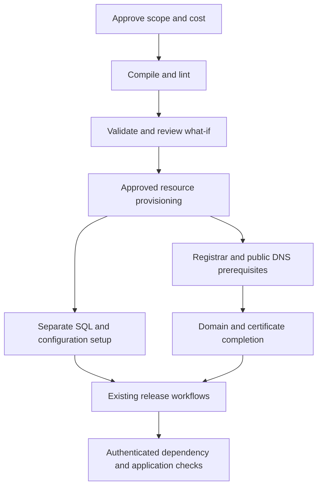
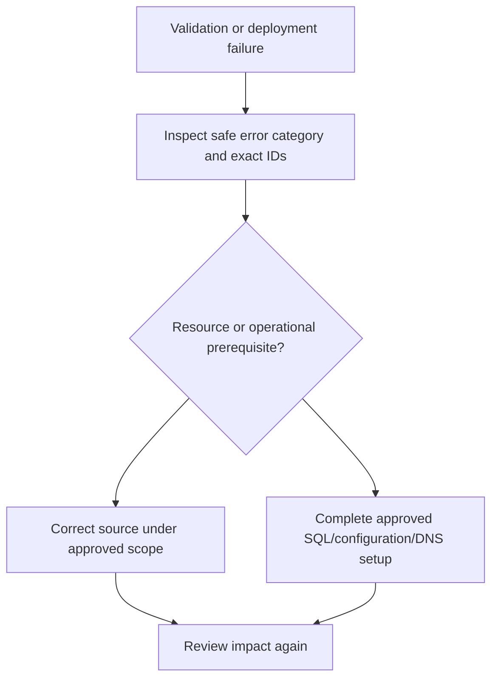

# 🚀 Deployment Guide

Deploy the declarative resource graph through `main.bicep` and its single facade. The
[standalone PowerShell toolkit](../PowerShell/README.md) and [rebuild/teardown runbook](../PowerShell/RUNBOOK.md) own separate operational
steps. Provisioning does not create SQL users, populate configuration, check public DNS, or prove application readiness.

## 🗺️ **Deployment Process Overview**



## 📋 **Table of Contents**

- [📋 Prerequisites](#-prerequisites)
- [🔧 Pre-Deployment Setup](#-pre-deployment-setup)
- [🚀 Deployment Methods](#-deployment-methods)
- [📊 Deployment Validation](#-deployment-validation)
- [🔄 Post-Deployment Configuration](#-post-deployment-configuration)
- [📈 Monitoring Setup](#-monitoring-setup)
- [🚨 Troubleshooting](#-troubleshooting)
- [📞 Support](#-support)

## 📋 **Prerequisites**

### **Required Tools**

| Tool                | Purpose                                                                            |
| ------------------- | ---------------------------------------------------------------------------------- |
| Azure CLI           | Explicit-target validation, what-if, and separately approved deployments.          |
| Bicep 0.48.1        | Verified compiler recognizing the selected resource schemas.                       |
| PowerShell 7        | Standalone setup, identity-specific proof, recovery and selective lifecycle tasks. |
| Repository runtimes | Root `AGENTS.md` owns application runtime versions and tests.                      |

### **Azure Requirements**

- Record the tenant, subscription, resource group, regions, authority, and acceptable cost before cloud operations.
- Confirm globally fixed application names and `arolariu.ro` ownership. A new resource group alone does not isolate those names.
- Confirm provider registration, regional service support, free-tier eligibility, and model quota. Registration itself needs approval.
- Confirm public DNS/registrar prerequisites before hostname bindings and managed certificates. There is no hidden DNS-wait deployment
  script.

### **Permission Requirements**

The deployer needs approved resource-creation and scoped-role-assignment rights. Azure RBAC does not provide Graph permissions: application,
service-principal, and group operations need separate tenant authorization. Runtime identities retain their resource-scoped permissions. The
infrastructure UAMI remains the SQL Entra administrator and retains approved configuration-writer roles.

## 🔧 **Pre-Deployment Setup**

### **1. Install Required Tools**

Use approved existing tools; do not silently replace the global compiler. Set `BICEP_CLI_PATH` to the verified executable. Restore the
existing pinned Graph extension only if it is missing from the cache.

### **2. Azure Authentication**

After explicit target approval:

```powershell
$SubscriptionId = '<approved-subscription-id>'
az account show --subscription $SubscriptionId --query '{tenant:tenantId,subscription:id}' --output table
```

Verify the expected tenant. Do not guess from or change the default account.

### **3. Register Resource Providers**

Check the required namespaces: Resources, ManagedIdentity, KeyVault, AppConfiguration, Storage, ContainerRegistry, Sql, DocumentDB, Web,
Insights, OperationalInsights, Network, Cdn, and CognitiveServices. Do not register missing providers without that approval.

### **4. Validate Bicep Templates**

Run from the repository root:

```powershell
$bicep = $env:BICEP_CLI_PATH
if ([string]::IsNullOrWhiteSpace($bicep)) { throw 'Select the verified Bicep executable.' }
$Artifacts = Join-Path $env:TEMP ('arolariu-infra-' + [guid]::NewGuid().ToString('N'))
New-Item -ItemType Directory -Path $Artifacts | Out-Null
$Template = Join-Path $Artifacts 'main.json'
$Parameters = Join-Path $Artifacts 'main.parameters.json'
& $bicep build .\infra\Azure\Bicep\main.bicep --no-restore --outfile $Template
if ($LASTEXITCODE -ne 0) { throw 'Template compilation failed.' }
& $bicep build-params .\infra\Azure\Bicep\main.bicepparam --no-restore --outfile $Parameters
if ($LASTEXITCODE -ne 0) { throw 'Parameter compilation failed.' }
& $bicep lint .\infra\Azure\Bicep\main.bicep --no-restore
```

Inspect diagnostics as well as exit codes; BCP081 is a failing schema gate. Do not regenerate the restored ARM reference artifacts. The
Bicep parameter profile uses France Central; the legacy JSON parameter file retains Sweden Central. AI is Sweden Central and Static Web Apps
are West Europe regardless of the regional profile.

## 🚀 **Deployment Methods**

### **Method 1: Azure CLI (Recommended)**

Use the same compiled JSON/hash for approved validation and any later create operation; this avoids Azure CLI selecting another compiler.

```powershell
az deployment sub validate --subscription $SubscriptionId --location francecentral --template-file $Template --parameters "@$Parameters"
az deployment sub what-if --subscription $SubscriptionId --location francecentral --template-file $Template --parameters "@$Parameters"
```

Review the actual proposed IDs, permissions, DNS, hosting changes, and cost. The existing production group is not an approved migration
target. A separate concrete checkpoint is required before:

```powershell
az deployment sub create --subscription $SubscriptionId --location francecentral --template-file $Template --parameters "@$Parameters"
```

### **Method 2: Azure PowerShell**

An operator can submit the same compiled artifact with Azure PowerShell under the same target/cost/authority checkpoints. No implicit login,
context switch, or alternate deployment behavior is part of the template.

### **Method 3: GitHub Actions (CI/CD)**

Existing workflows deliver application images/static content. This PR adds no infrastructure workflow and dispatches no release. Normal
release order is experiments, API, then production/development website; CV/docs/status content can be delivered independently.

## 📊 **Deployment Validation**

### **1. Check Deployment Status**

Inspect the approved deployment's provisioning result and non-secret `deploymentInfo` identifiers. No bootstrap/data-access/health
completion result is emitted by the facade.

### **2. Validate Resources**

Confirm actual plans, attached UAMIs, registry selection, endpoints, role scopes, and Graph application/service-principal IDs. A successful
what-if does not prove Graph operations, data-plane access, or quota.

### **3. Test Connectivity**

After configuration and releases, verify website `/api/health/`, API `/health`, experiments `/api/health` and `/api/ready`, actual image
pulls, permitted configuration access, and a real authorized application flow. Cloud Cosmos health uses the shared authenticated client for
a bounded `primary` database read; emulator URL probing remains unchanged.

## 🔄 **Post-Deployment Configuration**

### **1. DNS Configuration**

`network/dnsZone.bicep` owns Azure CNAME/TXT/apex records. Publish emitted registrar NS/current parent DS carefully; stale DS can break
resolution. Binding and Front Door modules retain declarative TLS/routing, but public DNS must already be propagated for completion. No
placeholder vendor records are emitted. Do not silently bypass a failed binding or modify production registrar settings.

### **2. Application Settings**

Follow the [complete inventory and executable sequence](../PowerShell/RUNBOOK.md#4-populate-secrets-before-references): four required secret
inputs, 16 PRODUCTION and 10 DEVELOPMENT required key/label settings, plus optional email/features. Clerk publishable keys are ordinary
public inputs; existing legacy public-key secrets are preserved rather than deleted.

Both website labels call the same API and must use its `PRODUCTION-JWT-SECRET`; preserve real keys and any unused legacy development key.
Missing optional Resend must be an ordinary empty setting, not a dangling reference. No placeholders should be written as credentials.

`EXP_ENTRA_APP_CLIENT_ID` is required for Azure callers; there is no legacy registration fallback. Local proxy requests do not acquire Azure
tokens. Existing frontend/backend-named CI-login secrets still select the infrastructure UAMI; application runtime settings select the
actual frontend/backend identities.

SQL is Entra-only. The restored `rbac/sql-rbac-uami.sql` is an unchanged manual reference, not idempotent bootstrap or production authority.
The [SQL sequence](../PowerShell/RUNBOOK.md#5-ensure-backend-sql-binding-and-memberships) derives the explicit SID from the backend client
ID and uses independently callable ensure tasks. Real backend login/permissions and the missing auth-schema initialization gate remain
separate; health/SELECT 1 is not schema proof.

### **3. Scaling Configuration**

No autoscaling or new paid tier is introduced. Changing SKUs, regions, plans, capacity, or network posture needs its own approval.

## 📈 **Monitoring Setup**

### **1. Configure Alerts**

Log Analytics and Application Insights exist; arbitrary alert rules and a standalone Managed Grafana instance do not. New monitoring
resources/costs require approval.

### **2. Enable Diagnostics**

Do not assume every resource sends diagnostics merely because the workspace exists. Validate real telemetry after release. Preserve the
workspace's 30-day retention/3 GB daily cap and the component's source-defined settings unless separately approved.

## 🚨 **Troubleshooting**

### **Troubleshooting & Rollback Flow**



### **Common Deployment Issues**

| Issue                                        | Response                                                                                    |
| -------------------------------------------- | ------------------------------------------------------------------------------------------- |
| Occupied names or existing production group  | Stop; do not rename, delete, or reconcile production implicitly.                            |
| Missing Graph/RBAC rights                    | Identify the exact operation; do not grant broad tenant/subscription permissions.           |
| Empty configuration or unavailable API login | Provisioning does not run bootstrap; perform separately approved operational setup.         |
| Public DNS/certificate not ready             | Check delegation/current DS and records; do not claim readiness from control-plane success. |
| Unsupported what-if changes                  | Treat them as unevaluated, not safe/no-change results.                                      |

### **Debugging Commands**

Use explicit subscription scope and select non-secret status/IDs. Never dump tokens, Key Vault values, secure environments, or raw
credential-containing service responses into logs.

### **Performance Troubleshooting**

Use actual application telemetry before proposing SKU changes. Stopping an app does not stop App Service plan billing.

### **Rollback Procedures**

There is no automatic resource-group-delete rollback. Preserve data, unrelated users, permanent identities/grants, and protected vaults. Any
exact-resource cleanup needs separate authorization. No deployment script/ACI/backing storage is created by the current graph; cleanup
behavior for optional script hosting must be approved and observed separately. Use the
[selective AI/Entra lifecycle tasks](../PowerShell/RUNBOOK.md#9-selectively-delete-or-permanently-purge), not a group sweep. Permanent purge
is an independently acknowledged action; preserved DNS/data/protected vaults are not incidental cleanup.

## 📞 **Support**

### **Getting Help**

Read the current module sources and README contracts before changing configuration. Report material drift and blocked evidence explicitly.

### **Useful Resources**

- [Azure Bicep](https://learn.microsoft.com/azure/azure-resource-manager/bicep/)
- [App Service Entra authentication](https://learn.microsoft.com/azure/app-service/configure-authentication-provider-aad)
- [Azure CLI deployment reference](https://learn.microsoft.com/cli/azure/deployment/sub)
- [Cost guide](COST_OPTIMIZATION.md)

---

**Last Updated**: October 2026\
**Version**: 3.0.0
