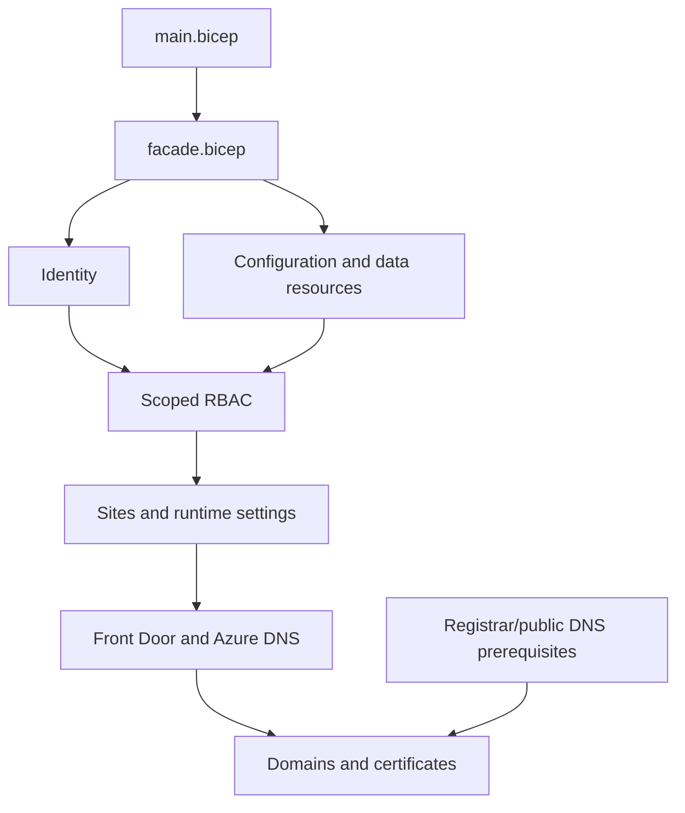

# 🚀 Azure Bicep Infrastructure

Azure resource definitions for arolariu.ro, organized into cohesive modules with managed identities, resource-scoped grants, and stable
naming. Bicep provisions resources; configuration population, SQL contained users, and operational probes are separate tasks.

> **Scope:** This is a fresh-infrastructure definition, not an approved migration of the existing production resource group. Bootstrap is
> being redesigned around standalone PowerShell 7 tasks. No inline bootstrap deployment scripts or Foundation/Domains wrapper files remain.

## 📋 **Table of Contents**

- [🏗️ Architecture Overview](#️-architecture-overview)
- [🚀 Quick Start](#-quick-start)
- [📁 Module Structure](#-module-structure)
- [🔧 Configuration](#-configuration)
- [📊 Deployment Flow](#-deployment-flow)
- [🛠️ Development](#️-development)
- [📖 Documentation](#-documentation)
- [🤝 Contributing](#-contributing)

## 🏗️ **Architecture Overview**

| Area                 | Resources                                                                                                                |
| -------------------- | ------------------------------------------------------------------------------------------------------------------------ |
| Identity             | Three user-assigned managed identities, GitHub federation, Graph groups, experiments app registration/service principal. |
| Configuration        | RBAC-enabled Key Vault and managed-identity-only App Configuration.                                                      |
| Compute and sites    | Linux B2/B1 plans, four App Services, CV/docs/status Free Static Web Apps.                                               |
| Data and images      | StorageV2, Basic ACR, Entra-only SQL, Cosmos database/containers and native data grant.                                  |
| Network              | Front Door Standard, custom-rule WAF, Azure DNS/DNSSEC, hostname/certificate bindings.                                   |
| Observability and AI | Log Analytics, Application Insights, AI Foundry/project/model-router deployment.                                         |

### **🎯 Key Features**

- ✅ Stable resource namespace derived from the resource-group ID, not a deployment timestamp.
- ✅ Correct resource/client/principal identity-ID wiring.
- ✅ Resource-scoped permissions and supported, explicitly pinned APIs.
- ✅ Existing application delivery workflows remain unchanged.
- ✅ Separate resource provisioning from operational configuration and health evidence.

## 🚀 **Quick Start**

### **Prerequisites**

Use the repository runtimes in root `AGENTS.md`, Azure CLI, and a verified Bicep executable. Current schema validation uses Bicep 0.48.1.
The [deployment guide](DEPLOYMENT_GUIDE.md) covers target approval, Graph permissions, provider/quota checks, DNS, and external setup.

### **Deployment**

Validate locally before any approved Azure operation:

```powershell
& $env:BICEP_CLI_PATH build .\infra\Azure\Bicep\main.bicep --no-restore --stdout
& $env:BICEP_CLI_PATH build-params .\infra\Azure\Bicep\main.bicepparam --no-restore --stdout
```

These are compilation commands, not deployments. Do not apply a fresh profile to an occupied production scope.

### **Parameters**

| Parameter                | Contract                                                                          |
| ------------------------ | --------------------------------------------------------------------------------- |
| `resourceGroupName`      | Required target resource group; existing application names remain globally fixed. |
| `resourceGroupAuthor`    | Required audit tag.                                                               |
| `resourceGroupLocation`  | France Central, North Europe, West Europe, or Sweden Central.                     |
| `resourceDeploymentDate` | Audit/deployment-name timestamp, default `utcNow()`.                              |

There is no `deploymentStage` parameter. `main.bicepparam` retains France Central; the restored legacy JSON parameter profile retains Sweden
Central. Choose the intended profile explicitly rather than assuming they are interchangeable. AI is explicitly in Sweden Central; Static
Web Apps are in West Europe.

## 📁 **Module Structure**

```text
main.bicep
  -> facade.bicep
       -> identity / configuration / storage / compute / observability / ai
       -> resource-scoped rbac
       -> sites -> network -> bindings
```

### **Module Dependencies**



The facade owns composition directly. Front Door routing/WAF association is back in its existing resource module; DNS records have one owner
in `network/dnsZone.bicep`.

## 🔧 **Configuration**

### **Bicep Configuration**

[bicepconfig.json](bicepconfig.json) retains existing lint rules. Source mapping and unused user-defined constraints are supported but
experimental; enabling source mapping produces the compiler's production-use warning, so neither is enabled. No missing-schema warning is
suppressed.

### **Naming Convention**

The prefix is `q` plus eight characters of `uniqueString(resourceGroup().id)`. Resource-family suffixes are defined by their modules. App
Service/Static Web App names and `arolariu.ro` stay fixed for existing workflow compatibility.

## 📊 **Deployment Flow**

1. Approve a target and confirm global names, providers, permissions, quota, and cost.
2. Provision resources and scoped grants through `main.bicep` → `facade.bicep`.
3. Complete operational SQL/configuration setup separately; public DNS must be ready for hostname/certificate completion.
4. Release experiments, API, then websites through the existing workflows.
5. Verify real authenticated access, dependencies, and application health.

Resource provisioning does not assert bootstrap completion or application readiness.

## 🛠️ **Development**

### **Local Development**

Use native Bicep build/lint and parameter compilation. The former ARM/bootstrap-specific TypeScript harness has been removed as requested;
application audience and authenticated Cosmos-health regressions remain with their owning projects.

### **Best Practices**

Preserve TLS, retention, partitions, SKUs, and approved access boundaries. Keep credentials out of templates and logs. A new API version
must have recognized schemas and an intentional compatibility review.

## 📖 **Documentation**

| Guide                                                                                      | Purpose                                                              |
| ------------------------------------------------------------------------------------------ | -------------------------------------------------------------------- |
| [Deployment](DEPLOYMENT_GUIDE.md)                                                          | Approval boundaries, provisioning, operational handoffs, validation. |
| [Costs](COST_OPTIMIZATION.md)                                                              | Current public retail meters and explicit example assumptions.       |
| [Identity](identity/README.md), [RBAC](rbac/README.md)                                     | IDs, federation, Entra, scoped grants.                               |
| [Configuration](configuration/README.md), [Storage](storage/README.md), [AI](ai/README.md) | Service contracts and separate configuration ownership.              |
| [Sites](sites/README.md), [Bindings](bindings/README.md), [Network](network/README.md)     | Runtime hosting, DNS, WAF, TLS.                                      |
| [Compute](compute/README.md), [Observability](observability/README.md)                     | Plans and telemetry resources.                                       |

The files under `infra\Azure\ARM` are restored reference artifacts, not regenerated outputs of this PR. Compile current Bicep to a separate
temporary/session artifact when validating or deploying; do not treat the legacy ARM snapshot as the current source.

## 🤝 **Contributing**

### **Code Quality Standards**

Keep changes surgical, document actual behavior, test changed application contracts, and obtain approval before cloud mutations. Never use
resource-group deletion as an automatic rollback.

---

**Version**: 3.0.0\
**Last Updated**: October 2026\
**Status**: Resource provisioning; PowerShell bootstrap design pending
