# Azure Bicep infrastructure

These templates provision a **fresh** arolariu.ro environment in two stages. They are not a migration or production-reconciliation
procedure. Application images and static content remain owned by the existing build/release workflows.

## Entry points and stages

| File                                 | Responsibility                                                                                                                   |
| ------------------------------------ | -------------------------------------------------------------------------------------------------------------------------------- |
| [main.bicep](main.bicep)             | Subscription entry point; creates the resource group only for Foundation.                                                        |
| [facade.bicep](facade.bicep)         | Derives the stable namespace and selects exactly one stage.                                                                      |
| [foundation.bicep](foundation.bicep) | Resources, identities, permissions, resolved configuration, backend access probes, and Azure-owned DNS preparation.              |
| [domains.bicep](domains.bicep)       | Reads the existing foundation, checks public DNS, then completes bindings, certificates, and Front Door routing/WAF association. |
| [main.bicepparam](main.bicepparam)   | Existing-pipeline profile: `arolariu-rg`, France Central, Foundation.                                                            |

```mermaid
flowchart LR
    Entry[main / facade] --> Foundation
    Foundation --> Resources[Resources and resource-scoped grants]
    Resources --> Probes[Backend SQL / Cosmos / blob / queue probes]
    Probes --> Configuration[Resolved configuration and secrets]
    Configuration --> Sites[Application hosts and Azure DNS records]
    Sites --> Registrar[Operator publishes registrar NS and current DS]
    Registrar --> Domains[Public DNS gate]
    Domains --> Completion[Bindings / certificates / Front Door completion]
```



Foundation creates three user-assigned managed identities, an experiments Entra application/service principal, App Configuration, Key Vault,
SQL, Cosmos, Storage, ACR, AI Foundry/model deployment, monitoring, App Service plans/apps, Static Web Apps, DNS, and Front Door. It does
not deploy Grafana or release the application.

The namespace is `q` plus eight characters of `uniqueString(resourceGroup().id)`. Deployment timestamps affect audit tags, nested deployment
names, and script attempts, not persistent resource names. Existing fixed application names and `arolariu.ro` are retained for pipeline
compatibility; their global availability is a preflight requirement.

## Deployment contract

See the [deployment guide](DEPLOYMENT_GUIDE.md) for approval boundaries, compiler selection, local checks, stage commands, and cleanup
verification. Do not copy deployment commands into an unapproved subscription or an existing production resource group.

The checked-in profile uses France Central for regional resources, Sweden Central for the explicitly pinned AI model, and West Europe for
Static Web Apps. The entry point also accepts North Europe, West Europe, and Sweden Central; this does not establish service/model
availability, quota, or approval for another profile.

Azure-owned configuration and permissions are populated by inline deployment scripts. The remaining operator handoffs are:

- Supply the DEVELOPMENT/PRODUCTION Clerk secrets; supply Resend keys only when email delivery is wanted.
- Publish the emitted DNS nameservers and current parent DS records at the registrar.
- Update the existing GitHub connection settings/secrets once, then use the existing release workflows.

`deploymentInfo.readiness.azureBootstrapComplete` means that the SQL bootstrap, backend data-access probes, and configuration bootstrap
succeeded. Missing external secret names are reported separately. It **does not** mean that applications are released, HTTP-healthy, or that
Domains has completed; `applicationHealthVerified` remains false.

## Security and lifecycle

SQL is Entra-only. The infrastructure identity remains its administrator and owns the approved configuration-writer permissions. SQL's
`AllowAzureServices` firewall rule is a deliberate public-network tradeoff, not a restriction to this subscription. Cosmos uses native
database-scoped data permissions, not management-plane Operator access. The backend probe authenticates as the backend identity and performs
read-only SQL/Cosmos/blob/queue checks.

Every inline script requests `cleanupPreference: 'Always'` and `retentionInterval: 'PT1H'`. Its ACI container and backing storage are
provider-created execution resources, never application storage. These settings are **not observed cleanup evidence**: verify absence of the
exact emitted/status resource IDs after success and controlled failure, and verify script-record expiry separately.

API pins are validated with stable Bicep 0.48.1. Storage deliberately uses `2026-06-01`: the newer published `2026-09-01` types are not
recognized by that compiler. No BCP081 warning is accepted or suppressed. DNSSEC retains its required preview API and SQL retains the
supported legacy auditing-policy API; other exact parent/child pins live in their owning source files.

## Source map

| Directory                                                    | Owner                                                                          |
| ------------------------------------------------------------ | ------------------------------------------------------------------------------ |
| [identity](identity/README.md)                               | Managed identities, GitHub federation, Graph groups, experiments registration. |
| [configuration](configuration/README.md)                     | App Configuration and Key Vault provisioning.                                  |
| `bootstrap`                                                  | Inline configuration, backend-access, and public-DNS scripts.                  |
| [storage](storage/README.md)                                 | Storage services, ACR, SQL, and Cosmos.                                        |
| [rbac](rbac/README.md)                                       | Resource-scoped grants and SQL contained-user bootstrap.                       |
| [ai](ai/README.md)                                           | AI account/project and the pinned model-router deployment.                     |
| [compute](compute/README.md), [sites](sites/README.md)       | Plans, application hosts, runtime identities/settings, and static sites.       |
| [network](network/README.md), [bindings](bindings/README.md) | Azure DNS, staged Front Door, hostname bindings, and certificates.             |
| [observability](observability/README.md)                     | Log Analytics and Application Insights.                                        |
| [types](types/README.md)                                     | Shared Bicep contracts.                                                        |

[bicepconfig.json](bicepconfig.json) is the lint configuration. The real-compiler and inline-script regression suite is
[`scripts/azure/bicep.test.ts`](../../../scripts/azure/bicep.test.ts). The [cost guide](COST_OPTIMIZATION.md) contains historical estimates,
not a current quote or permission to resize/add resources.

The tracked ARM template/parameter snapshots are generated by Bicep, not `npm run generate`. After changing the entry graph/profile,
regenerate them with the same verified compiler selected in the deployment guide; never hand-edit generated templates:

```powershell
& $env:BICEP_CLI_PATH build .\infra\Azure\Bicep\main.bicep --no-restore --outfile .\infra\Azure\ARM\main.json
& $env:BICEP_CLI_PATH build-params .\infra\Azure\Bicep\main.bicepparam --no-restore --outfile .\infra\Azure\ARM\main.parameters.json
```
