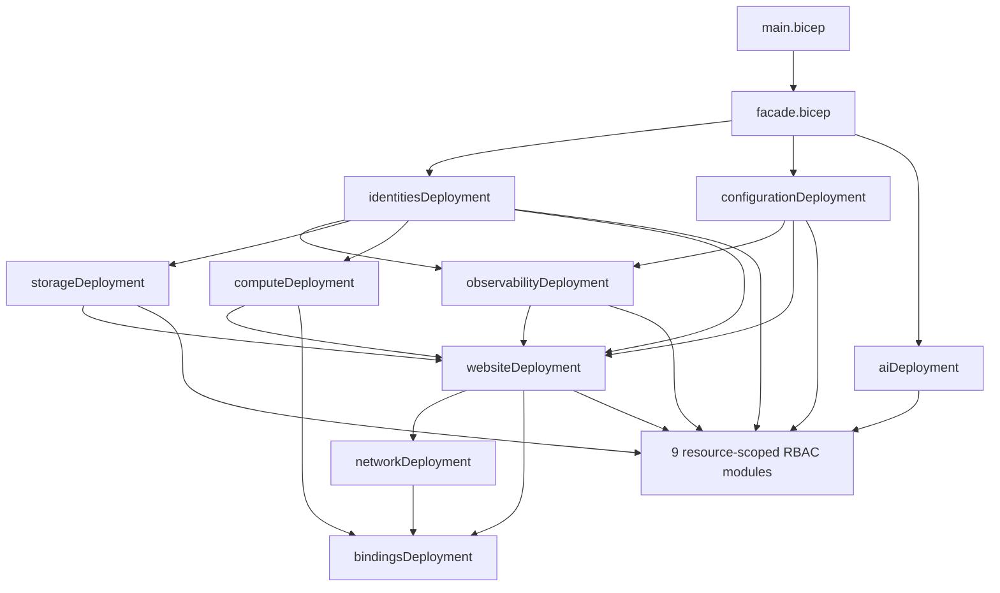

# 🚀 Azure Bicep Infrastructure

[](https://docs.microsoft.com/en-us/azure/azure-resource-manager/bicep/)
[](https://github.com/arolariu/arolariu.ro)
[](https://arolariu.ro)

A comprehensive, production-ready Azure infrastructure-as-code solution built with Azure Bicep, featuring standardized naming conventions,
explicit dependency management, and enterprise-grade parameter validation.

## 📋 **Table of Contents**

- [🚀 Azure Bicep Infrastructure](#-azure-bicep-infrastructure)
  - [📋 **Table of Contents**](#-table-of-contents)
  - [🏗️ **Architecture Overview**](#️-architecture-overview)
    - [**🎯 Key Features**](#-key-features)
  - [🚀 **Quick Start**](#-quick-start)
    - [**Prerequisites**](#prerequisites)
    - [**Deployment**](#deployment)
    - [**Parameters**](#parameters)
  - [📁 **Module Structure**](#-module-structure)
    - [**Module Dependencies**](#module-dependencies)
  - [🔧 **Configuration**](#-configuration)
    - [**Bicep Configuration**](#bicep-configuration)
    - [**Naming Convention**](#naming-convention)
  - [📊 **Deployment Flow**](#-deployment-flow)
  - [🛠️ **Development**](#️-development)
    - [**Local Development**](#local-development)
    - [**Best Practices**](#best-practices)
  - [📖 **Documentation**](#-documentation)
  - [🤝 **Contributing**](#-contributing)
    - [**Code Quality Standards**](#code-quality-standards)

## 🏗️ **Architecture Overview**

This infrastructure solution deploys a complete web application platform on Azure with the following components:

- **🔐 Identity & Security**: Managed identities, Federated credentials, Security groups
- **🔒 Configuration**: Key Vault, App Configuration
- **💻 Compute**: App Service Plans (Production + Development)
- **🌐 Networking**: Azure Front Door, DNS zones with DNSSEC
- **📦 Storage**: Storage accounts, Container Registry, SQL Database, Cosmos DB
- **📊 Observability**: Log Analytics, Application Insights
- **🤖 AI Services**: Azure AI Foundry (AIServices account + project)
- **🌍 Web Applications**: Main site, API, Dev, Exp (configuration proxy), CV (SvelteKit), Docs (Docusaurus)
- **🔗 Bindings**: Custom domains, Managed certificates
- **🔑 RBAC**: Resource-scoped role assignments for all identities

### **🎯 Key Features**

- ✅ **Production-ready** with enterprise-grade standards
- ✅ **Standardized naming** across all Azure resources
- ✅ **Explicit dependencies** for reliable deployments
- ✅ **Parameter validation** prevents invalid configurations
- ✅ **Modular design** for easy maintenance and updates
- ✅ **Comprehensive linting** with 31 analyzer rules

## 🚀 **Quick Start**

### **Prerequisites**

- Azure CLI (latest version)
- Azure subscription with appropriate permissions
- Bicep CLI (latest version)

### **Deployment**

1. **Clone the repository**

   ```bash
   git clone https://github.com/arolariu/arolariu.ro.git
   cd arolariu.ro/infra/Azure/Bicep
   ```

2. **Login to Azure**

   ```bash
   az login
   az account set --subscription "your-subscription-id"
   ```

3. **Set the exp.arolariu.ro App Registration client ID**

   Replace the `expEntraAppClientId` placeholder in `main.bicepparam` (the file shows the `az ad app create` command that creates the
   registration). `main.bicepparam` is the canonical parameters file; it also sets `resourceGroupName = 'arolariu-rg'`,
   `resourceGroupLocation = 'francecentral'` and `resourceGroupAuthor`.

4. **Deploy the infrastructure** (from `infra/Azure/Bicep`)
   ```bash
   az deployment sub create \
     --location francecentral \
     --template-file main.bicep \
     --parameters main.bicepparam
   ```

No GitHub workflow deploys these templates; deployment is manual via the Azure CLI. See the [Deployment Guide](./DEPLOYMENT_GUIDE.md) for
details.

### **Parameters**

| Parameter                | Type   | Default      | Description                                                       |
| ------------------------ | ------ | ------------ | ----------------------------------------------------------------- |
| `resourceGroupName`      | string | — (required) | Name of the resource group (1-90 chars)                           |
| `resourceGroupAuthor`    | string | — (required) | Author of the deployment (5-100 chars)                            |
| `resourceGroupLocation`  | string | — (required) | Azure region for deployment                                       |
| `resourceDeploymentDate` | string | `utcNow()`   | Deployment timestamp; seeds the resource-name prefix              |
| `expEntraAppClientId`    | string | — (required) | Entra ID App Registration client ID for exp.arolariu.ro Easy Auth |

**Allowed Regions**: `francecentral`, `northeurope`, `westeurope`, `swedencentral`

The AI Foundry account is always deployed to `swedencentral`, regardless of `resourceGroupLocation`.

## 📁 **Module Structure**

```
infra/Azure/Bicep/
├── 📄 main.bicep                    # Subscription-level entry point
├── 📄 main.bicepparam               # Canonical deployment parameters
├── 📄 main.parameters.json          # Legacy JSON parameters (lacks expEntraAppClientId; not used)
├── 📄 facade.bicep                  # Main orchestration module
├── ⚙️ bicepconfig.json              # Bicep configuration & linting
├── 📄 DEPLOYMENT_GUIDE.md           # Deployment guide
├── 📄 COST_OPTIMIZATION.md          # Cost optimization guide
├── 📁 ai/                           # Azure AI Foundry
├── 📁 bindings/                     # Custom domain bindings
├── 📁 compute/                      # App Service Plans
├── 📁 configuration/                # App Configuration & Key Vault
├── 📁 constants/                    # Shared role definition IDs (roles.bicep) and createTags() (tags.bicep)
├── 📁 identity/                     # Managed Identities & Federated Credentials
├── 📁 network/                      # Azure Front Door & DNS
├── 📁 observability/                # Monitoring & logging
├── 📁 rbac/                         # Resource-scoped RBAC assignments
├── 📁 sites/                        # Web applications & Static Web Apps
├── 📁 storage/                      # Storage, SQL, NoSQL, Container Registry
└── 📁 types/                        # User-defined types
```

### **Module Dependencies**

Edges show `dependsOn` or output references in `facade.bicep`:



## 🔧 **Configuration**

### **Bicep Configuration**

The `bicepconfig.json` file provides:

- ✅ **31 linting rules** for code quality
- ✅ **Experimental features** (compileTimeImports, userDefinedConstraints, symbolicNameCodegen, sourceMapping)
- ✅ **Standardized formatting** (2-space indentation)
- ✅ **Security rules** (no hardcoded values)

### **Naming Convention**

`facade.bicep` computes one resource-name prefix per deployment and passes it to the modules as `resourceConventionPrefix`:

```bicep
var resourceConventionPrefix = 'q${substring(uniqueString(resourceDeploymentDate), 0, 5)}'
```

`resourceDeploymentDate` defaults to `utcNow()` and `main.bicepparam` does not set it, so a deployment that does not pin it computes a new
prefix and therefore new resource names. Modules append a fixed suffix to the prefix (shown as `<prefix>`):

| Resource                | Name                                                                               |
| ----------------------- | ---------------------------------------------------------------------------------- |
| App Service plans       | `<prefix>-production`, `<prefix>-development`                                      |
| Key Vault               | `<prefix>kv`                                                                       |
| App Configuration       | `<prefix>appconfig`                                                                |
| Storage account         | `<prefix>sacc`                                                                     |
| Container registry      | `<prefix>acrprod`                                                                  |
| SQL server              | `<prefix>-sqlserver`                                                               |
| Cosmos DB account       | `<prefix>-nosqlserver`                                                             |
| Managed identities      | `<prefix>-uami-frontend`, `<prefix>-uami-backend`, `<prefix>-uami-infrastructure`  |
| Log Analytics workspace | `<prefix>-workspace`                                                               |
| Application Insights    | `<prefix>-insights`                                                                |
| AI Foundry account      | `<prefix>-ai-foundry`                                                              |
| Front Door profile      | `<prefix>-afd`                                                                     |
| DNS zone                | `arolariu.ro` (fixed)                                                              |
| App Services            | `www-arolariu-ro`, `api-arolariu-ro`, `dev-arolariu-ro`, `exp-arolariu-ro` (fixed) |
| Static Web Apps         | `docs-arolariu-ro`, `cv-arolariu-ro` (fixed)                                       |

## 📊 **Deployment Flow**

`facade.bicep` orders the modules through `dependsOn` and output references:

1. **🔐 Identity** - Managed identities, federated credentials, security groups (no dependencies)
2. **⚙️ Configuration** - Key Vault & App Configuration (no dependencies)
3. **📊 Observability** - Log Analytics & Application Insights (after Identity, Configuration)
4. **📦 Storage** - Storage account, Container Registry, SQL, Cosmos DB (after Identity)
5. **💻 Compute** - App Service Plans (after Identity)
6. **🌍 Sites** - App Services & Static Web Apps (after Storage, Configuration; uses Observability, Compute and Identity outputs)
7. **🌐 Network** - Front Door & DNS zone (after Sites)
8. **🔗 Bindings** - Custom domains & managed certificates (after Sites, Network, Compute)
9. **🤖 AI** - Azure AI Foundry (no dependencies)
10. **🔒 RBAC** - 9 resource-scoped role-assignment modules (after their target resources)

## 🛠️ **Development**

### **Local Development**

1. **Install Bicep CLI**

   ```bash
   az bicep install
   ```

2. **Validate templates**

   ```bash
   az bicep build --file main.bicep
   ```

3. **Run linting**
   ```bash
   az bicep lint --file main.bicep
   ```

### **Best Practices**

- ✅ Use parameter validation decorators (`@minLength`, `@maxLength`, `@allowed`)
- ✅ Document all parameters with `@description`
- ✅ Follow the established naming convention
- ✅ Add explicit dependencies where needed

## 📖 **Documentation**

Each module contains detailed documentation:

- [📖 Deployment Guide](./DEPLOYMENT_GUIDE.md) - Step-by-step deployment and troubleshooting
- [💰 Cost Optimization](./COST_OPTIMIZATION.md) - Cost breakdown and optimization guidance
- [📁 ai/](./ai/README.md) - Azure AI Foundry documentation
- [📁 bindings/](./bindings/README.md) - Custom domain bindings documentation
- [📁 compute/](./compute/README.md) - App Service Plans documentation
- [📁 configuration/](./configuration/README.md) - App Configuration & Key Vault documentation
- [📁 identity/](./identity/README.md) - Identity & security documentation
- [📁 network/](./network/README.md) - Networking & DNS documentation
- [📁 observability/](./observability/README.md) - Monitoring documentation
- [📁 rbac/](./rbac/README.md) - RBAC assignments documentation
- [📁 sites/](./sites/README.md) - Web applications documentation
- [📁 storage/](./storage/README.md) - Storage documentation
- [📁 types/](./types/README.md) - User-defined types documentation

## 🤝 **Contributing**

1. Fork the repository
2. Create a feature branch
3. Follow the established patterns and naming conventions
4. Ensure all linting rules pass
5. Add appropriate documentation
6. Submit a pull request

### **Code Quality Standards**

- ✅ All Bicep files must pass linting without errors
- ✅ Parameters must include validation and descriptions
- ✅ Follow the standardized naming convention
- ✅ Document dependencies and their reasons
- ✅ Include appropriate metadata

---

**Author**: Alexandru-Razvan Olariu (<admin@arolariu.ro>)  
**License**: MIT  
**Version**: 2.0.0  
**Last Updated**: November 2026\
**Status**: Production Ready 🚀
