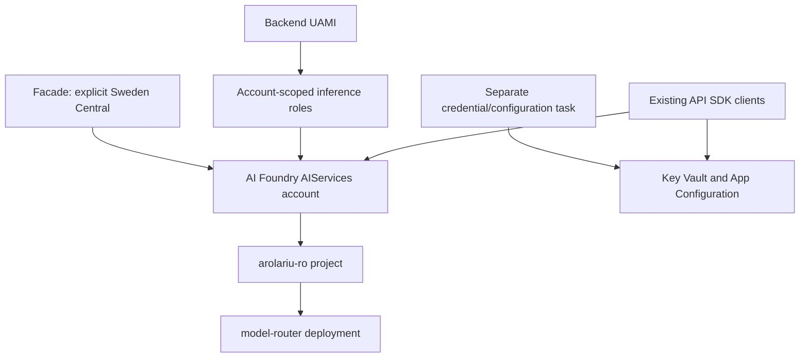

# 🤖 AI Module

Azure AI Foundry resources for the platform's existing model-routing and document-analysis consumers.

## 📋 Overview

- One `AIServices` account with S0 SKU and system-assigned identity.
- The `arolariu-ro` project and pinned `model-router` deployment.
- Explicit Sweden Central placement from the facade.
- Resource provisioning does not retrieve or emit account keys.

## 🏗️ Resources Created

| Resource            | Current contract                                              |
| ------------------- | ------------------------------------------------------------- |
| AI account          | `<prefix>-ai-foundry`, AIServices/S0, public access retained. |
| Project             | `arolariu-ro`, system-assigned identity.                      |
| Model deployment    | `model-router`, format `OpenAI`, version `2025-11-18`.        |
| Deployment capacity | GlobalStandard, capacity 10.                                  |
| APIs                | Account/project/deployment `2026-09-01`.                      |

This is not a separate legacy OpenAI account or Machine Learning hub.

## 📊 Architecture



## 🔧 Parameters

| Parameter                  | Meaning                                                                     |
| -------------------------- | --------------------------------------------------------------------------- |
| `resourceConventionPrefix` | Stable namespace.                                                           |
| `resourceLocation`         | Account/project/model location; facade deliberately passes `swedencentral`. |
| `resourceDeploymentDate`   | Audit/deployment-name timestamp.                                            |

## 📤 Outputs

`aiFoundryName` and non-secret `aiResources` containing account/project IDs and endpoint. No `listKeys()` or secure key-forwarding output
remains; credential population is a separate task.

## 🛡️ Security & RBAC

The [AI RBAC module](../rbac/ai-rbac.bicep) grants the backend Cognitive Services User and Azure AI User at account scope. Existing SDK key
authentication and public-network posture remain; secrets must be populated through a separately approved process without logging.

## 🚀 Example Usage

```bicep
module ai 'ai/deploymentFile.bicep' = {
  name: 'ai-${resourceDeploymentDate}'
  params: {
    resourceConventionPrefix: resourceConventionPrefix
    resourceDeploymentDate: resourceDeploymentDate
    resourceLocation: 'swedencentral'
  }
}
```

## 📁 Module Files

| File                                         | Purpose                                                          |
| -------------------------------------------- | ---------------------------------------------------------------- |
| [deploymentFile.bicep](deploymentFile.bicep) | Compose the account/project/model and expose non-secret outputs. |
| [aiFoundry.bicep](aiFoundry.bicep)           | Actual AI resources and exact model contract.                    |

## 🚨 Troubleshooting

| Issue                                    | Response                                                                               |
| ---------------------------------------- | -------------------------------------------------------------------------------------- |
| Model/SKU unavailable or quota exhausted | Stop for the exact target/cost decision; do not silently substitute models or regions. |
| Missing SDK key                          | Bicep does not populate configuration; inspect separately approved operational setup.  |
| Authorization failure                    | Check the actual identity, key mode, and account-scoped grant.                         |
| Successful compile but inference fails   | Real model availability and inference remain live validation requirements.             |

## 📚 References

- [AI account template reference](https://learn.microsoft.com/azure/templates/microsoft.cognitiveservices/accounts)
- [Deployment guide](../DEPLOYMENT_GUIDE.md)
- [Cost assumptions](../COST_OPTIMIZATION.md)

---

**Module Version**: 3.0.0\
**Last Updated**: October 2026
