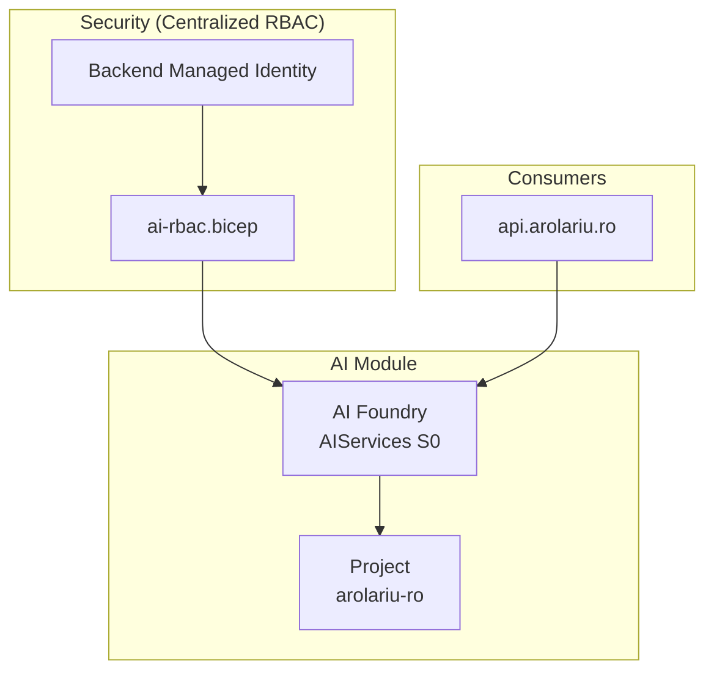

# 🤖 AI Module

This module deploys an Azure AI Foundry (AIServices) account and its default project for the arolariu.ro platform.

## 📋 Overview

- Deploys an Azure AI Foundry account (Cognitive Services, kind AIServices, S0 SKU, system-assigned identity; serves OpenAI models)
- Deploys the default AI Foundry project `arolariu-ro`
- Configures custom subdomain, public network access, and tags
- RBAC assignments are centralized in `rbac/ai-rbac.bicep`

## 🏗️ Resources Created

| Resource Type                              | Name Pattern          | Purpose                                                    |
| ------------------------------------------ | --------------------- | ---------------------------------------------------------- |
| CognitiveServices account (AIServices, S0) | `{prefix}-ai-foundry` | Azure AI Foundry resource (OpenAI + Document Intelligence) |
| AI Foundry project                         | `arolariu-ro`         | Default project                                            |

## 📊 Architecture



## 🔧 Parameters

| Parameter                  | Type   | Required | Description                                                                                                                                                    |
| -------------------------- | ------ | -------- | -------------------------------------------------------------------------------------------------------------------------------------------------------------- |
| `resourceLocation`         | string | ✅       | Allowed: francecentral, northeurope, westeurope, swedencentral. Currently unused: AI Foundry is always deployed to `swedencentral` (`aiFoundry.bicep` default) |
| `resourceDeploymentDate`   | string | ✅       | Deployment timestamp                                                                                                                                           |
| `resourceConventionPrefix` | string | ✅       | Prefix for resource names                                                                                                                                      |

## 📤 Outputs

| Output          | Type   | Description                                                   |
| --------------- | ------ | ------------------------------------------------------------- |
| `aiFoundryName` | string | Name of the AI Foundry account (used by `rbac/ai-rbac.bicep`) |
| `aiResources`   | object | `{ aiFoundryId, aiFoundryEndpoint, aiProjectId }`             |

## 🛡️ Security & RBAC

> **Note**: RBAC assignments are centralized in the `rbac/` module for better maintainability.

- The backend managed identity is granted **Cognitive Services User** (Document Intelligence) on the AI Foundry account via
  `rbac/ai-rbac.bicep`. The module also assigns the `azureAiUser` constant for inference (including OpenAI model-router), but its ID matches
  no built-in role (see [`../rbac/README.md`](../rbac/README.md#role-ids-that-differ-from-their-constant-names))
- No inline RBAC assignments in this module
- See: [rbac/README.md](../rbac/README.md) for complete RBAC documentation

## 🚀 Example Usage

```bicep
module aiDeployment 'ai/deploymentFile.bicep' = {
  name: 'aiDeployment'
  params: {
    resourceLocation: 'swedencentral'
    resourceDeploymentDate: '2025-07-03'
    resourceConventionPrefix: 'arolariu'
  }
}
```

## 📁 Module Files

| File                   | Purpose                                                       |
| ---------------------- | ------------------------------------------------------------- |
| `deploymentFile.bicep` | Orchestrates AI service deployments                           |
| `aiFoundry.bicep`      | Azure AI Foundry (AIServices) account + `arolariu-ro` project |

## 🚨 Troubleshooting

| Issue                | Solution                                                                                        |
| -------------------- | ----------------------------------------------------------------------------------------------- |
| Access denied        | Check RBAC in `rbac/ai-rbac.bicep`                                                              |
| Quota exceeded       | Request quota increase in Azure portal                                                          |
| Region not available | AI Foundry is fixed to `swedencentral` via the `aiFoundryLocation` default in `aiFoundry.bicep` |

## 📚 References

- [Azure OpenAI Documentation](https://learn.microsoft.com/en-us/azure/ai-services/openai/)
- [Azure AI Foundry](https://learn.microsoft.com/en-us/azure/ai-studio/)
- [Cognitive Services RBAC](https://learn.microsoft.com/en-us/azure/cognitive-services/authorizing-users)

---

**Module Version**: 2.0.0  
**Last Updated**: November 2026\
**Maintainer**: Alexandru-Razvan Olariu
