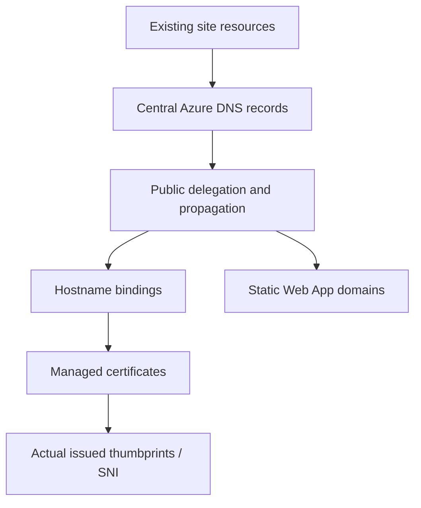

# 🔗 Bindings Module

Custom-domain and certificate definitions for App Services and Static Web Apps. Azure DNS records are owned centrally by Network; they were
moved out of these leaf modules, not removed from the infrastructure.

## 📋 Overview

- API, development, and experiments hostname/managed-certificate/SNI sequences.
- CV, docs, and status Static Web App custom domains.
- Actual App Service plan IDs and issued certificate thumbprints.
- Public DNS must be ready; there is no hidden bootstrap readiness script or separate Domains wrapper.

## 🏗️ Resources Created

| Resource                              | Purpose                                              |
| ------------------------------------- | ---------------------------------------------------- |
| App Service hostname bindings         | API/dev/exp custom names.                            |
| Managed certificates and SNI bindings | Issue first, consume the nonempty issued thumbprint. |
| Static Web App custom domains         | CV/docs/status domains and provider-managed TLS.     |

## 📁 Module Files

| Files                                                                                                                                                                                                      | Owner                                 |
| ---------------------------------------------------------------------------------------------------------------------------------------------------------------------------------------------------------- | ------------------------------------- |
| [deploymentFile.bicep](deploymentFile.bicep)                                                                                                                                                               | Compose every binding group.          |
| [api-arolariu-ro-bindings.bicep](api-arolariu-ro-bindings.bicep), [api-arolariu-ro-certificate-bindings.bicep](api-arolariu-ro-certificate-bindings.bicep)                                                 | API hostname/certificate/SNI.         |
| [dev-arolariu-ro-bindings.bicep](dev-arolariu-ro-bindings.bicep), [dev-arolariu-ro-certificate-bindings.bicep](dev-arolariu-ro-certificate-bindings.bicep)                                                 | Development hostname/certificate/SNI. |
| [exp-arolariu-ro-bindings.bicep](exp-arolariu-ro-bindings.bicep), [exp-arolariu-ro-certificate-bindings.bicep](exp-arolariu-ro-certificate-bindings.bicep)                                                 | Experiments hostname/certificate/SNI. |
| [cv-arolariu-ro-bindings.bicep](cv-arolariu-ro-bindings.bicep), [docs-arolariu-ro-bindings.bicep](docs-arolariu-ro-bindings.bicep), [status-arolariu-ro-bindings.bicep](status-arolariu-ro-bindings.bicep) | Static Web App domains.               |

## 🔧 Parameters

The orchestrator accepts resource location/date, DNS zone name, existing site names, and separate API/dev/experiments plan IDs. The facade
supplies the production plan to API and the development plan to dev/experiments, matching their actual Sites assignments.

## 📤 Outputs

No application-health or bootstrap-completion output. The leaf certificate modules pass actual thumbprints to their SNI consumers.

## 🛠️ Usage Example

The facade passes resolved outputs from Sites, Compute, and Network rather than guessed hostnames/plans. To operate a leaf separately, use
that leaf's actual parameter definitions and an approved scope; do not substitute a different service's plan.

## 📊 Architecture Diagram

## 🔄 Deployment Flow

Site creation → centralized DNS records → public prerequisites → hostname ownership → certificate issuance → SNI. A fresh deployment can
remain blocked at public DNS until registrar work is complete; do not claim that a control-plane dependency waits for public propagation.

## 🔗 Dependencies

Existing site resources, actual plans, Azure DNS definitions, and public ownership validation. Apex/www TLS and routing belong to
`network/azureFrontDoor.bicep`, not main-site App Service bindings.

## 🛡️ Security & Best Practices

Preserve HTTPS/SNI and provider certificate validation. Do not duplicate DNS owners in the binding leaves or reintroduce placeholder
thumbprints. No credential material is embedded here.

## 🚨 Troubleshooting

| Issue                                      | Check                                                                    |
| ------------------------------------------ | ------------------------------------------------------------------------ |
| Missing CNAME/TXT                          | Sites' `applicationDnsRecords` → Network → `dnsZone.bicep`.              |
| API certificate uses the wrong plan        | API's production-plan ID, not dev's plan.                                |
| Pending ownership/TLS                      | Public NS/current DS, current verification values, provider eligibility. |
| A resource exists but the app is unhealthy | Release/configuration/dependency evidence is separate.                   |

## 📚 References

- [App Service custom domains](https://learn.microsoft.com/azure/app-service/app-service-web-tutorial-custom-domain)
- [App Service managed certificates](https://learn.microsoft.com/azure/app-service/configure-ssl-certificate)
- [Deployment guide](../DEPLOYMENT_GUIDE.md)

---

**Module Version**: 3.0.0\
**Last Updated**: October 2026
