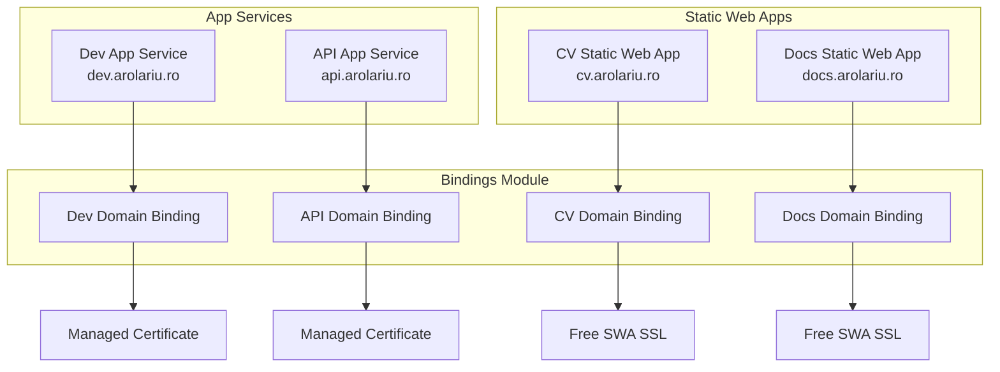

# 🔗 Bindings Module

This module manages custom domain bindings and managed certificates for App Services and Static Web Apps in the arolariu.ro platform. It
ensures correct sequencing and secure configuration for domain and certificate provisioning.

---

## 📋 Overview

- Deploys subdomain bindings for api, dev (App Service + managed certificate) and cv, docs (Static Web App, free SSL); apex/www are bound
  via Front Door in the network module
- Supports both App Services (api, dev) and Static Web Apps (cv, docs)
- Ensures dependencies: App Service/Static Web App and DNS must exist before bindings
- Modular structure for each site type

---

## 🏗️ Resources Created

| Resource Type                                                               | Purpose                                             |
| --------------------------------------------------------------------------- | --------------------------------------------------- |
| App Service hostname binding (created SSL-disabled, then re-bound with SNI) | Binds custom domains to App Services                |
| App Service managed certificate (api, dev only)                             | Issues and attaches certificates                    |
| Static Web App Custom Domain                                                | Binds custom domains to Static Web Apps             |
| DNS CNAME record (`api`, `dev`, `cv`, `docs`)                               | Points the subdomain at the site's default hostname |
| DNS TXT record (`asuid.api`, `asuid.dev`)                                   | App Service domain-ownership verification           |

---

## 📁 Module Files

| File                                         | Purpose                                                                                         |
| -------------------------------------------- | ----------------------------------------------------------------------------------------------- |
| `deploymentFile.bicep`                       | Orchestrates all binding deployments                                                            |
| `api-arolariu-ro-bindings.bicep`             | API CNAME + `asuid` TXT records, hostname binding, App Service managed certificate              |
| `api-arolariu-ro-certificate-bindings.bicep` | Re-binds the API hostname with SNI SSL using the managed certificate thumbprint (nested module) |
| `dev-arolariu-ro-bindings.bicep`             | Dev CNAME + `asuid` TXT records, hostname binding, App Service managed certificate              |
| `dev-arolariu-ro-certificate-bindings.bicep` | Re-binds the Dev hostname with SNI SSL using the managed certificate thumbprint (nested module) |
| `cv-arolariu-ro-bindings.bicep`              | CV Static Web App domain binding                                                                |
| `docs-arolariu-ro-bindings.bicep`            | Docs Static Web App domain binding                                                              |
| `status-arolariu-ro-bindings.bicep`          | Status Static Web App domain binding; present but not wired (not deployed)                      |

---

## 🔧 Parameters

| Name                        | Type   | Required | Description                                                      | Allowed Values                                        |
| --------------------------- | ------ | -------- | ---------------------------------------------------------------- | ----------------------------------------------------- |
| resourceDeploymentDate      | string | ✅       | The date when the deployment is executed                         | -                                                     |
| resourceLocation            | string | ✅       | Azure region for resources                                       | francecentral, northeurope, westeurope, swedencentral |
| resourceConventionPrefix    | string | ✅       | Prefix for resource names (currently unused)                     | -                                                     |
| dnsZoneName                 | string | ✅       | The name of the Azure DNS Zone resource                          | -                                                     |
| devWebsiteAppServicePlanId  | string | ✅       | Dev App Service Plan resource ID                                 | -                                                     |
| prodWebsiteAppServicePlanId | string | ✅       | Prod App Service Plan resource ID (currently unused)             | -                                                     |
| apiWebsiteHostname          | string | ✅       | Resource name of the API site (used as an `existing` reference)  | -                                                     |
| devWebsiteHostname          | string | ✅       | Resource name of the Dev site (used as an `existing` reference)  | -                                                     |
| docsWebsiteHostname         | string | ✅       | Resource name of the Docs site (used as an `existing` reference) | -                                                     |
| cvWebsiteHostname           | string | ✅       | Resource name of the CV site (used as an `existing` reference)   | -                                                     |
| prodWebsiteHostname         | string | ✅       | Resource name of the production website (currently unused)       | -                                                     |

---

## 📤 Outputs

_None (module is orchestration layer for submodules)_

---

## 🛠️ Usage Example

```bicep
module bindingsDeployment 'bindings/deploymentFile.bicep' = {
  name: 'bindingsDeployment-${resourceDeploymentDate}'
  params: {
    resourceLocation: resourceLocation
    resourceDeploymentDate: resourceDeploymentDate
    resourceConventionPrefix: resourceConventionPrefix
    dnsZoneName: networkDeployment.outputs.dnsZoneName
    devWebsiteAppServicePlanId: computeDeployment.outputs.developmentAppPlanId
    prodWebsiteAppServicePlanId: computeDeployment.outputs.productionAppPlanId
    cvWebsiteHostname: websiteDeployment.outputs.cvWebsiteName
    apiWebsiteHostname: websiteDeployment.outputs.apiWebsiteName
    devWebsiteHostname: websiteDeployment.outputs.devWebsiteName
    docsWebsiteHostname: websiteDeployment.outputs.docsWebsiteName
    prodWebsiteHostname: websiteDeployment.outputs.mainWebsiteName
  }
}
```

---

## 📊 Architecture Diagram



---

## 🔄 Deployment Flow

1. **Deploy App Services** (api, dev) and **Static Web Apps** (cv, docs)
2. **Deploy DNS zone** (network module: zone, apex and `www` records)
3. **Deploy Bindings Module** (this module)
   - Creates subdomain CNAME/TXT records
   - Binds domains to App Services
   - Issues managed certificates

---

## 🔗 Dependencies

- **Requires:** App Services and DNS zones to exist before binding.
- **Used by:** `facade.bicep` (deployed after the Sites, Compute and Network modules)

---

## 🛡️ Security & Best Practices

- Certificates are managed by Azure for automatic renewal.
- No secrets or keys are stored in code.
- Explicit dependency management for reliable deployment.

---

## 🚨 Troubleshooting

| Issue                     | Solution                                                            |
| ------------------------- | ------------------------------------------------------------------- |
| Binding fails             | Ensure App Service and DNS are deployed and propagated              |
| Certificate not issued    | Check DNS CNAME records and domain ownership                        |
| Resource naming conflicts | Check for existing DNS records or custom domains with the same name |
| Permission errors         | Verify deployment identity has sufficient permissions               |

---

## 📚 References

- [Azure App Service Custom Domains](https://docs.microsoft.com/en-us/azure/app-service/app-service-web-tutorial-custom-domain)
- [App Service Managed Certificates](https://docs.microsoft.com/en-us/azure/app-service/configure-ssl-certificate#create-a-free-managed-certificate)
- [Bicep Modules](https://docs.microsoft.com/en-us/azure/azure-resource-manager/bicep/modules)

---

**Module Version**: 2.0.0\
**Last Updated**: November 2026\
**Maintainer**: Alexandru-Razvan Olariu
