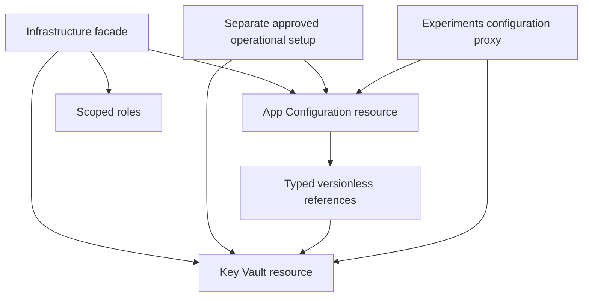

# ⚙️ Configuration Module

Provision centralized configuration resources without coupling their contents to an ARM deployment. Operational population is separate; the
replacement standalone PowerShell bootstrap is being designed after the PR review.

## 📋 Overview

- Key Vault owns secrets; App Configuration owns non-secret settings and typed references.
- Managed identities and resource-scoped RBAC control access.
- Environment labels remain `DEVELOPMENT` and `PRODUCTION`.
- Store provisioning does not seed placeholders, rotate credentials, or imply application readiness.

## 📁 Module Files

| File                                                                         | Purpose                                                                    |
| ---------------------------------------------------------------------------- | -------------------------------------------------------------------------- |
| [deploymentFile.bicep](deploymentFile.bicep)                                 | Compose the stores and return actual names/endpoints.                      |
| [keyVault.bicep](keyVault.bicep)                                             | Standard, RBAC-enabled vault with soft delete/purge protection.            |
| [appConfiguration.bicep](appConfiguration.bicep)                             | Free store, local authentication disabled, current preview management API. |
| [appConfiguration.json](appConfiguration.json)                               | Meaningful non-secret defaults; not automatically upserted by Bicep.       |
| [../rbac/key-vault-rbac.bicep](../rbac/key-vault-rbac.bicep)                 | Resource-scoped vault roles.                                               |
| [../rbac/app-configuration-rbac.bicep](../rbac/app-configuration-rbac.bicep) | Resource-scoped configuration roles.                                       |

## Architecture Diagram



## Components

### Azure Key Vault

#### Specifications

Standard SKU, RBAC authorization, 90-day soft delete, purge protection, existing public-network posture. There are no access policies.

#### Stored Secrets

| Names                                                                 | Required ownership/behavior                                                    |
| --------------------------------------------------------------------- | ------------------------------------------------------------------------------ |
| `PRODUCTION-JWT-SECRET`                                               | Shared API signing key for both current website labels; preserve real values.  |
| `DEVELOPMENT-ClerkPublishableKey`, `PRODUCTION-ClerkPublishableKey`   | Operator-owned.                                                                |
| `DEVELOPMENT-ClerkSecretKey`, `PRODUCTION-ClerkSecretKey`             | Operator-owned.                                                                |
| `DEVELOPMENT-ResendKey`, `PRODUCTION-ResendKey`                       | Optional operator-owned email credentials.                                     |
| `DEVELOPMENT-CognitiveServicesKey`, `PRODUCTION-CognitiveServicesKey` | Actual AI account credential for existing SDK consumers, populated separately. |

The old placeholder `keyVault.json` is not a source of real secrets. Never write its placeholder values into a vault or replace real
operator credentials on a rerun. No secret values are emitted by this module.

### Azure App Configuration

#### Specifications

Free SKU, managed-identity authentication, public access retained. API `2025-08-01-preview` is the latest published management version
checked during review. Local authentication stays disabled.

#### Configuration Types

Resolved service endpoints/identity selectors are ordinary values. Secret references use the Key Vault reference content type and a
versionless `uri`, not plaintext credentials. Store creation does not populate either kind.

### Configuration Snapshots

Snapshots are not provisioned. Do not describe the live labels as immutable snapshots or promise automatic rollback/refresh.

### Managed Identities

#### Infrastructure Identity

Permanent App Configuration Data Owner and Key Vault Secrets Officer, scoped to these resources; not subscription-wide administration.

#### Frontend Identity

App Configuration Reader; private runtime settings are obtained through the established proxy path, not new frontend vault-write access.

#### Backend Identity

Existing App Configuration Data Owner and Key Vault Secrets User permissions support the experiments/configuration path.

## Security Model

### Access Control

An App Configuration reference does not itself grant vault access. The resolving identity needs its own scoped Key Vault permission. The
preview `dataPlaneProxy` setting is not enabled: separate tasks can use native authenticated data-plane APIs without it.

### Secret Rotation

Versionless references allow later versions to be resolved, subject to consumer refresh/restart behavior. No zero-downtime rotation,
automatic credential generation, or preservation proof is implied by resource provisioning.

## Configuration Flow

1. Bicep creates stores and scoped grants.
2. A separately approved operational task resolves actual resource values and populates configuration.
3. The experiments provider eagerly resolves referenced secrets.
4. Website/API consumers request their configured label/target.

Missing optional email must be an ordinary empty value, disabling delivery. A dangling optional Key Vault reference can prevent the eager
provider from starting. Required Clerk/JWT/endpoint values must be valid.

## Best Practices

Use actual endpoints, correct DEVELOPMENT/PRODUCTION labels, and the same API signing key for the one shared API. Preserve existing unused
development signing material rather than deleting it. Never store account-key connection-string fallbacks.

## 🔧 Parameters

`resourceConventionPrefix`, `resourceLocation`, and `resourceDeploymentDate`; exact validation lives in the orchestrator.

## 📤 Outputs

`keyVaultName`, `keyVaultUri`, `appConfigurationName`, and `appConfigurationEndpoint`.

## 🛠️ Usage Example

```bicep
module configuration 'configuration/deploymentFile.bicep' = {
  name: 'configuration-${resourceDeploymentDate}'
  params: {
    resourceConventionPrefix: resourceConventionPrefix
    resourceLocation: resourceLocation
    resourceDeploymentDate: resourceDeploymentDate
  }
}
```

## 🔄 Dependencies

### **Required Dependencies**

Store creation is independent; facade role assignments depend on resource and identity outputs.

### **Dependent Modules**

Sites consume the actual App Configuration endpoint. Application startup additionally depends on separately populated data.

## 📊 Deployment Flow

Provision stores → assign scoped roles → perform approved operational population → release/verify applications.

## 🚨 Troubleshooting

| Symptom                             | Check                                                                                          |
| ----------------------------------- | ---------------------------------------------------------------------------------------------- |
| Forbidden configuration/secret read | Exact caller identity, resource scope, and classified propagation; do not enable account keys. |
| Missing secret                      | Distinguish 404 from authorization/service failure.                                            |
| Startup failure with email disabled | Empty optional email setting, not a reference to an absent Resend secret.                      |
| Empty Azure endpoints               | Resource provisioning did not run configuration population.                                    |

## Deployment Considerations

The Free store has service limits and no soft-delete/purge-protection support. Public networking remains intentional; private endpoints or a
paid SKU need separate scope/cost approval.

## 📚 References

- [App Configuration template reference](https://learn.microsoft.com/azure/templates/microsoft.appconfiguration/configurationstores)
- [Key Vault references](https://learn.microsoft.com/azure/azure-app-configuration/use-key-vault-references)
- [Deployment guide](../DEPLOYMENT_GUIDE.md)

---

**Module Version**: 3.0.0\
**Last Updated**: October 2026
