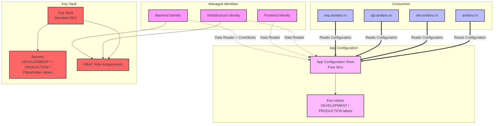

# ⚙️ Configuration Module

This module deploys the configuration management infrastructure for the arolariu.ro platform, providing centralized configuration and
secrets management through Azure App Configuration and Key Vault.

## 📋 Overview

The configuration infrastructure implements a secure, centralized configuration management system that:

- Separates sensitive secrets (Key Vault) from application configuration (App Configuration)
- Enables secure access through Managed Identities
- Supports environment-specific configurations

## 📁 Module Files

| File                     | Purpose                                  |
| ------------------------ | ---------------------------------------- |
| `deploymentFile.bicep`   | Orchestrates configuration deployments   |
| `keyVault.bicep`         | Azure Key Vault for secrets              |
| `keyVault.json`          | Key Vault secrets data (imported)        |
| `appConfiguration.bicep` | Azure App Configuration store            |
| `appConfiguration.json`  | App Configuration values data (imported) |

## Architecture Diagram



## Components

### Azure Key Vault

The Key Vault serves as the secure secrets store for all sensitive configuration values.

#### Specifications

- **SKU**: Standard
- **Soft Delete**: Enabled (90 days retention)
- **Purge Protection**: Enabled
- **Access Model**: Azure RBAC (`enableRbacAuthorization: true`; no access policies) — role assignments in `rbac/key-vault-rbac.bicep`

#### Stored Secrets

The template creates 20 secrets from [`keyVault.json`](keyVault.json). Each base name below exists as `DEVELOPMENT-<name>` and
`PRODUCTION-<name>`, is seeded with a placeholder value, and must be replaced after deployment.

| Group          | Secret base names                                                                                                                          |
| -------------- | ------------------------------------------------------------------------------------------------------------------------------------------ |
| Authentication | `JWT-SECRET`, `ClerkPublishableKey`, `ClerkSecretKey`                                                                                      |
| Communication  | `ResendKey`                                                                                                                                |
| Endpoints      | `NoSqlServerEndpoint`, `SQLServerEndpoint`, `CacheEndpoint`, `CognitiveServicesEndpoint`, `StorageEndpoint`, `ApplicationInsightsEndpoint` |

### Azure App Configuration

The App Configuration service provides centralized configuration management with versioning and feature flags.

#### Specifications

- **SKU**: Free (1000 requests/day, 10MB storage)
- **Authentication**: Local authentication disabled (`disableLocalAuth: true`); Entra ID / managed identity only

#### Configuration Types

##### Seeded Key-Values

App Configuration is seeded with 21 plain key-values × `DEVELOPMENT`/`PRODUCTION` labels from
[`appConfiguration.json`](appConfiguration.json) (some intentionally empty), under the `Identity:`, `Site:`, `Auth:`, `Endpoints:`,
`Communication:` and `FeatureManagement:` key prefixes.

##### Key Vault References

The template creates no Key Vault references. Key Vault references, if added post-deployment, are resolved client-side by the App
Configuration provider using the caller's managed identity.

### Managed Identities

Three managed identities provide secure, passwordless access. Their role assignments are defined in `rbac/key-vault-rbac.bicep` and
`rbac/app-configuration-rbac.bicep` (see [rbac/README.md](../rbac/README.md)):

#### Infrastructure Identity

- **Purpose**: Deployment and infrastructure management
- **Access**: Key Vault Secrets User + Key Vault Reader; App Configuration Data Reader
- **Usage**: CI/CD pipelines, infrastructure provisioning

#### Frontend Identity

- **Purpose**: Frontend application access
- **Access**: No Key Vault role; App Configuration Data Reader
- **Usage**: Web applications (arolariu.ro, dev.arolariu.ro)

#### Backend Identity

- **Purpose**: Backend services and APIs
- **Access**: Key Vault Secrets User (read secrets); App Configuration Data Reader + App Configuration Contributor (management only;
  constant `appConfigurationDataOwner`)
- **Usage**: API services (api.arolariu.ro, exp.arolariu.ro)

## Security Model

### Access Control

1. **Scoped Key Vault access**: Only the backend identity (used by api and exp) and the infrastructure identity can read secrets; the
   frontend identity has no Key Vault role
2. **Managed Identity authentication**: No passwords or keys in code
3. **Least privilege**: Each identity has minimal required permissions
4. **Network restrictions**: Can be configured for private endpoint access

### Secret Rotation

- Secrets can be rotated in Key Vault without application changes
- New secret versions are picked up when the client provider refreshes
- Zero-downtime secret rotation capability

## Configuration Flow

1. **Secret Storage**: Secrets are created in Key Vault with placeholder values and replaced after deployment
2. **Configuration Seeding**: App Configuration is seeded with plain key-values for the `DEVELOPMENT` and `PRODUCTION` labels
3. **Application Request**: The consumer loads configuration from App Configuration with its managed identity
4. **Secret Resolution**: Key Vault references, if added post-deployment, are resolved client-side by the App Configuration provider using
   the caller's managed identity

## Best Practices

1. **Environment Separation**: Use `DEVELOPMENT-`/`PRODUCTION-` secret-name prefixes in Key Vault and `DEVELOPMENT`/`PRODUCTION` labels in
   App Configuration
2. **Secret Rotation**: Regularly rotate secrets and API keys
3. **Access Auditing**: Monitor Key Vault access logs
4. **Minimal Permissions**: Grant only required permissions to each identity

## 🔧 Parameters

| Parameter                  | Type   | Required | Description                                                                         |
| -------------------------- | ------ | -------- | ----------------------------------------------------------------------------------- |
| `resourceConventionPrefix` | string | ✅       | Prefix for resource names                                                           |
| `resourceLocation`         | string | ✅       | Azure region for deployment (francecentral, northeurope, westeurope, swedencentral) |
| `resourceDeploymentDate`   | string | ✅       | Deployment timestamp                                                                |

## 📤 Outputs

| Output                 | Type   | Description                                                                                                         |
| ---------------------- | ------ | ------------------------------------------------------------------------------------------------------------------- |
| `keyVaultName`         | string | Key Vault name (`{prefix}kv`, dashes removed), used by `rbac/key-vault-rbac.bicep`                                  |
| `appConfigurationName` | string | App Configuration name (`{prefix}appconfig`, dashes removed), used by Sites and `rbac/app-configuration-rbac.bicep` |

## 🛠️ Usage Example

```bicep
module configurationDeployment 'configuration/deploymentFile.bicep' = {
  name: 'configurationDeployment-${resourceDeploymentDate}'
  params: {
    resourceLocation: resourceLocation
    resourceDeploymentDate: resourceDeploymentDate
    resourceConventionPrefix: resourceConventionPrefix
  }
}
```

## 🔄 Dependencies

### **Required Dependencies**

- **None** — deployed first alongside Identity (no inputs from other modules)

### **Dependent Modules**

- **All application modules**: Rely on configuration services for settings and secrets

## 📊 Deployment Flow

1. **Identity** and **Configuration** modules deploy independently
2. **Observability** and **Sites** modules deploy after Configuration
3. **RBAC** modules grant identities access to Key Vault and App Configuration

## 🚨 Troubleshooting

| Issue                       | Symptoms                     | Solution                                                                          |
| --------------------------- | ---------------------------- | --------------------------------------------------------------------------------- |
| **Key Vault access denied** | Configuration load failures  | Check the identity's Key Vault RBAC role assignment (`rbac/key-vault-rbac.bicep`) |
| **App Config not found**    | Service discovery failures   | Verify App Configuration deployment                                               |
| **Secret not found**        | Application startup failures | Check secret exists in Key Vault                                                  |
| **Permission errors**       | RBAC assignment failures     | Verify identity permissions and principal IDs                                     |

## Deployment Considerations

- RBAC role assignments (`rbac/key-vault-rbac.bicep`, `rbac/app-configuration-rbac.bicep`) are created after both identities and
  configuration exist
- Configuration values should be loaded after infrastructure deployment
- Deployment slots (for zero-downtime configuration updates) require Standard (S1+) plans; the current plans are Basic

## 📚 References

- [Azure Key Vault Documentation](https://docs.microsoft.com/en-us/azure/key-vault/)
- [Azure App Configuration Documentation](https://docs.microsoft.com/en-us/azure/azure-app-configuration/)
- [Key Vault References in App Configuration](https://docs.microsoft.com/en-us/azure/azure-app-configuration/use-key-vault-references)
- [Managed Identity Authentication](https://docs.microsoft.com/en-us/azure/active-directory/managed-identities-azure-resources/)

---

**Module Version**: 2.0.0  
**Last Updated**: November 2026\
**Maintainer**: Alexandru-Razvan Olariu
