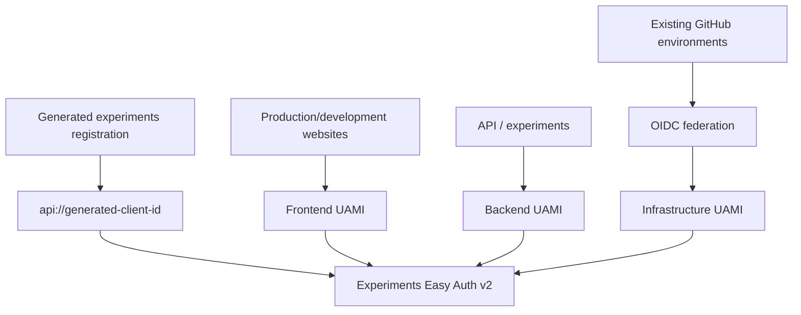

# 🔐 Identity Module

Managed identities, GitHub federation, Graph groups, and the tenant-only experiments application registration/service principal.

## 📋 Overview

- Three user-assigned managed identities with a fixed positional output contract.
- Existing development/production GitHub environment federation on the infrastructure identity only.
- Manually managed Graph security groups.
- Generated experiments application client ID supplied to Easy Auth and its callers.

## 📁 Module Files

| File                                                         | Purpose                                                                    |
| ------------------------------------------------------------ | -------------------------------------------------------------------------- |
| [deploymentFile.bicep](deploymentFile.bicep)                 | Compose identities, federation, groups, registration/exposure.             |
| [userAssignedIdentity.bicep](userAssignedIdentity.bicep)     | Three UAMIs.                                                               |
| [federatedCredentials.bicep](federatedCredentials.bicep)     | Serialized GitHub federated credentials.                                   |
| [securityGroups.bicep](securityGroups.bicep)                 | Existing manually managed Graph groups.                                    |
| [expApplication.bicep](expApplication.bicep)                 | Create the stable-keyed application and obtain its generated client ID.    |
| [expApplicationExposure.bicep](expApplicationExposure.bicep) | Set the generated identifier URI and create the enabled service principal. |

## 🏗️ Resources Created

| Index/resource     | Name                                     | Purpose                                                       |
| ------------------ | ---------------------------------------- | ------------------------------------------------------------- |
| UAMI 0             | `<prefix>-uami-frontend`                 | Production/development website runtime.                       |
| UAMI 1             | `<prefix>-uami-backend`                  | API/experiments runtime.                                      |
| UAMI 2             | `<prefix>-uami-infrastructure`           | Existing CI login and approved infrastructure administration. |
| Federation         | Development/Production named credentials | Exact existing GitHub environment subjects.                   |
| Experiments app/SP | `<prefix>-exp` alternate key             | Tenant-only v2-token API resource.                            |

UAMI and federated-credential declarations/reference use latest published `2025-05-31-preview`. The reviewed compiler recognizes the exact
types. The Graph `v1.0` registry's latest published extension tag is `1.0.0`, already used here.

## 📊 Architecture

## 🔧 Parameters

`resourceConventionPrefix`, `resourceLocation`, and `resourceDeploymentDate`. The registration client ID is generated, not a required
operator placeholder.

## 📤 Outputs

`managedIdentitiesList` has `name`, `displayName`, `resourceId`, `clientId`, and `principalId`. Index ordering must remain 0/1/2.
`expEntraAppClientId` and `expEntraServicePrincipalId` describe the API registration and enterprise application.

## 👥 Security Groups

`arolariu-JIT-Users` and `arolariu-JIT-Apps` retain manual membership. Creating these groups does not automatically implement PIM,
membership provisioning, or tenant-wide rights.

## 🛡️ Security & RBAC

| Value                             | Use                                                              |
| --------------------------------- | ---------------------------------------------------------------- |
| UAMI resource ID                  | Identity attachment dictionaries.                                |
| UAMI client ID                    | Credential selection, ACR pulls, CI login.                       |
| UAMI principal/object ID          | RBAC, SQL administrator, Easy Auth allowed-principal identities. |
| Experiments application client ID | Token resource/audience, not a UAMI selector.                    |

No client secret or certificate is needed for API bearer-token validation. This is not an interactive user-sign-in registration.

## 🚀 Example Usage

The facade consumes identity outputs and supplies `EXP_ENTRA_APP_CLIENT_ID` to the website/API runtime. Azure callers require a canonical
configured GUID; missing/malformed values fail without a legacy registration fallback. Local proxy routing does not acquire Azure tokens.

## 🔒 **Identity Details**

Frontend, backend, and infrastructure grants are deliberately asymmetric; the [RBAC guide](../rbac/README.md) lists actual scopes.
Infrastructure SQL administration and configuration-writer permissions remain permanent, not disposable bootstrap resources.

## 🌐 **Federated Identity**

### **GitHub Actions Integration**

Issuer `https://token.actions.githubusercontent.com`, audience `api://AzureADTokenExchange`, and exact subjects:

- `repo:arolariu/arolariu.ro:environment:development`
- `repo:arolariu/arolariu.ro:environment:production`

Only the infrastructure UAMI has these credentials. Legacy frontend/backend-named GitHub secrets used for Azure login therefore contain the
infrastructure client ID; runtime identities are separately provided in App Service settings.

## 🔧 **Security Features**

The experiments app is `AzureADMyOrg` with `requestedAccessTokenVersion: 2` and identifier URI `api://<generated-client-id>`. Its enabled
service principal has assignment requirements disabled for the documented app-only ACL pattern. Easy Auth requires authentication, validates
the tenant issuer/application audience, and restricts callers by the three approved UAMI object IDs.

Microsoft permits role-less app-only tokens for ACL-based APIs; delegated scopes/app-role grants are not invented here. The app client ID is
accepted by Easy Auth by default for v2 tokens. Actual tenant permissions/token issuance still require live proof; documentation and schema
checks are not a claim of 100% deployed correctness.

The [management inspector and actual-caller probe](../../PowerShell/RUNBOOK.md#8-obtain-actual-identity-specific-proof) distinguish
configuration from runtime access. Current `/admin` exclusions are a failed readiness assertion, not a silently accepted policy. The
[separate registration/SP delete and purge tasks](../../PowerShell/RUNBOOK.md#9-selectively-delete-or-permanently-purge) preserve the
registration by default, reject backing MI/foreign/first-party objects, and require independent exact acknowledgement for permanent purge.

## 🛠️ **Maintenance**

Preserve stable alternate keys and positional identity outputs. Entra application/group lifecycle differs from resource-group lifecycle;
never delete production identities or broaden tenant permissions to work around an unverified deployment.

## 🔄 **Dependencies**

Azure resource rights and separately approved Graph application/service-principal/group rights. RBAC/resource modules consume the outputs.

## 📊 **Deployment Flow**

Create UAMIs → serialize federation; create app → use generated client ID to expose it/create SP → wire site/caller settings.

## 🚨 Troubleshooting

| Issue                         | Check                                                                            |
| ----------------------------- | -------------------------------------------------------------------------------- |
| GitHub OIDC login rejected    | Exact repository/environment subject and infrastructure client ID.               |
| Azure caller missing audience | Required runtime `EXP_ENTRA_APP_CLIENT_ID`, not an old hardcoded ID.             |
| Easy Auth 403                 | `oid` principal allowlist; client IDs and principal IDs are not interchangeable. |
| Graph create/update rejected  | Exact tenant authority/operation; do not add blanket directory permissions.      |

## 📚 References

- [Managed identities](https://learn.microsoft.com/entra/identity/managed-identities-azure-resources/overview)
- [Easy Auth Entra configuration and ACL policy](https://learn.microsoft.com/azure/app-service/configure-authentication-provider-aad)
- [App-only ACL authorization](https://learn.microsoft.com/entra/identity-platform/v2-oauth2-client-creds-grant-flow)
- [Graph Bicep](https://learn.microsoft.com/graph/templates/bicep/quickstart-create-bicep-interactive-mode)

---

**Module Version**: 3.0.0\
**Last Updated**: October 2026
