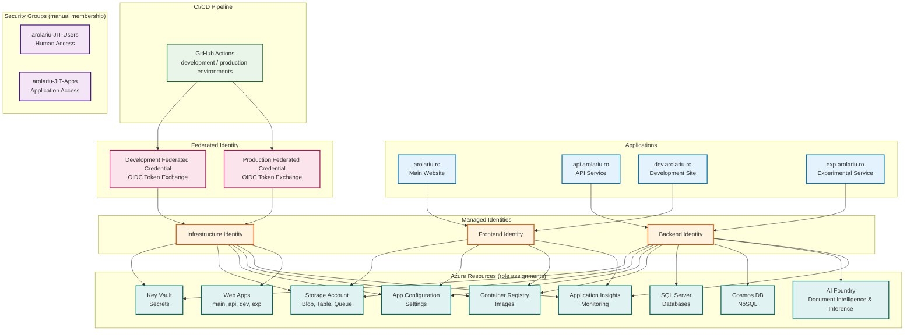
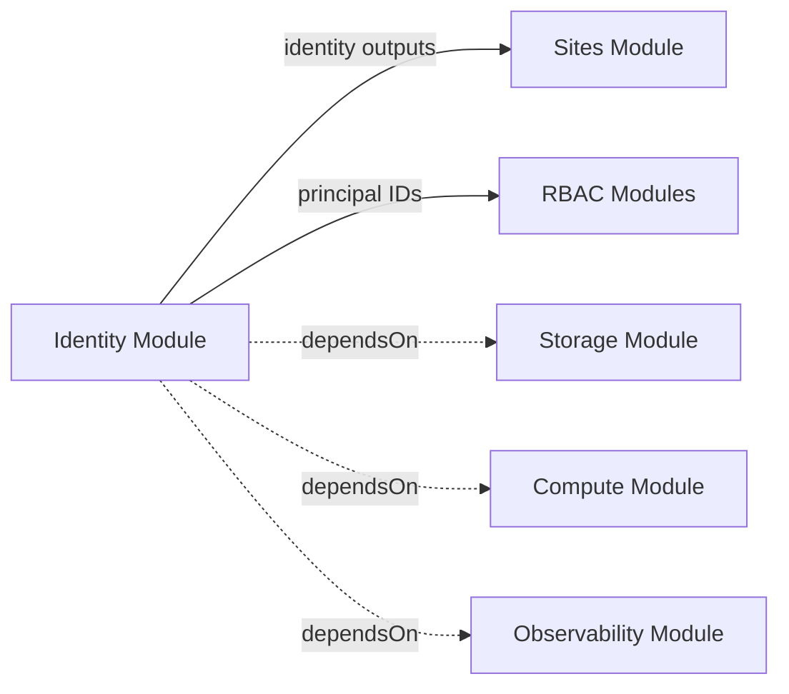

# 🔐 Identity Module

This module provisions managed identities, federated credentials, and security groups for secure, passwordless access and RBAC in the
arolariu.ro platform.

## 📋 **Overview**

- User-assigned managed identities for frontend, backend, and infrastructure
- Federated identity credentials for GitHub Actions (OIDC)
- Security groups for JIT access (manual membership)

## 📁 **Module Files**

| File                         | Purpose                                     |
| ---------------------------- | ------------------------------------------- |
| `deploymentFile.bicep`       | Orchestrates all identity deployments       |
| `userAssignedIdentity.bicep` | User-assigned managed identity creation     |
| `federatedCredentials.bicep` | GitHub Actions federated credentials (OIDC) |
| `securityGroups.bicep`       | Security groups for JIT access              |

## 🏗️ **Resources Created**

| Resource Type                      | Name Pattern                                                                        | Purpose                                                     |
| ---------------------------------- | ----------------------------------------------------------------------------------- | ----------------------------------------------------------- |
| User Assigned Managed Identity     | `{prefix}-uami-frontend`                                                            | Frontend applications access                                |
| User Assigned Managed Identity     | `{prefix}-uami-backend`                                                             | Backend services access                                     |
| User Assigned Managed Identity     | `{prefix}-uami-infrastructure`                                                      | CI/CD and infrastructure operations access                  |
| Federated Identity Credential (×2) | `FederatedGithubCredentialForDevelopment`, `FederatedGithubCredentialForProduction` | GitHub Actions OIDC (development / production environments) |
| Security Group                     | `arolariu-JIT-Users`                                                                | JIT user access (manual)                                    |
| Security Group                     | `arolariu-JIT-Apps`                                                                 | Managed identities group (manual)                           |

`{prefix}` is the `resourceConventionPrefix` generated by `facade.bicep` for each deployment.

## 📊 **Architecture**



Identity-to-resource edges are the role assignments listed under Identity Details. No identity is added to a security group by this module.

## 🔧 **Configuration**

### **Parameters**

| Parameter                  | Type   | Required | Description                                                                                                             |
| -------------------------- | ------ | -------- | ----------------------------------------------------------------------------------------------------------------------- |
| `resourceConventionPrefix` | string | ✅       | Prefix for resource names (generated by `facade.bicep` as `q` + 5 characters of `uniqueString(resourceDeploymentDate)`) |
| `resourceLocation`         | string | ✅       | Azure region (`francecentral`, `northeurope`, `westeurope`, `swedencentral`)                                            |
| `resourceDeploymentDate`   | string | ✅       | Deployment timestamp                                                                                                    |

### **Example Usage**

`facade.bicep` declares `param resourceDeploymentDate string = utcNow()` and passes its generated prefix:

```bicep
module identitiesDeployment 'identity/deploymentFile.bicep' = {
  name: 'identitiesDeployment-${resourceDeploymentDate}'
  params: {
    resourceLocation: resourceLocation
    resourceDeploymentDate: resourceDeploymentDate
    resourceConventionPrefix: resourceConventionPrefix
  }
}
```

## 📤 **Outputs**

| Output                  | Type       | Description                                                                                   |
| ----------------------- | ---------- | --------------------------------------------------------------------------------------------- |
| `managedIdentitiesList` | identity[] | Array of all created managed identities (`[0]` frontend, `[1]` backend, `[2]` infrastructure) |

**Output Structure** (`../types/identity.type.bicep`):

```bicep
type identity = {
  name: string         // Resource name
  displayName: string  // Human-readable name
  resourceId: string   // Full Azure resource ID
  principalId: string  // Azure Principal ID (GUID)
  clientId: string     // Azure Client ID (GUID) — used for DefaultAzureCredential
}
```

## 🔒 **Identity Details**

Role assignments are defined in the [`../rbac/`](../rbac/) modules (role GUIDs in [`../constants/roles.bicep`](../constants/roles.bicep))
and wired in the RBAC section of [`../facade.bicep`](../facade.bicep). The lists below summarize them.

### **Frontend Identity (`{prefix}-uami-frontend`)**

**Purpose:** Secure access for frontend applications (main website, development site)

**Role Assignments:**

- **Storage account**: Storage Blob Data Contributor, Storage Queue Data Reader, Storage Table Data Reader
- **App Configuration**: App Configuration Data Reader
- **Container registry**: AcrPull, Container Registry Repository Reader
- **Application Insights**: Monitoring Metrics Publisher
- No Key Vault role

**Used By:**

- `arolariu.ro` (main website)
- `dev.arolariu.ro` (development site)

### **Backend Identity (`{prefix}-uami-backend`)**

**Purpose:** Enhanced access for backend services and APIs

**Role Assignments:**

- **Key Vault**: Key Vault Secrets User
- **Storage account**: Storage Blob Data Owner, Storage Queue Data Contributor, Storage Table Data Contributor
- **App Configuration**: App Configuration Data Reader, App Configuration Contributor (constant `appConfigurationDataOwner`)
- **Container registry**: AcrPull, Container Registry Repository Reader
- **SQL server**: SQL DB Contributor
- **Cosmos DB account**: Cosmos DB Operator (constant `cosmosDbDataOperator`; no data access)
- **AI Foundry account**: Cognitive Services User and the `azureAiUser` constant, whose ID matches no built-in role (see
  [`../rbac/README.md`](../rbac/README.md#role-ids-that-differ-from-their-constant-names))
- **Application Insights**: Monitoring Metrics Publisher

**Used By:**

- `api.arolariu.ro` (API service)
- `exp.arolariu.ro` (experimental FastAPI service)

### **Infrastructure Identity (`{prefix}-uami-infrastructure`)**

**Purpose:** CI/CD access for GitHub Actions (through the federated credentials) and infrastructure operations

**Role Assignments:**

- **Key Vault**: Key Vault Secrets User, Key Vault Reader
- **Storage account**: Storage Blob Data Reader, Storage Queue Data Reader, Storage Table Data Reader
- **App Configuration**: App Configuration Data Reader
- **Container registry**: AcrPush, AcrPull, Container Registry Repository Reader
- **Web apps** (main, api, dev, exp): Website Contributor
- **Application Insights**: Monitoring Metrics Publisher
- No Owner, Contributor, or deployment-scope role is assigned in Bicep

**Used By:**

- GitHub Actions CI/CD pipeline
- Administrative operations

All three identities are allowed callers of `exp.arolariu.ro` (Easy Auth `allowedPrincipals` in `../sites/exp-arolariu-ro.bicep`). Database
users for the managed identities are created by manually running `../rbac/sql-rbac-uami.sql`; no Bicep module runs it.

## 🌐 **Federated Identity**

### **GitHub Actions Integration**

Federated identity credentials for both development and production environments are created for the infrastructure managed identity using a
single template (`federatedCredentials.bicep`).

**How it works:**

- Both credentials are created in a loop with `@batchSize(1)` to ensure sequential creation (avoiding Azure API limitations).
- Each credential uses:
  - **Issuer**: `https://token.actions.githubusercontent.com`
  - **Subject**: `repo:arolariu/arolariu.ro:environment:development` or `repo:arolariu/arolariu.ro:environment:production`
  - **Audience**: `api://AzureADTokenExchange`

**Benefits:**

- No secrets in GitHub: No need to store Azure credentials
- Automatic token exchange: OIDC tokens exchanged for Azure tokens
- Enhanced security: Tokens are short-lived and scoped
- Audit trail: All access is logged and traceable

**Usage in GitHub Actions:**

```yaml
# Example step (no repository workflow deploys this Bicep; Azure login is used in e.g. .github/workflows/official-api-trigger.yml)
- name: Azure Login
  uses: azure/login@v3
  with:
    client-id: ${{ secrets.AZURE_CLIENT_ID }} # Infrastructure Identity Client ID
    tenant-id: ${{ secrets.AZURE_TENANT_ID }}
    subscription-id: ${{ secrets.AZURE_SUBSCRIPTION_ID }}
```

## 👥 **Security Groups**

### **arolariu-JIT-Users**

**Purpose:** Provides just-in-time (JIT) access for human users who require temporary or emergency access to production resources.

**Configuration:**

- **Mail Enabled**: No (mail is disabled for both security groups to enhance security and reduce complexity)
- **Security Enabled**: Yes
- **Members**: Managed manually as needed (no automatic assignment)

**Use Cases:**

- Emergency access to production resources
- Temporary elevated permissions for troubleshooting or audits
- Compliance and audit requirements

### **arolariu-JIT-Apps**

**Purpose:** Intended for grouping managed identities (User Assigned Managed Identities - UAMIs) to streamline RBAC and bulk permission
assignments.

**Configuration:**

- **Mail Enabled**: No (mail is disabled for both security groups to enhance security and reduce complexity)
- **Security Enabled**: Yes
- **Members**: Managed manually as needed (no automatic assignment)

**Use Cases:**

- Bulk permission assignments to application/service identities
- Centralized access control for managed identities
- Simplified RBAC management and auditing

> **Note:** Membership in both groups is managed manually. No automatic assignment is performed by the module.

## 💰 **Cost Considerations**

| Resource Type                  | Quantity | Monthly Cost |
| ------------------------------ | -------- | ------------ |
| User Assigned Managed Identity | 3        | €0 (Free)    |
| Federated Identity Credential  | 2        | €0 (Free)    |
| Microsoft Graph Groups         | 2        | €0 (Free)    |
| **Total**                      |          | **€0**       |

**Cost Benefits:**

- **No authentication costs**: Managed identities are free
- **Reduced operational overhead**: No credential rotation needed
- **Enhanced security**: No password-related vulnerabilities

## 🔧 **Security Features**

### **Zero-Trust Principles**

- **Least privilege access**: Each identity has minimal required permissions
- **Identity verification**: All access requires valid Azure AD authentication
- **Continuous monitoring**: All operations are logged and auditable
- **Conditional access**: Can be enhanced with conditional access policies

### **RBAC Implementation**

```bicep
// Excerpt from ../rbac/key-vault-rbac.bicep: Key Vault Secrets User role for the backend identity
import { keyVaultSecretsUser } from '../constants/roles.bicep'

resource backendSecretsUser 'Microsoft.Authorization/roleAssignments@2022-04-01' = {
  scope: keyVault
  name: guid(keyVault.id, backendPrincipalId, keyVaultSecretsUser)
  properties: {
    roleDefinitionId: subscriptionResourceId('Microsoft.Authorization/roleDefinitions', keyVaultSecretsUser)
    principalId: backendPrincipalId
    principalType: 'ServicePrincipal'
    description: 'Backend: read secrets from key vault'
  }
}
```

### **Audit & Compliance**

- **Activity logs**: All identity operations logged to Azure Activity Log
- **Sign-in logs**: Authentication events tracked in Azure AD
- **Resource access**: All resource access logged at target resources
- **Compliance ready**: Supports SOC, ISO, and other compliance frameworks

## 🛠️ **Maintenance**

### **Identity Lifecycle**

**Creation:**

1. Identities created during initial deployment
2. Security group membership is managed manually as needed
3. RBAC permissions applied by the `rbac/*.bicep` modules wired in `facade.bicep` (section 10, RBAC)

**Management:**

- **No password rotation** required (passwordless)
- **Permission updates** via RBAC role assignments
- **Monitoring** through Azure AD and Activity logs

**Deletion:**

- Identities deleted with resource group
- Automatic cleanup of dependent permissions

### **Monitoring & Alerting**

```bash
# Monitor identity usage
az monitor activity-log list \
  --resource-group "arolariu-rg" \
  --caller "frontend-identity-object-id" \
  --start-time "2024-01-01T00:00:00Z"

# Check identity permissions
az role assignment list \
  --assignee "frontend-identity-object-id" \
  --all
```

## 🔄 **Dependencies**

### **Required Dependencies**

**None** - `facade.bicep` deploys this module without `dependsOn`.

### **Dependent Modules**

Identity outputs are consumed by the **Sites** module (UAMI resource/client/principal IDs) and by the **RBAC** modules (`../rbac/*.bicep`).
Storage, Compute and Observability only order after Identity via `dependsOn`; Configuration, Network and AI take no identity input.

## 📊 **Deployment Flow**



**Order:**

1. **Identity Module** (first - no dependencies; Configuration and AI also have none)
2. Remaining modules as their `dependsOn` and output references allow (most do not consume identity outputs)

## 🚨 **Troubleshooting**

### **Common Issues**

| Issue                            | Symptoms                                  | Solution                                          |
| -------------------------------- | ----------------------------------------- | ------------------------------------------------- |
| **Federated credential failed**  | GitHub Actions authentication errors      | Verify repository name and environment in subject |
| **Missing Graph permissions**    | Security group creation fails             | Ensure deployment identity has Graph permissions  |
| **Group membership not updated** | Expected members missing from a JIT group | Add/remove members manually in Azure AD           |
| **Identity not found**           | Resource access denied                    | Check identity exists and has proper RBAC         |
| **Principal ID not available**   | Role assignment fails                     | Wait for identity propagation (up to 5 minutes)   |

### **Validation Commands**

```bash
# List all managed identities
az identity list \
  --resource-group "arolariu-rg" \
  --output table

# Check identity details
az identity show \
  --name "<prefix>-uami-frontend" \
  --resource-group "arolariu-rg"

# Verify federated credentials
az identity federated-credential list \
  --identity-name "<prefix>-uami-infrastructure" \
  --resource-group "arolariu-rg"

# Inspect the production credential's issuer, subject, and audience
az identity federated-credential show \
  --name "FederatedGithubCredentialForProduction" \
  --identity-name "<prefix>-uami-infrastructure" \
  --resource-group "arolariu-rg"
```

### **Security Verification**

```bash
# Check role assignments for an identity
az role assignment list \
  --assignee "principal-id-of-identity" \
  --all \
  --output table

# Verify Key Vault access
az keyvault secret list \
  --vault-name "<prefix>kv"
```

## 📚 **References**

- [Azure Managed Identities](https://docs.microsoft.com/en-us/azure/active-directory/managed-identities-azure-resources/)
- [Workload Identity Federation](https://docs.microsoft.com/en-us/azure/active-directory/workload-identities/workload-identity-federation)
- [GitHub Actions with Azure](https://docs.microsoft.com/en-us/azure/developer/github/connect-from-azure)
- [Azure RBAC](https://docs.microsoft.com/en-us/azure/role-based-access-control/)
- [Microsoft Graph Groups](https://docs.microsoft.com/en-us/graph/api/resources/group)

---

**Module Version**: 2.0.0  
**Last Updated**: November 2026\
**Maintainer**: Alexandru-Razvan Olariu
