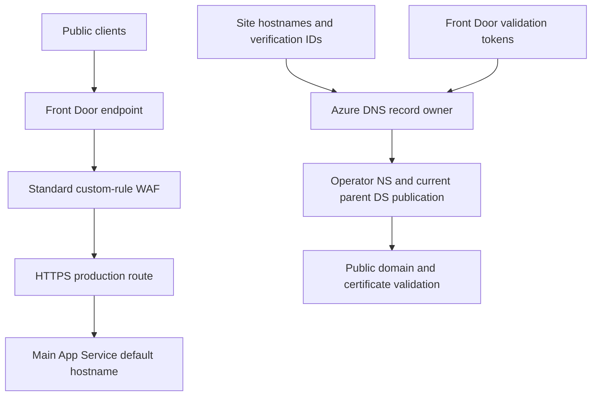

# 🌐 Network Module

Azure Front Door, WAF, Azure DNS, and DNSSEC for arolariu.ro. The existing resource modules own provisioning directly; there is no separate
Front Door completion file or automatic public-DNS readiness deployment script.

## 📋 **Overview**

- Global HTTPS routing to the actual main-site default hostname.
- Front Door Standard custom-rule WAF association and managed custom domains.
- One Azure owner for application CNAME/TXT/apex records.
- Registrar/public DNS remains an external prerequisite for successful domain/certificate completion.

## 🏗️ **Resources Created**

| Resource                        | Name/contract                                                          |
| ------------------------------- | ---------------------------------------------------------------------- |
| Front Door profile              | `<prefix>-afd`, Standard_AzureFrontDoor.                               |
| Endpoint                        | `<prefix>-afd-production`, namespace-derived.                          |
| Origin group/origin             | `production` / `production-origin`, actual main-site hostname.         |
| WAF policy/security association | `productionWAF`, custom rules, endpoint plus apex/www domains.         |
| Route                           | `production-route`, HTTPS redirect/forwarding and both custom domains. |
| DNS zone/DNSSEC                 | `arolariu.ro` / `default`.                                             |

## 📁 **Module Files**

| File                                         | Purpose                                                                       |
| -------------------------------------------- | ----------------------------------------------------------------------------- |
| [deploymentFile.bicep](deploymentFile.bicep) | Compose Front Door and DNS from actual site outputs.                          |
| [azureFrontDoor.bicep](azureFrontDoor.bicep) | Profile, WAF, domains, endpoint, origin, security policy, and HTTPS route.    |
| [dnsZone.bicep](dnsZone.bicep)               | Public zone, DNSSEC, Azure-owned application records, and delegation outputs. |

## 📊 **Architecture**



## 🔧 **Configuration**

### **Parameters**

`resourceConventionPrefix`, `resourceDeploymentDate`, `mainWebsiteHostname`, and typed `applicationDnsRecords`. The network group is global;
the site origin is a resolved default hostname, not a guessed production DNS target.

### **Example Usage**

The facade passes `websiteDeployment.outputs.mainWebsiteUrl` and `applicationDnsRecords` directly. Do not independently recreate those
record values in binding modules.

## 📤 **Outputs**

`frontDoorProductionFqdn`, profile/endpoint IDs, `dnsZoneName`, `dnsZoneNameServers`, and current `dnsZoneDsRecords`.

## 🌍 **Front Door Configuration**

### **Profile Settings**

Standard SKU, global location, source-defined timeout. There is no Premium/private-link origin or managed-rule-set deployment.

### **Endpoints**

#### **Production Endpoint**

The globally unique endpoint name uses the stable namespace. The default domain and apex/www custom domains share the WAF security policy.

### **Origin Configuration**

#### **Apex Domain (arolariu.ro)**

Front Door routes to the main App Service's actual default hostname with certificate-name checking enabled.

#### **WWW Subdomain (www.arolariu.ro)**

Shares the same origin/HTTPS route; it is not a second production backend.

## 🔒 **Security & Performance**

### **Web Application Firewall**

The association and route are present in `azureFrontDoor.bicep`; they were not removed from the intended resource set. Standard supports
custom rules, not Premium managed DRS/Bot Manager rule sets. An empty custom-rule list is not a configured application attack ruleset.

### **SSL/TLS**

Managed custom-domain certificates, TLS12 minimum on Front Door domains, HTTPS-only forwarding and redirect. Public ownership/validation is
still required; template existence alone is not certificate readiness.

## 🌐 **DNS Management**

### **Public DNS Zone**

Azure DNSSEC produces the actual signer records. The operator publishes NS/current DS at the registrar; stale DS can break resolution.

### **DNS Records**

| Record                                    | Owner/source                             |
| ----------------------------------------- | ---------------------------------------- |
| Apex A alias and www CNAME                | Actual Front Door endpoint.              |
| API/dev/exp CNAME                         | Actual App Service default hostnames.    |
| CV/docs/status CNAME                      | Actual Static Web App default hostnames. |
| `asuid.api`, `asuid.dev`, `asuid.exp` TXT | Current App Service verification IDs.    |
| `_dnsauth`, `_dnsauth.www` TXT            | Current Front Door validation tokens.    |

### **Third-Party Service Integration**

#### **Clerk Authentication**

No guessed vendor CNAME/DKIM targets are emitted. Any actual vendor-domain configuration needs approved provider-specific values.

#### **Resend Email Service**

No placeholder DKIM/MX records are seeded. Email credentials/configuration are a separate optional application integration.

#### **DMARC Policy**

Do not treat an unprovisioned mail-policy example as a deployed record; the zone source is authoritative.

### **DNS Configuration Example**

Use emitted values and inspect public records. Do not manually replace the apex alias with a hardcoded IP or point www at the apex.

## 💰 **Cost Considerations**

The [cost guide](../COST_OPTIMIZATION.md) records current retail base/request/transfer rates and explicitly assumed traffic. Front Door base
fees and WAF policy fees are separate; no Legacy Front Door resource is added.

## 🔧 **Customization Options**

### **Adding Custom Domains**

Update the existing module, matching DNS records and certificate prerequisites under an approved public-domain change.

### **Advanced Routing Rules**

Keep route/origin identity and HTTPS behavior consistent; do not introduce a second completion owner.

### **WAF Integration**

Rules, managed-rule availability, SKU, and cost are distinct decisions. Do not upgrade to Premium implicitly.

## 🛠️ **Maintenance**

### **Monitoring & Alerting**

Check actual origin health, TLS, DNS, and application response behavior after release. Arbitrary diagnostic settings/alerts are not created.

### **Performance Optimization**

Use measured request/transfer/cache data before changing compression or caching policy.

## 🔄 **Dependencies**

### **Required Dependencies**

Actual site hostnames/verification IDs from Sites. DNS consumes Front Door tokens and endpoint IDs.

### **Dependent Modules**

Bindings consumes the zone name after Azure-owned records are provisioned.

### **External Dependencies**

Domain ownership, registrar delegation/current DS, public propagation, and managed-certificate eligibility.

## 📊 **Deployment Flow**

Sites → Front Door definitions → Azure DNS records → public registrar prerequisites → successful binding/TLS completion. The single facade
does not wait for public DNS in a hidden script; incomplete prerequisites must remain visible failures.

### Cache-correction rollout and verification

Changing the origin's `Cache-Control` header does not evict responses already cached at the edge. Complete this sequence after an **approved
production deployment** of both [the query-string cache-key fix](./azureFrontDoor.bicep) and the website's
[`/api/user`](../../../../sites/arolariu.ro/src/app/api/user/route.ts) and
[`/api/health`](../../../../sites/arolariu.ro/src/app/api/health/route.ts) `no-store` responses. A purge is a separately approved production
operation; these instructions do not authorize deployment, permission changes, or a purge.

1. In Azure, confirm the deployed `production-route` uses `UseQueryString`. A committed Bicep/ARM change alone is not deployment evidence.
2. Verify the deployed origin returns `Cache-Control: no-store` for `/api/user/` and `/api/health/`. Use unauthenticated **HEAD** requests
   for this preflight: Front Door forwards HEAD to the origin instead of serving cached GET data. Do not warm the GET cache before the
   corrected origin is live, and do not print or save identity response bodies. HEAD is only an origin-header check, not cache-purge proof.
3. Confirm the production endpoint and its route-bound custom domains in Azure before purging. Also include the endpoint hostname when
   `linkToDefaultDomain` is enabled. Do not infer this list from all custom domains on the profile: an unbound domain is not a route. The
   production resource verified for this rollout is `arolariu-rg` / `qpfnu3-afd` / `production`, with `arolariu.ro`, `www.arolariu.ro`, and
   `production-c0e8gvg4dpfzcvhs.z02.azurefd.net`. Re-discover the scope if these resources change.
4. With approval, purge the following paths for **every** domain from step 3. Both API slash forms and the actual Next.js optimizer path are
   included; purging `/images/*` alone does not clear `/_next/image/`. Front Door purges all query-string variants of a path.

```powershell
# Requires an approved Azure CLI environment with the cdn commands already available.
# Otherwise use the Azure portal's Purge cache operation with the same domains and paths.
$domains = @('arolariu.ro', 'www.arolariu.ro', 'production-c0e8gvg4dpfzcvhs.z02.azurefd.net')
$paths = @('/api/*', '/api/user', '/api/user/', '/api/health', '/api/health/',
           '/_next/image', '/_next/image/', '/images/*')
az afd endpoint purge --resource-group arolariu-rg --profile-name qpfnu3-afd `
    --endpoint-name production --domains $domains --content-paths $paths
if ($LASTEXITCODE -ne 0) { throw 'Front Door purge failed; do not mark the rollout complete.' }
```

5. Wait for successful purge completion and edge propagation. Microsoft documents propagation of up to ten minutes. Then issue two ordinary
   GETs to each API path on each domain, without query cache-busters, authorization, cookies, or request cache-bypass headers. On Windows,
   this probe discards bodies and outputs only the status and relevant cache headers:

```powershell
foreach ($domain in $domains) {
    foreach ($path in @('/api/user', '/api/user/', '/api/health', '/api/health/')) {
        foreach ($attempt in 1..2) {
            $headers = @(curl.exe --silent --show-error --max-time 30 --dump-header - --output NUL "https://$domain$path")
            if ($LASTEXITCODE -ne 0) { throw "Request failed: $domain$path" }
            $status = @($headers | Select-String '^HTTP/\S+\s+(\d{3})')
            $expectedStatus = if ($path.EndsWith('/')) { '200' } else { '308' }
            if ($status.Count -ne 1 -or $status[0].Matches[0].Groups[1].Value -ne $expectedStatus) {
                throw "Unexpected HTTP status: $domain$path"
            }
            $cache = ($headers | Select-String '^x-cache:\s*') -join ', '
            if ($cache -notmatch '^x-cache:\s*(TCP_MISS|CONFIG_NOCACHE|PRIVATE_NOSTORE)\s*$') {
                throw "Unexpected or missing cache status: $domain$path ($cache)"
            }
            if ($path.EndsWith('/') -and -not ($headers -match '^cache-control:.*\bno-store\b')) {
                throw "Missing no-store directive: $domain$path"
            }
            "GET $domain$path attempt $attempt"
            $headers | Select-String '^(HTTP/|location:|cache-control:|x-cache:|age:|x-azure-ref:)'
        }
    }
}
```

6. Confirm the no-slash `308` redirects point to their corresponding slash paths. Repeat the GET checks from another geographic location
   where available. Any `TCP_HIT`/`TCP_REMOTE_HIT`, missing `no-store` on a terminal API response, unexpected status, or failed purge leaves
   the rollout incomplete. A single `TCP_MISS` or a HEAD request does not prove that stale cached entries were evicted.

Record the deployment revision, purge operation result, affected domains/paths, and sanitized header evidence on the associated review
thread before resolving it. If validation fails, investigate the deployed origin and route rather than restoring cacheable identity
responses or repeatedly purging an unchanged origin. Do not automatically install CLI extensions or grant broader Azure permissions. See
[Microsoft's purge procedure](https://learn.microsoft.com/en-us/azure/frontdoor/standard-premium/how-to-cache-purge) and
[Front Door caching behavior](https://learn.microsoft.com/en-us/azure/frontdoor/front-door-caching).

## 🚨 **Troubleshooting**

### **Common Issues**

| Issue                       | Check                                                                                    |
| --------------------------- | ---------------------------------------------------------------------------------------- |
| Missing application records | Sites → typed record list → `dnsZone.bicep`; do not add duplicate binding-module owners. |
| Domain/certificate pending  | Public NS/current DS, CNAME/TXT values, and provider validation state.                   |
| Origin unhealthy            | Actual released main-site response and allowed access path.                              |
| Unexpected what-if changes  | Fresh-only profile is not a migration plan.                                              |

### **Validation Commands**

Use read-only DNS/HTTPS checks against approved names; Azure commands must use the approved subscription explicitly.

### **Performance Testing**

Load tests and paid/third-party monitoring require a separate approved scope; they are not deployment prerequisites.

## 📚 **References**

- [Azure Front Door](https://learn.microsoft.com/azure/frontdoor/)
- [Azure DNS](https://learn.microsoft.com/azure/dns/)
- [Deployment guide](../DEPLOYMENT_GUIDE.md)

---

**Module Version**: 3.0.0\
**Last Updated**: October 2026
