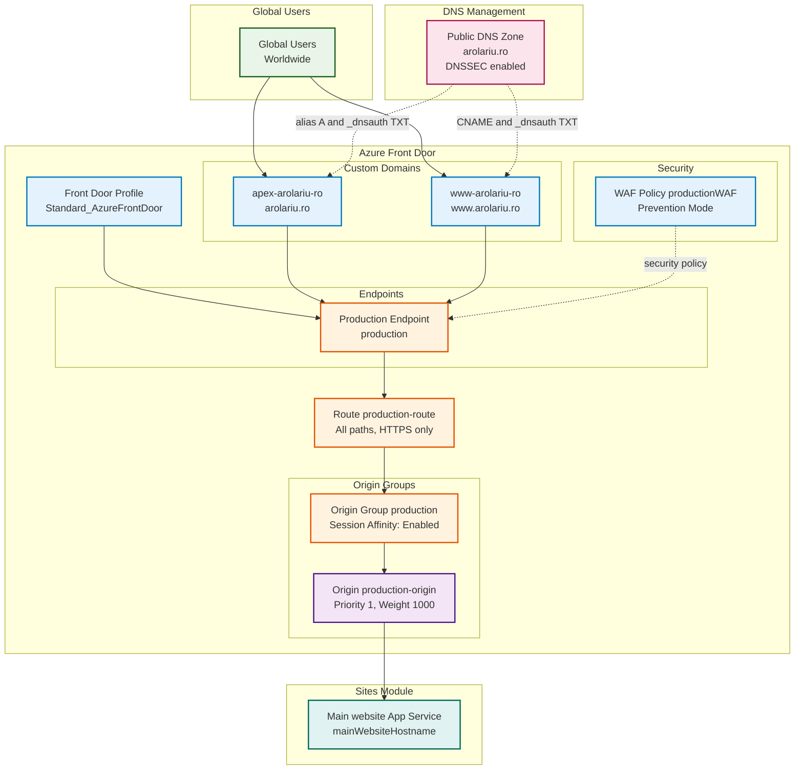

# 🌐 Network Module

This module provisions the global networking infrastructure for the arolariu.ro platform, including Azure Front Door for global edge
routing, WAF protection, load balancing, and DNS management.

## 📋 **Overview**

The network module creates a comprehensive global networking solution that:

- **Provides global edge routing** through Azure Front Door
- **Routes traffic** to the main website through a health-probed origin group (single origin, no failover)
- **Implements security features** with a WAF policy and managed TLS certificates
- **Manages DNS** for the domain
- **Optimizes performance** with edge caching and routing

## 🏗️ **Resources Created**

| Resource Type      | Name Pattern                          | Purpose                                                                 |
| ------------------ | ------------------------------------- | ----------------------------------------------------------------------- |
| Front Door Profile | `{prefix}-afd`                        | Azure Front Door Standard profile                                       |
| WAF Policy         | `productionWAF`                       | Web Application Firewall policy                                         |
| Security Policy    | `productionWAF`                       | Attaches the WAF policy to the `production` endpoint                    |
| AFD Endpoint       | `production`                          | Production traffic endpoint                                             |
| Custom Domains     | `apex-arolariu-ro`, `www-arolariu-ro` | `arolariu.ro` / `www.arolariu.ro` with AFD-managed TLS 1.2 certificates |
| Route              | `production-route`                    | `/*`, HTTPS-only, both custom domains                                   |
| Origin Group       | `production`                          | Production origin group                                                 |
| Origin             | `production-origin`                   | Main website App Service                                                |
| DNS Zone           | `arolariu.ro`                         | Public DNS zone management                                              |
| DNSSEC Config      | `default`                             | Cryptographic DNS security                                              |
| DNS Record Sets    | (see DNS Records)                     | Apex alias, www, validation, email and Clerk records                    |

`{prefix}` is the `resourceConventionPrefix` generated by `facade.bicep` for each deployment.

## 📁 **Module Files**

| File                   | Purpose                                                                |
| ---------------------- | ---------------------------------------------------------------------- |
| `deploymentFile.bicep` | Orchestrates network deployments                                       |
| `azureFrontDoor.bicep` | Azure Front Door profile, WAF, custom domains, origin group, and route |
| `dnsZone.bicep`        | DNS zone, DNSSEC, apex/www, validation, email and Clerk records        |

## 📊 **Architecture**



The API (`api.arolariu.ro`), development (`dev.arolariu.ro`), docs and CV sites are not behind Front Door; their DNS records and custom
domains are created by the bindings module (`../bindings/`).

## 🔧 **Configuration**

### **Parameters**

| Parameter                  | Type   | Required | Description                                                                                                                    |
| -------------------------- | ------ | -------- | ------------------------------------------------------------------------------------------------------------------------------ |
| `resourceConventionPrefix` | string | ✅       | Prefix for resource names (generated by `facade.bicep` as `q` + 5 characters of `uniqueString(resourceDeploymentDate)`)        |
| `resourceLocation`         | string | ✅       | Allowed: `francecentral`, `northeurope`, `westeurope`, `swedencentral` (currently unused — all network resources are `Global`) |
| `resourceDeploymentDate`   | string | ✅       | Deployment timestamp                                                                                                           |
| `mainWebsiteHostname`      | string | ✅       | Hostname of the main production website                                                                                        |

### **Example Usage**

`facade.bicep` declares `param resourceDeploymentDate string = utcNow()` and passes its generated prefix:

```bicep
module networkDeployment 'network/deploymentFile.bicep' = {
  name: 'networkDeployment-${resourceDeploymentDate}'
  params: {
    resourceLocation: resourceLocation
    resourceDeploymentDate: resourceDeploymentDate
    resourceConventionPrefix: resourceConventionPrefix
    mainWebsiteHostname: websiteDeployment.outputs.mainWebsiteUrl
  }
}
```

## 📤 **Outputs**

| Output                    | Type   | Description                         |
| ------------------------- | ------ | ----------------------------------- |
| `frontDoorProductionFqdn` | string | Front Door production endpoint FQDN |
| `frontDoorProfileId`      | string | Front Door profile resource ID      |
| `dnsZoneName`             | string | DNS zone name (arolariu.ro)         |

## 🌍 **Front Door Configuration**

### **Profile Settings**

**SKU**: Standard_AzureFrontDoor

- **Global presence**: 200+ edge locations worldwide
- **Response timeout**: 16 seconds
- **Load balancing**: Health-probed origin group with a single origin (no failover)

### **Endpoints**

#### **Production Endpoint (`production`)**

- **Purpose**: Primary application traffic
- **Route**: `production-route` matches `/*` for the `arolariu.ro` and `www.arolariu.ro` custom domains and is also linked to the endpoint's
  default `*.azurefd.net` hostname
- **Protocols**: HTTPS only (`supportedProtocols: ['Https']`, `httpsRedirect: 'Enabled'`); forwards to the origin over HTTPS only
  (`forwardingProtocol: 'HttpsOnly'`)
- **Caching**: The query string is part of the cache key (`queryStringCachingBehavior: 'UseQueryString'`); compression is disabled

#### **Production Origin Group (`production`)**

- **Session affinity**: Enabled (sticky sessions)
- **Load balancing**: 4 samples, 3 successful required
- **Additional latency**: 50ms tolerance
- **Health probe**: `HEAD /` over HTTPS every 30 seconds

### **Origin Configuration**

#### **Origin `production-origin`**

- **Host name and host header**: `mainWebsiteHostname` (the main website App Service hostname from the Sites module)
- **Priority**: 1
- **Weight**: 1000
- **Ports**: HTTP (80), HTTPS (443)
- **Certificate name check**: Enabled

#### **Custom domains**

- `apex-arolariu-ro` → `arolariu.ro`
- `www-arolariu-ro` → `www.arolariu.ro`
- **Certificates**: AFD-managed certificates with minimum TLS 1.2
- **Routing**: Both are bound to `production-route`

## 🔒 **Security & Performance**

### **Web Application Firewall**

The `productionWAF` policy is attached to the production endpoint for all paths (`/*`):

- **Mode**: Prevention (matching requests are blocked)
- **Request body inspection**: Enabled
- **Rules**: None configured (empty custom-rule list; managed rule sets such as DRS/Bot Manager require the Premium SKU), so the policy
  currently blocks no traffic

### **SSL/TLS**

- **HTTPS-only route**: `supportedProtocols: ['Https']` with `httpsRedirect: 'Enabled'`
- **Certificate management**: Azure-managed certificates
- **TLS versions**: Modern TLS support (1.2+)
- **HSTS**: Can be configured for enhanced security

## 🌐 **DNS Management**

### **Public DNS Zone**

The module creates a public DNS zone with DNSSEC enabled for the arolariu.ro domain:

- **Zone type**: Public
- **Global scope**: Worldwide DNS resolution
- **DNSSEC**: Enabled for cryptographic DNS security
- **TTL**: 3600 seconds (1 hour) for most records

### **DNS Records**

`dnsZone.bicep` creates these records:

| Record Type | Name                     | Purpose                           |
| ----------- | ------------------------ | --------------------------------- |
| **A**       | `@`                      | Apex domain → Front Door (ALIAS)  |
| **CNAME**   | `www`                    | WWW subdomain → Front Door        |
| **TXT**     | `_dnsauth`               | Front Door apex domain validation |
| **TXT**     | `_dnsauth.www`           | Front Door WWW domain validation  |
| **TXT**     | `_dmarc`                 | DMARC email authentication policy |
| **TXT**     | `send.mail`              | SPF record for Resend email       |
| **TXT**     | `resend._domainkey.mail` | DKIM record for Resend email      |
| **MX**      | `send.mail`              | MX record for Amazon SES          |
| **CNAME**   | `clerk`                  | Clerk authentication service      |
| **CNAME**   | `accounts`               | Clerk accounts service            |
| **CNAME**   | `clkmail`                | Clerk mail service                |
| **CNAME**   | `clk._domainkey`         | Clerk DKIM key 1                  |
| **CNAME**   | `clk2._domainkey`        | Clerk DKIM key 2                  |

> ⚠️ `clkmail`, `clk._domainkey`, `clk2._domainkey`, the `send.mail` MX record and `resend._domainkey.mail` currently contain `<your-…>`
> placeholder values in `dnsZone.bicep`; they must be replaced with real values before these records work.

The subdomain records below are created in the same zone by the bindings module (`../bindings/`), which consumes this module's `dnsZoneName`
output:

| Record Type | Name        | Purpose                             |
| ----------- | ----------- | ----------------------------------- |
| **CNAME**   | `api`       | API subdomain → App Service         |
| **CNAME**   | `dev`       | Dev subdomain → App Service         |
| **CNAME**   | `cv`        | CV subdomain → Static Web App       |
| **CNAME**   | `docs`      | Docs subdomain → Static Web App     |
| **TXT**     | `asuid.api` | App Service API domain verification |
| **TXT**     | `asuid.dev` | App Service Dev domain verification |

A `status` CNAME module (`../bindings/status-arolariu-ro-bindings.bicep`) is present but not wired (not deployed).

### **Third-Party Service Integration**

#### **Clerk Authentication**

- `clerk.arolariu.ro` → `frontend-api.clerk.services`
- `accounts.arolariu.ro` → `accounts.clerk.services`
- `clkmail`, `clk._domainkey` and `clk2._domainkey` CNAMEs for Clerk mail and DKIM (placeholder targets; see the note above)

#### **Resend Email Service**

- SPF record: `v=spf1 include:amazonses.com ~all`
- DKIM record `resend._domainkey.mail` (placeholder public key; see the note above)
- MX record `send.mail` for Amazon SES (placeholder exchange; see the note above)

#### **DMARC Policy**

- `v=DMARC1; p=none; rua=mailto:admin@arolariu.ro`
- Policy: None (monitoring mode)
- Reports sent to admin@arolariu.ro

### **Apex and `www` Records**

`dnsZone.bicep` creates both records, so no manual DNS commands are needed:

- `@`: an alias A record whose target resource is the AFD `production` endpoint (no static IP address)
- `www`: a CNAME to the endpoint hostname (the `frontDoorProductionFqdn` output)

## 💰 **Cost Considerations**

| Resource           | Tier/SKU                | Estimated Monthly Cost\* |
| ------------------ | ----------------------- | ------------------------ |
| Front Door Profile | Standard_AzureFrontDoor | €20-50                   |
| DNS Zone           | Public zone             | €0.50                    |
| **Data Transfer**  | Global egress           | €5-20                    |
| **Total**          |                         | **€25.50-70.50**         |

\*Estimates based on moderate traffic (1-10GB/month). Costs vary significantly with traffic volume.

### **Cost Optimization**

- **Caching strategies**: Reduce origin requests
- **Compression**: Enable gzip/brotli for bandwidth savings
- **Geographic routing**: Route traffic to nearest origins
- **Health probes**: Minimize health check frequency

## 🔧 **Customization Options**

### **Adding Custom Domains**

```bicep
// Add custom domain to Front Door endpoint
resource customDomain 'Microsoft.Cdn/profiles/customDomains@2025-09-01-preview' = {
  parent: frontDoorProfile
  name: 'custom-domain'
  properties: {
    hostName: 'api.arolariu.ro'
    tlsSettings: {
      certificateType: 'ManagedCertificate'
      minimumTlsVersion: 'TLS12'
    }
  }
}
```

### **Advanced Routing Rules**

```bicep
// Example: API routing rule
resource apiRoutingRule 'Microsoft.Cdn/profiles/afdEndpoints/routes@2025-09-01-preview' = {
  parent: frontDoorProductionEndpoint
  name: 'api-route'
  properties: {
    customDomains: [{ id: apiCustomDomain.id }]
    originGroup: { id: apiOriginGroup.id }
    patternsToMatch: ['/api/*']
    supportedProtocols: ['Https']
    httpsRedirect: 'Enabled'
  }
}
```

### **WAF Integration**

```bicep
// Web Application Firewall policy
resource wafPolicy 'Microsoft.Network/FrontDoorWebApplicationFirewallPolicies@2025-10-01' = {
  name: 'productionWAF'
  location: 'Global'
  sku: { name: 'Standard_AzureFrontDoor' }
  properties: {
    policySettings: {
      enabledState: 'Enabled'
      mode: 'Prevention'
      requestBodyCheck: 'Enabled'
    }
  }
}
```

## 🛠️ **Maintenance**

### **Monitoring & Alerting**

- **Health probes**: Automatic endpoint health monitoring
- **Metrics**: Traffic, latency, error rates via Azure Monitor
- **Alerts**: Configure alerts for high latency or failures
- **Logs**: Not configured by this module (no diagnostic settings); enable AFD access/WAF logs manually if required

### **Performance Optimization**

```bash
# Monitor Front Door performance
az monitor metrics list \
  --resource "/subscriptions/<subscription-id>/resourceGroups/arolariu-rg/providers/Microsoft.Cdn/profiles/<prefix>-afd" \
  --metric "OriginLatency,OriginHealthPercentage" \
  --start-time "2024-01-01T00:00:00Z"

# Inspect the production origin's host name and host header
az afd origin list \
  --profile-name "<prefix>-afd" \
  --origin-group-name "production" \
  --resource-group "arolariu-rg" \
  --query "[].{host:hostName,hostHeader:originHostHeader}"
```

## 🔄 **Dependencies**

### **Required Dependencies**

**Sites Module** — `mainWebsiteHostname` comes from `websiteDeployment.outputs.mainWebsiteUrl`, so Sites must be deployed first.

### **Dependent Modules**

- **Bindings Module** (`../bindings/`): consumes `dnsZoneName` to create subdomain records, hostname bindings and certificates

### **External Dependencies**

- **Domain ownership**: Valid ownership of the domain
- **DNS delegation**: Nameserver delegation to Azure DNS
- **SSL certificates**: Domain validation for managed certificates

## 📊 **Deployment Flow**

`facade.bicep` deploys the related modules in this order:

1. **Sites Module**: Deploys the main website App Service that becomes the Front Door origin
2. **Network Module**: Deploys Front Door (WAF, custom domains, route, origin group) and the DNS zone with its records
3. **Bindings Module**: Creates the `api`, `dev`, `cv` and `docs` records, hostname bindings and certificates

### Cache-correction rollout and verification

Changing the origin's `Cache-Control` header does not evict responses already cached at the edge. Complete this sequence after an **approved
production deployment** of both [the query-string cache-key fix](./azureFrontDoor.bicep) and the website's
[`/api/user`](../../../../sites/arolariu.ro/src/app/api/user/route.ts) and
[`/api/health`](../../../../sites/arolariu.ro/src/app/api/health/route.ts) `no-store` responses. A purge is a separately approved production
operation; these instructions do not authorize deployment, permission changes, or a purge.

1. In Azure, confirm the deployed `production-route` uses `UseQueryString`. A committed Bicep/ARM change alone is not deployment evidence.
2. Verify the deployed origin returns `Cache-Control: no-store` for `/api/user/` and `/api/health/`. Use unauthenticated **HEAD** requests
   for this preflight: Front Door forwards HEAD to the origin instead of serving cached GET data. Do not warm the GET cache before the
   corrected origin is live, and do not print or save identity response bodies. HEAD is only an origin-header check, not cache-purge proof.
3. Confirm the production endpoint and its route-bound custom domains in Azure before purging. Also include the endpoint hostname when
   `linkToDefaultDomain` is enabled. Do not infer this list from all custom domains on the profile: an unbound domain is not a route. The
   production resource verified for this rollout is `arolariu-rg` / `qpfnu3-afd` / `production`, with `arolariu.ro`, `www.arolariu.ro`, and
   `production-c0e8gvg4dpfzcvhs.z02.azurefd.net`. Re-discover the scope if these resources change.
4. With approval, purge the following paths for **every** domain from step 3. Both API slash forms and the actual Next.js optimizer path are
   included; purging `/images/*` alone does not clear `/_next/image/`. Front Door purges all query-string variants of a path.

```powershell
# Requires an approved Azure CLI environment with the cdn commands already available.
# Otherwise use the Azure portal's Purge cache operation with the same domains and paths.
$domains = @('arolariu.ro', 'www.arolariu.ro', 'production-c0e8gvg4dpfzcvhs.z02.azurefd.net')
$paths = @('/api/*', '/api/user', '/api/user/', '/api/health', '/api/health/',
           '/_next/image', '/_next/image/', '/images/*')
az afd endpoint purge --resource-group arolariu-rg --profile-name qpfnu3-afd `
    --endpoint-name production --domains $domains --content-paths $paths
if ($LASTEXITCODE -ne 0) { throw 'Front Door purge failed; do not mark the rollout complete.' }
```

5. Wait for successful purge completion and edge propagation. Microsoft documents propagation of up to ten minutes. Then issue two ordinary
   GETs to each API path on each domain, without query cache-busters, authorization, cookies, or request cache-bypass headers. On Windows,
   this probe discards bodies and outputs only the status and relevant cache headers:

```powershell
foreach ($domain in $domains) {
    foreach ($path in @('/api/user', '/api/user/', '/api/health', '/api/health/')) {
        foreach ($attempt in 1..2) {
            $headers = @(curl.exe --silent --show-error --max-time 30 --dump-header - --output NUL "https://$domain$path")
            if ($LASTEXITCODE -ne 0) { throw "Request failed: $domain$path" }
            $status = @($headers | Select-String '^HTTP/\S+\s+(\d{3})')
            $expectedStatus = if ($path.EndsWith('/')) { '200' } else { '308' }
            if ($status.Count -ne 1 -or $status[0].Matches[0].Groups[1].Value -ne $expectedStatus) {
                throw "Unexpected HTTP status: $domain$path"
            }
            $cache = ($headers | Select-String '^x-cache:\s*') -join ', '
            if ($cache -notmatch '^x-cache:\s*(TCP_MISS|CONFIG_NOCACHE|PRIVATE_NOSTORE)\s*$') {
                throw "Unexpected or missing cache status: $domain$path ($cache)"
            }
            if ($path.EndsWith('/') -and -not ($headers -match '^cache-control:.*\bno-store\b')) {
                throw "Missing no-store directive: $domain$path"
            }
            "GET $domain$path attempt $attempt"
            $headers | Select-String '^(HTTP/|location:|cache-control:|x-cache:|age:|x-azure-ref:)'
        }
    }
}
```

6. Confirm the no-slash `308` redirects point to their corresponding slash paths. Repeat the GET checks from another geographic location
   where available. Any `TCP_HIT`/`TCP_REMOTE_HIT`, missing `no-store` on a terminal API response, unexpected status, or failed purge leaves
   the rollout incomplete. A single `TCP_MISS` or a HEAD request does not prove that stale cached entries were evicted.

Record the deployment revision, purge operation result, affected domains/paths, and sanitized header evidence on the associated review
thread before resolving it. If validation fails, investigate the deployed origin and route rather than restoring cacheable identity
responses or repeatedly purging an unchanged origin. Do not automatically install CLI extensions or grant broader Azure permissions. See
[Microsoft's purge procedure](https://learn.microsoft.com/en-us/azure/frontdoor/standard-premium/how-to-cache-purge) and
[Front Door caching behavior](https://learn.microsoft.com/en-us/azure/frontdoor/front-door-caching).

## 🚨 **Troubleshooting**

### **Common Issues**

| Issue                      | Symptoms                      | Solution                                           |
| -------------------------- | ----------------------------- | -------------------------------------------------- |
| **DNS propagation delays** | Domain not resolving          | Wait 24-48h for global DNS propagation             |
| **SSL certificate issues** | HTTPS errors or warnings      | Verify domain ownership and certificate validation |
| **Origin health failures** | 502/503 errors                | Check backend application health and accessibility |
| **CORS errors**            | Cross-origin request failures | Review App Service CORS origins in `sites/*.bicep` |
| **High latency**           | Slow response times           | Check origin performance and Front Door routing    |

### **Validation Commands**

```bash
# Test Front Door endpoint (hostname from the frontDoorProductionFqdn output)
curl -I "https://<frontDoorProductionFqdn>"

# Check DNS resolution
nslookup arolariu.ro
dig arolariu.ro

# Verify SSL certificate
openssl s_client -connect arolariu.ro:443 -servername arolariu.ro

# Test CORS headers
curl -H "Origin: https://arolariu.ro" \
     -H "Access-Control-Request-Method: GET" \
     -H "Access-Control-Request-Headers: X-Requested-With" \
     -X OPTIONS \
     https://arolariu.ro
```

### **Performance Testing**

```bash
# Load test Front Door endpoint
ab -n 1000 -c 10 https://arolariu.ro/

# Test from different geographic locations
# Use tools like GTmetrix, Pingdom, or WebPageTest

# Monitor real-time performance
az monitor metrics list \
  --resource "/subscriptions/<subscription-id>/resourceGroups/arolariu-rg/providers/Microsoft.Cdn/profiles/<prefix>-afd" \
  --metric "RequestCount,ResponseSize,OriginLatency"
```

## 📚 **References**

- [Azure Front Door](https://docs.microsoft.com/en-us/azure/frontdoor/)
- [Azure DNS](https://docs.microsoft.com/en-us/azure/dns/)
- [Front Door Routing](https://docs.microsoft.com/en-us/azure/frontdoor/front-door-routing-architecture)
- [Azure Front Door Security](https://docs.microsoft.com/en-us/azure/frontdoor/front-door-faq)

---

**Module Version**: 2.0.0  
**Last Updated**: November 2026\
**Maintainer**: Alexandru-Razvan Olariu
