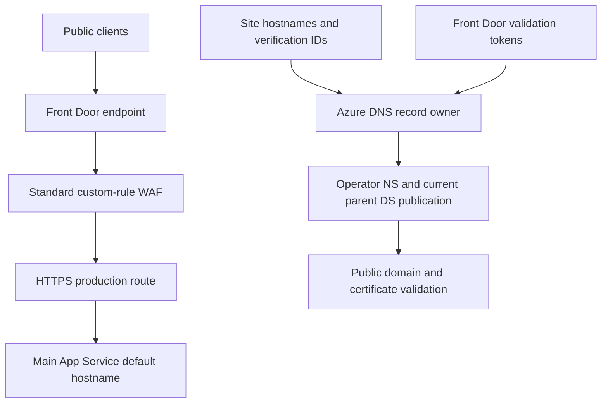

# 🌐 Network Module

Azure Front Door, WAF, Azure DNS, and DNSSEC for arolariu.ro. The existing resource modules own provisioning directly; there is no separate
Front Door completion file or automatic public-DNS readiness deployment script.

## 📋 **Overview**

- Global HTTPS routing to the actual main-site default hostname.
- Front Door Standard custom-rule WAF association and managed custom domains.
- One Azure owner for application CNAME/TXT/apex records.
- Registrar/public DNS remains an external prerequisite for successful domain/certificate completion.

## 🏗️ **Resources Created**

| Resource                        | Name/contract                                                          |
| ------------------------------- | ---------------------------------------------------------------------- |
| Front Door profile              | `<prefix>-afd`, Standard_AzureFrontDoor.                               |
| Endpoint                        | `<prefix>-afd-production`, namespace-derived.                          |
| Origin group/origin             | `production` / `production-origin`, actual main-site hostname.         |
| WAF policy/security association | `productionWAF`, custom rules, endpoint plus apex/www domains.         |
| Route                           | `production-route`, HTTPS redirect/forwarding and both custom domains. |
| DNS zone/DNSSEC                 | `arolariu.ro` / `default`.                                             |

## 📁 **Module Files**

| File                                         | Purpose                                                                       |
| -------------------------------------------- | ----------------------------------------------------------------------------- |
| [deploymentFile.bicep](deploymentFile.bicep) | Compose Front Door and DNS from actual site outputs.                          |
| [azureFrontDoor.bicep](azureFrontDoor.bicep) | Profile, WAF, domains, endpoint, origin, security policy, and HTTPS route.    |
| [dnsZone.bicep](dnsZone.bicep)               | Public zone, DNSSEC, Azure-owned application records, and delegation outputs. |

## 📊 **Architecture**

## 🔧 **Configuration**

### **Parameters**

`resourceConventionPrefix`, `resourceDeploymentDate`, `mainWebsiteHostname`, and typed `applicationDnsRecords`. The network group is global;
the site origin is a resolved default hostname, not a guessed production DNS target.

### **Example Usage**

The facade passes `websiteDeployment.outputs.mainWebsiteUrl` and `applicationDnsRecords` directly. Do not independently recreate those
record values in binding modules.

## 📤 **Outputs**

`frontDoorProductionFqdn`, profile/endpoint IDs, `dnsZoneName`, `dnsZoneNameServers`, and current `dnsZoneDsRecords`.

## 🌍 **Front Door Configuration**

### **Profile Settings**

Standard SKU, global location, source-defined timeout. There is no Premium/private-link origin or managed-rule-set deployment.

### **Endpoints**

#### **Production Endpoint**

The globally unique endpoint name uses the stable namespace. The default domain and apex/www custom domains share the WAF security policy.

### **Origin Configuration**

#### **Apex Domain (arolariu.ro)**

Front Door routes to the main App Service's actual default hostname with certificate-name checking enabled.

#### **WWW Subdomain (www.arolariu.ro)**

Shares the same origin/HTTPS route; it is not a second production backend.

## 🔒 **Security & Performance**

### **Web Application Firewall**

The association and route are present in `azureFrontDoor.bicep`; they were not removed from the intended resource set. Standard supports
custom rules, not Premium managed DRS/Bot Manager rule sets. An empty custom-rule list is not a configured application attack ruleset.

### **SSL/TLS**

Managed custom-domain certificates, TLS12 minimum on Front Door domains, HTTPS-only forwarding and redirect. Public ownership/validation is
still required; template existence alone is not certificate readiness.

## 🌐 **DNS Management**

### **Public DNS Zone**

Azure DNSSEC produces the actual signer records. The operator publishes NS/current DS at the registrar; stale DS can break resolution.

### **DNS Records**

| Record                                    | Owner/source                             |
| ----------------------------------------- | ---------------------------------------- |
| Apex A alias and www CNAME                | Actual Front Door endpoint.              |
| API/dev/exp CNAME                         | Actual App Service default hostnames.    |
| CV/docs/status CNAME                      | Actual Static Web App default hostnames. |
| `asuid.api`, `asuid.dev`, `asuid.exp` TXT | Current App Service verification IDs.    |
| `_dnsauth`, `_dnsauth.www` TXT            | Current Front Door validation tokens.    |

### **Third-Party Service Integration**

#### **Clerk Authentication**

No guessed vendor CNAME/DKIM targets are emitted. Any actual vendor-domain configuration needs approved provider-specific values.

#### **Resend Email Service**

No placeholder DKIM/MX records are seeded. Email credentials/configuration are a separate optional application integration.

#### **DMARC Policy**

Do not treat an unprovisioned mail-policy example as a deployed record; the zone source is authoritative.

### **DNS Configuration Example**

Use emitted values and inspect public records. Do not manually replace the apex alias with a hardcoded IP or point www at the apex.

## 💰 **Cost Considerations**

The [cost guide](../COST_OPTIMIZATION.md) records current retail base/request/transfer rates and explicitly assumed traffic. Front Door base
fees and WAF policy fees are separate; no Legacy Front Door resource is added.

## 🔧 **Customization Options**

### **Adding Custom Domains**

Update the existing module, matching DNS records and certificate prerequisites under an approved public-domain change.

### **Advanced Routing Rules**

Keep route/origin identity and HTTPS behavior consistent; do not introduce a second completion owner.

### **WAF Integration**

Rules, managed-rule availability, SKU, and cost are distinct decisions. Do not upgrade to Premium implicitly.

## 🛠️ **Maintenance**

### **Monitoring & Alerting**

Check actual origin health, TLS, DNS, and application response behavior after release. Arbitrary diagnostic settings/alerts are not created.

### **Performance Optimization**

Use measured request/transfer/cache data before changing compression or caching policy.

## 🔄 **Dependencies**

### **Required Dependencies**

Actual site hostnames/verification IDs from Sites. DNS consumes Front Door tokens and endpoint IDs.

### **Dependent Modules**

Bindings consumes the zone name after Azure-owned records are provisioned.

### **External Dependencies**

Domain ownership, registrar delegation/current DS, public propagation, and managed-certificate eligibility.

## 📊 **Deployment Flow**

Sites → Front Door definitions → Azure DNS records → public registrar prerequisites → successful binding/TLS completion. The single facade
does not wait for public DNS in a hidden script; incomplete prerequisites must remain visible failures.

## 🚨 **Troubleshooting**

### **Common Issues**

| Issue                       | Check                                                                                    |
| --------------------------- | ---------------------------------------------------------------------------------------- |
| Missing application records | Sites → typed record list → `dnsZone.bicep`; do not add duplicate binding-module owners. |
| Domain/certificate pending  | Public NS/current DS, CNAME/TXT values, and provider validation state.                   |
| Origin unhealthy            | Actual released main-site response and allowed access path.                              |
| Unexpected what-if changes  | Fresh-only profile is not a migration plan.                                              |

### **Validation Commands**

Use read-only DNS/HTTPS checks against approved names; Azure commands must use the approved subscription explicitly.

### **Performance Testing**

Load tests and paid/third-party monitoring require a separate approved scope; they are not deployment prerequisites.

## 📚 **References**

- [Azure Front Door](https://learn.microsoft.com/azure/frontdoor/)
- [Azure DNS](https://learn.microsoft.com/azure/dns/)
- [Deployment guide](../DEPLOYMENT_GUIDE.md)

---

**Module Version**: 3.0.0\
**Last Updated**: October 2026
