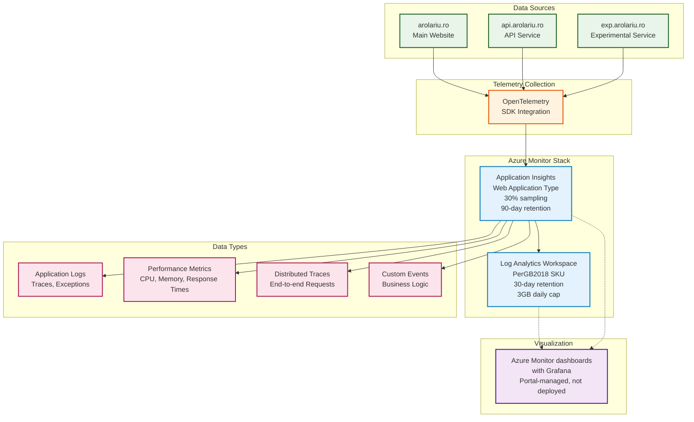

# 📊 Observability Module

This module provisions the monitoring and observability stack for the arolariu.ro platform: Log Analytics and Application Insights for
telemetry collection and analysis. Visualization uses Azure Monitor dashboards with Grafana (portal-managed, no deployed resource).

## 📋 **Overview**

The observability module creates a monitoring solution that:

- **Collects application telemetry** from the main website, the API and the exp service through Application Insights
- **Provides centralized logging** through Log Analytics workspace
- **Enables application monitoring** with Application Insights
- **Supports visualization** through Azure Monitor dashboards with Grafana (portal-managed, no deployed resource)
- **Supports OpenTelemetry (OTel)** for modern observability
- **Implements cost controls** with data retention and capping

## 🏗️ **Resources Created**

| Resource Type           | Name Pattern         | Purpose                              |
| ----------------------- | -------------------- | ------------------------------------ |
| Log Analytics Workspace | `{prefix}-workspace` | Centralized log storage and analysis |
| Application Insights    | `{prefix}-insights`  | Application performance monitoring   |

`{prefix}` is the `resourceConventionPrefix` generated by `facade.bicep` for each deployment.

## 📁 **Module Files**

| File                         | Purpose                                |
| ---------------------------- | -------------------------------------- |
| `deploymentFile.bicep`       | Orchestrates observability deployments |
| `log-analytics.bicep`        | Log Analytics workspace                |
| `application-insights.bicep` | Application Insights resource          |

## 📊 **Architecture**



The development site (`dev.arolariu.ro`) is not wired to Application Insights: its only app setting is `AZURE_CLIENT_ID`. No diagnostic
settings, alert rules or workbooks are deployed, so Azure resource logs (Front Door, App Service, Storage) do not reach the workspace.

## 🔧 **Configuration**

### **Parameters**

| Parameter                  | Type   | Required | Description                                                                                                             |
| -------------------------- | ------ | -------- | ----------------------------------------------------------------------------------------------------------------------- |
| `resourceConventionPrefix` | string | ✅       | Prefix for resource names (generated by `facade.bicep` as `q` + 5 characters of `uniqueString(resourceDeploymentDate)`) |
| `resourceLocation`         | string | ✅       | Azure region (allowed: `francecentral`, `northeurope`, `westeurope`, `swedencentral`)                                   |
| `resourceDeploymentDate`   | string | ✅       | Deployment timestamp                                                                                                    |

### **Example Usage**

`facade.bicep` declares `param resourceDeploymentDate string = utcNow()` and passes its generated prefix:

```bicep
module observabilityDeployment 'observability/deploymentFile.bicep' = {
  name: 'observabilityDeployment-${resourceDeploymentDate}'
  dependsOn: [identitiesDeployment, configurationDeployment]
  params: {
    resourceLocation: resourceLocation
    resourceDeploymentDate: resourceDeploymentDate
    resourceConventionPrefix: resourceConventionPrefix
  }
}
```

## 📤 **Outputs**

| Output                        | Type   | Description                                                |
| ----------------------------- | ------ | ---------------------------------------------------------- |
| `logAnalyticsWorkspaceId`     | string | Resource ID of Log Analytics workspace                     |
| `appInsightsConnectionString` | string | Application Insights connection string                     |
| `appInsightsName`             | string | Name of the Application Insights component (used for RBAC) |

## 📈 **Component Details**

### **Log Analytics Workspace**

**Configuration:**

- **SKU**: PerGB2018 (pay-per-GB ingestion)
- **Retention**: 30 days
- **Daily cap**: 3GB (cost control)
- **Access**: Public network access enabled
- **Permissions**: Resource-based access control

**Features:**

- **KQL queries**: Advanced log analysis with Kusto Query Language
- **Log correlation**: Cross-service log analysis
- **Custom tables**: Extensible data schema
- **Data export**: Integration with external systems

**Cost Management:**

```bicep
workspaceCapping: {
  dailyQuotaGb: 3  // Prevents unexpected costs
}
```

### **Application Insights**

**Configuration:**

- **Type**: Web application
- **Sampling**: 30% (optimized for cost/visibility balance)
- **Retention**: 90 days
- **Integration**: Log Analytics workspace
- **Ingestion mode**: LogAnalytics (unified logs)

**Telemetry Types:**

- **Requests**: HTTP request tracking
- **Dependencies**: External service calls
- **Exceptions**: Unhandled exceptions and errors
- **Custom events**: Business logic tracking
- **Performance counters**: System metrics

**Sampling Strategy:**

- **30% sampling**: Reduces costs while maintaining statistical significance
- **Fixed-rate sampling**: Consistent data collection

## 🔍 **Monitoring Capabilities**

### **Application Performance Monitoring (APM)**

The applications emit telemetry through OpenTelemetry with Azure Monitor exporters; none of them uses the browser Application Insights SDK
or `TelemetryClient`:

- **Website** (`sites/arolariu.ro/src/instrumentation.server.ts`): the OpenTelemetry Node SDK (`NodeSDK`) with the
  `@azure/monitor-opentelemetry-exporter` trace, metric and log exporters, configured from `APPLICATIONINSIGHTS_CONNECTION_STRING`
- **API** (`sites/api.arolariu.ro/src/Common/Telemetry/`): `AddAzureMonitorTraceExporter`, `AddAzureMonitorMetricExporter` and
  `AddAzureMonitorLogExporter`, using the connection string from `ApplicationOptions.ApplicationInsightsEndpoint`
- **exp** (`sites/exp.arolariu.ro/telemetry/`): OpenTelemetry with the Azure Monitor trace, metric and log exporters, configured from
  `APPLICATIONINSIGHTS_CONNECTION_STRING`

See [RFC 1001](../../../../docs/rfc/1001-opentelemetry-observability-system.md) and
[RFC 2002](../../../../docs/rfc/2002-opentelemetry-backend-observability.md) for the frontend and backend designs.

### **Infrastructure Monitoring**

- **App Service metrics**: CPU, memory, response times
- **Front Door performance**: Request latency, error rates
- **Storage metrics**: Blob operations, queue length
- **Database performance**: Query execution, connection pool

## 📊 **Sample Queries & Dashboards**

### **Useful KQL Queries**

```kusto
// Application error rate over time
requests
| where timestamp > ago(1h)
| summarize
    Total = count(),
    Errors = countif(success == false)
    by bin(timestamp, 5m)
| extend ErrorRate = (Errors * 100.0) / Total
| render timechart

// Top exceptions by count
exceptions
| where timestamp > ago(24h)
| summarize Count = count() by type, outerMessage
| order by Count desc
| take 10

// Response time percentiles
requests
| where timestamp > ago(1h)
| summarize
    p50 = percentile(duration, 50),
    p95 = percentile(duration, 95),
    p99 = percentile(duration, 99)
    by bin(timestamp, 5m)
| render timechart

// Dependency call analysis
dependencies
| where timestamp > ago(1h)
| summarize
    CallCount = count(),
    AvgDuration = avg(duration),
    FailureRate = countif(success == false) * 100.0 / count()
    by name, target
| order by CallCount desc
```

## 🚨 **Alerting & Notifications**

### **Recommended Alert Rules**

This module deploys no alert rules; the following are recommendations.

```bicep
// Example: High error rate alert
resource errorRateAlert 'Microsoft.Insights/metricAlerts@2018-03-01' = {
  name: 'high-error-rate'
  location: 'Global'
  properties: {
    description: 'Alert when error rate exceeds 5%'
    severity: 2
    enabled: true
    evaluationFrequency: 'PT1M'
    windowSize: 'PT5M'
    criteria: {
      'odata.type': 'Microsoft.Azure.Monitor.SingleResourceMultipleMetricCriteria'
      allOf: [
        {
          name: 'ErrorRate'
          metricName: 'requests/failed'
          operator: 'GreaterThan'
          threshold: 5
          timeAggregation: 'Average'
        }
      ]
    }
  }
}
```

### **Common Alert Scenarios**

- **High error rate**: > 5% failed requests
- **Slow response time**: > 2s average response time
- **High CPU usage**: > 80% for 5 minutes
- **Memory pressure**: > 85% memory usage
- **Dependency failures**: External service unavailable
- **Quota exceeded**: Daily log ingestion cap reached

## 💰 **Cost Considerations**

| Component            | Configuration              | Monthly Cost Estimate\* |
| -------------------- | -------------------------- | ----------------------- |
| Log Analytics        | 3GB/day, 30-day retention  | €15-25                  |
| Application Insights | 30% sampling, web app type | €10-20                  |
| **Total**            |                            | **€25-45**              |

\*Estimates based on moderate application traffic. Costs scale with data volume.

### **Cost Optimization Strategies**

- **Sampling**: 30% sampling reduces ingestion costs
- **Data retention**: 30-day Log Analytics retention balances analysis needs with cost
- **Daily cap**: 3GB daily limit prevents cost overruns
- **Query optimization**: Efficient KQL queries reduce compute costs

### **Cost Monitoring**

```kusto
// Monitor daily ingestion volume
Usage
| where TimeGenerated > ago(30d)
| where IsBillable == true
| summarize BillableDataGB = sum(Quantity) / 1000 by bin(TimeGenerated, 1d)
| render columnchart
```

## 🔧 **Integration Examples**

### **Application Integration**

```yaml
# Docker compose with Application Insights
version: "3.8"
services:
  webapp:
    image: myapp:latest
    environment:
      - APPLICATIONINSIGHTS_CONNECTION_STRING=${APPINSIGHTS_CONNECTION_STRING}
```

### **Infrastructure Diagnostics**

Example only — no module currently deploys diagnostic settings:

```bicep
// Enable diagnostics for App Service
resource appServiceDiagnostics 'Microsoft.Insights/diagnosticSettings@2021-05-01-preview' = {
  scope: appService
  name: 'diagnostics'
  properties: {
    workspaceId: logAnalyticsWorkspace.id
    logs: [
      {
        category: 'AppServiceHTTPLogs'
        enabled: true
      }
      {
        category: 'AppServiceConsoleLogs'
        enabled: true
      }
    ]
  }
}
```

## 🛠️ **Maintenance**

### **Data Retention Management**

- **Automatic cleanup**: 30-day Log Analytics workspace retention automatically purges old data
- **Archive options**: Export historical data to storage accounts
- **Compliance**: Adjust retention for regulatory requirements

### **Performance Tuning**

```kusto
// Identify expensive queries
Usage
| where TimeGenerated > ago(1d)
| where IsBillable == true
| summarize DataVolume = sum(Quantity) by Solution
| order by DataVolume desc
```

## 🔄 **Dependencies**

### **Required Dependencies**

**None** - The observability module can be deployed independently (ordered after Identity and Configuration in `facade.bicep`, but consumes
none of their outputs).

### **Integration Points**

- **Sites Module**: The main website, API and exp App Services receive `APPLICATIONINSIGHTS_CONNECTION_STRING` from the
  `appInsightsConnectionString` output (the dev site does not)
- **Network Module**: Not configured — no diagnostic settings are deployed for Front Door
- **Storage Module**: Not configured — no diagnostic settings are deployed for Storage
- **Identity Module**: All three UAMIs (frontend, backend, infrastructure) receive Monitoring Metrics Publisher on Application Insights
  (publish-only) via `rbac/app-insights-rbac.bicep`

## 📊 **Deployment Flow**

1. **Log Analytics Workspace**: Deploy first (foundation)
2. **Application Insights**: Deploy with workspace dependency
3. **Application Integration**: The Sites module passes the connection string to the main website, API and exp App Services
4. **Dashboard Creation** (manual, outside Bicep): Build monitoring dashboards
5. **Alert Configuration** (manual, outside Bicep): Set up proactive monitoring

## 🚨 **Troubleshooting**

### **Common Issues**

| Issue                    | Symptoms                   | Solution                                                                              |
| ------------------------ | -------------------------- | ------------------------------------------------------------------------------------- |
| **No telemetry data**    | Empty Application Insights | Verify `APPLICATIONINSIGHTS_CONNECTION_STRING` and the OpenTelemetry exporter setup   |
| **High ingestion costs** | Unexpected billing         | Check daily cap and sampling configuration                                            |
| **Missing logs**         | Incomplete log data        | No diagnostic settings are provisioned by Bicep; add them if resource logs are needed |
| **Query performance**    | Slow KQL queries           | Optimize queries and add time filters                                                 |

## 📚 **References**

- [Azure Monitor](https://docs.microsoft.com/en-us/azure/azure-monitor/)
- [Application Insights](https://docs.microsoft.com/en-us/azure/azure-monitor/app/app-insights-overview)
- [Log Analytics](https://docs.microsoft.com/en-us/azure/azure-monitor/logs/)
- [KQL Reference](https://docs.microsoft.com/en-us/azure/data-explorer/kusto/query/)
- [OpenTelemetry](https://opentelemetry.io/)

---

**Module Version**: 3.0.0\
**Last Updated**: November 2026\
**Maintainer**: Alexandru-Razvan Olariu
