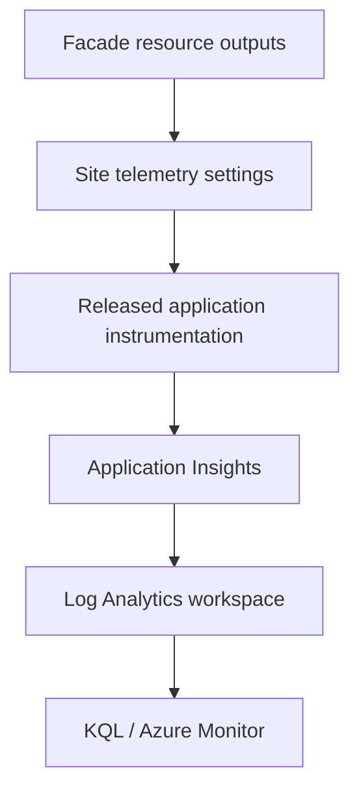

# 📊 Observability Module

Log Analytics and workspace-linked Application Insights for the applications' existing OpenTelemetry instrumentation.

## 📋 **Overview**

- Central workspace and Application Insights resource.
- Actual telemetry configuration forwarded to Sites.
- Existing sampling, retention, access, and ingestion-cap settings.
- No standalone Managed Grafana, alert-rule fleet, or arbitrary diagnostic-setting deployment.

## 🏗️ **Resources Created**

| Resource             | Current settings                                                                                                   |
| -------------------- | ------------------------------------------------------------------------------------------------------------------ |
| `<prefix>-workspace` | PerGB2018, 30-day retention, 3 GB daily ingestion cap, public ingestion/query.                                     |
| `<prefix>-insights`  | Web application, LogAnalytics ingestion, workspace link, 90-day component retention setting, 30% sampling setting. |

## 📁 **Module Files**

| File                                                     | Owner                                        |
| -------------------------------------------------------- | -------------------------------------------- |
| [deploymentFile.bicep](deploymentFile.bicep)             | Compose workspace then Application Insights. |
| [log-analytics.bicep](log-analytics.bicep)               | Workspace/access/cap/retention.              |
| [application-insights.bicep](application-insights.bicep) | Component and workspace linkage.             |

## 📊 **Architecture**



## 🔧 **Configuration**

### **Parameters**

`resourceConventionPrefix`, `resourceLocation`, and `resourceDeploymentDate`.

### **Example Usage**

The facade forwards `appInsightsConnectionString` to Sites. No separate instrumentation-key parameter/output is required.

## 📤 **Outputs**

`logAnalyticsWorkspaceId`, `appInsightsConnectionString`, and `appInsightsName`. These describe resources/configuration, not proof of
ingestion or end-to-end trace delivery.

## 📈 **Component Details**

### **Log Analytics Workspace**

API `2026-03-01`; resource-permission access, 30-day source retention, 3 GB daily cap. A cap is not a free allowance or a complete budget.

### **Application Insights**

Workspace-linked `2020-02-02` component. Preserve source-defined retention/sampling; SDK instrumentation and actual ingestion behavior need
separate application checks.

### **Managed Grafana**

Not deployed. Portal visualization is not a standalone Grafana resource or an invitation to uncomment a paid tier.

## 🔍 **Monitoring Capabilities**

### **Application Performance Monitoring (APM)**

Existing application instrumentation reports requests/dependencies/exceptions. Infrastructure creation alone does not emit those events.

### **Infrastructure Monitoring**

Resource metrics exist independently; resource diagnostic settings are not automatically universal in this graph.

### **Custom Metrics**

Follow the repository instrumentation contracts and avoid secrets/high-cardinality personal data in telemetry.

## 📊 **Sample Queries & Dashboards**

### **Useful KQL Queries**

```kusto
requests
| where timestamp > ago(1h)
| summarize Requests=count(), Failures=countif(success == false) by bin(timestamp, 5m)
```

### **Grafana Dashboard Examples**

No dashboard artifact is provisioned. Any new managed dashboard/alert resources require an approved scope and cost.

## 🚨 **Alerting & Notifications**

### **Recommended Alert Rules**

Base alerts on actual dependency failures, ingestion caps, and application health. Proposed rules are not deployed resources.

### **Common Alert Scenarios**

Sustained errors/latency, missing telemetry, dependency unavailability, and cap exhaustion.

## 💰 **Cost Considerations**

Use the [current retail meter guide](../COST_OPTIMIZATION.md). Do not bill App Insights and the same workspace ingestion twice; apply actual
eligibility/free allowances before estimating billable GB.

### **Cost Optimization Strategies**

Measure sampling and ingestion before adjusting caps/retention. Changes require approval.

### **Cost Monitoring**

```kusto
Usage
| where TimeGenerated > ago(30d) and IsBillable == true
| summarize BillableGB=sum(Quantity) / 1000 by bin(TimeGenerated, 1d)
```

## 🔧 **Integration Examples**

### **Application Integration**

Sites receives `APPLICATIONINSIGHTS_CONNECTION_STRING`; application delivery remains in existing workflows.

### **Infrastructure Diagnostics**

Verify actual per-resource diagnostic settings before relying on workspace logs for those resources.

## 🛠️ **Maintenance**

### **Data Retention Management**

Keep the distinction between the 30-day workspace setting and 90-day component setting. Real table/provider policy governs actual data.

### **Performance Tuning**

Investigate actual ingestion/query data, not historical Grafana or pricing assumptions.

## 🔄 **Dependencies**

### **Required Dependencies**

Application Insights consumes the workspace ID.

### **Integration Points**

Sites consumes the component's connection string; scoped monitoring roles are composed by the facade.

## 📊 **Deployment Flow**

Workspace → Application Insights → runtime settings → normal release → observed ingestion.

## 🚨 **Troubleshooting**

| Symptom                     | Check                                                                               |
| --------------------------- | ----------------------------------------------------------------------------------- |
| No requests/traces          | Actual release, connection settings, instrumentation, network access, and sampling. |
| Missing infrastructure logs | The resource's diagnostic configuration, not just workspace existence.              |
| High costs                  | Actual billable GB, cap, retention, and free-tier eligibility.                      |

## 📚 **References**

- [Azure Monitor](https://learn.microsoft.com/azure/azure-monitor/)
- [Application Insights](https://learn.microsoft.com/azure/azure-monitor/app/app-insights-overview)
- [Log Analytics](https://learn.microsoft.com/azure/azure-monitor/logs/)

---

**Module Version**: 3.0.0\
**Last Updated**: October 2026
