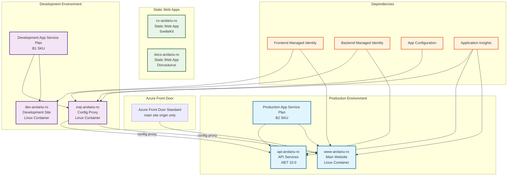
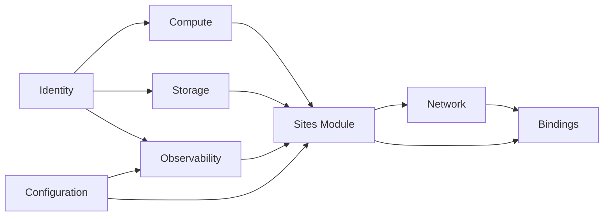

# 🌍 Sites Module

This module provisions the web applications and static sites for the arolariu.ro platform, including the main website, API services, the
experimental (exp) configuration proxy, development environment, CV portfolio, and documentation portal.

## 📋 **Overview**

The sites module creates six web applications and static sites:

- **Main Website**: Production frontend application (arolariu.ro)
- **API Service**: RESTful backend services (api.arolariu.ro)
- **Experimental Service**: Python/FastAPI container (exp.arolariu.ro) — config proxy behind Easy Auth
- **Development Site**: Development environment (dev.arolariu.ro)
- **CV Portfolio**: Personal CV/resume site (cv.arolariu.ro) - SvelteKit
- **Documentation Portal**: Static documentation site (docs.arolariu.ro) - Docusaurus

`status-arolariu-ro.bicep` (status.arolariu.ro, a Free Static Web App) is present but not wired (not deployed): `deploymentFile.bicep` does
not reference it.

## 🏗️ **Resources Created**

| Resource Type                 | Name Pattern                     | Environment      | Purpose                                       |
| ----------------------------- | -------------------------------- | ---------------- | --------------------------------------------- |
| App Service                   | `www-arolariu-ro`                | Production       | Main frontend website                         |
| App Service                   | `api-arolariu-ro`                | Production       | Backend API services                          |
| App Service (Linux container) | `exp-arolariu-ro`                | Development plan | Experimental/config-proxy service (Easy Auth) |
| App Service auth settings     | `exp-arolariu-ro/authsettingsV2` | Development plan | Easy Auth v2 (Entra ID) for the exp service   |
| App Service                   | `dev-arolariu-ro`                | Development      | Development/staging environment               |
| Static Web App                | `cv-arolariu-ro`                 | Production       | CV/resume portfolio (SvelteKit)               |
| Static Web App                | `docs-arolariu-ro`               | Production       | Documentation portal (Docusaurus)             |

## 📁 **Module Files**

| File                       | Purpose                                                           |
| -------------------------- | ----------------------------------------------------------------- |
| `deploymentFile.bicep`     | Orchestrates all site deployments                                 |
| `arolariu-ro.bicep`        | Main website (arolariu.ro)                                        |
| `api-arolariu-ro.bicep`    | API backend service                                               |
| `exp-arolariu-ro.bicep`    | Experimental config-proxy service with Easy Auth                  |
| `dev-arolariu-ro.bicep`    | Development/staging site                                          |
| `cv-arolariu-ro.bicep`     | CV portfolio Static Web App                                       |
| `docs-arolariu-ro.bicep`   | Documentation Static Web App                                      |
| `status-arolariu-ro.bicep` | Status page Static Web App — present but not wired (not deployed) |

## 📊 **Architecture**



Front Door fronts only the main website. The api, dev, cv and docs sites are reached directly through DNS records and custom-domain bindings
created by the bindings module (see Custom Domains below). The main website and the API read configuration through the exp config proxy, and
the dev site receives no Application Insights connection string.

## 🔧 **Configuration**

### **Parameters**

| Parameter                                  | Type   | Required | Description                                                                                                       |
| ------------------------------------------ | ------ | -------- | ----------------------------------------------------------------------------------------------------------------- |
| `resourceLocation`                         | string | ✅       | Azure region (allowed: `francecentral`, `northeurope`, `westeurope`, `swedencentral`)                             |
| `resourceDeploymentDate`                   | string | ❌       | Deployment timestamp (default `utcNow()`)                                                                         |
| `productionAppPlanId`                      | string | ✅       | Resource ID of production App Service Plan                                                                        |
| `developmentAppPlanId`                     | string | ✅       | Resource ID of development App Service Plan                                                                       |
| `appInsightsConnectionString`              | string | ✅       | Application Insights connection string                                                                            |
| `managedIdentityFrontendId`                | string | ✅       | Resource ID of frontend managed identity                                                                          |
| `managedIdentityBackendId`                 | string | ✅       | Resource ID of backend managed identity                                                                           |
| `managedIdentityFrontendClientId`          | string | ✅       | Client ID of the frontend managed identity (`AZURE_CLIENT_ID` for the main and dev sites)                         |
| `managedIdentityBackendClientId`           | string | ✅       | Client ID of the backend managed identity (`AZURE_CLIENT_ID` for the API and exp)                                 |
| `managedIdentityFrontendPrincipalId`       | string | ✅       | Principal ID of the frontend managed identity (exp Easy Auth allow-list and `EXP_CALLER_WEBSITE_IDS`)             |
| `managedIdentityBackendPrincipalId`        | string | ✅       | Principal ID of the backend managed identity (exp Easy Auth allow-list and `EXP_CALLER_API_IDS`)                  |
| `managedIdentityInfrastructurePrincipalId` | string | ✅       | Principal ID of the infrastructure (CI/CD) managed identity (exp Easy Auth allow-list and `EXP_CALLER_INFRA_IDS`) |
| `expEntraAppClientId`                      | string | ✅       | Entra ID app registration client ID for the exp Easy Auth                                                         |
| `appConfigurationName`                     | string | ✅       | App Configuration store name (used for the exp `AZURE_APPCONFIG_ENDPOINT`)                                        |

### **Example Usage**

`facade.bicep` declares `param resourceDeploymentDate string = utcNow()` and passes the outputs of the other modules:

```bicep
module websiteDeployment 'sites/deploymentFile.bicep' = {
  name: 'websiteDeployment-${resourceDeploymentDate}'
  dependsOn: [
    storageDeployment
    configurationDeployment
  ]
  params: {
    appConfigurationName: configurationDeployment.outputs.appConfigurationName
    appInsightsConnectionString: observabilityDeployment.outputs.appInsightsConnectionString
    developmentAppPlanId: computeDeployment.outputs.developmentAppPlanId
    expEntraAppClientId: expEntraAppClientId
    managedIdentityBackendClientId: identitiesDeployment.outputs.managedIdentitiesList[1].clientId
    managedIdentityBackendId: identitiesDeployment.outputs.managedIdentitiesList[1].resourceId
    managedIdentityBackendPrincipalId: identitiesDeployment.outputs.managedIdentitiesList[1].principalId
    managedIdentityFrontendClientId: identitiesDeployment.outputs.managedIdentitiesList[0].clientId
    managedIdentityFrontendId: identitiesDeployment.outputs.managedIdentitiesList[0].resourceId
    managedIdentityFrontendPrincipalId: identitiesDeployment.outputs.managedIdentitiesList[0].principalId
    managedIdentityInfrastructurePrincipalId: identitiesDeployment.outputs.managedIdentitiesList[2].principalId
    productionAppPlanId: computeDeployment.outputs.productionAppPlanId
    resourceDeploymentDate: resourceDeploymentDate
    resourceLocation: resourceLocation
  }
}
```

## 📤 **Outputs**

| Output            | Type   | Description                                  |
| ----------------- | ------ | -------------------------------------------- |
| `mainWebsiteUrl`  | string | Default hostname of the main website         |
| `apiWebsiteUrl`   | string | Default hostname of the API service          |
| `devWebsiteUrl`   | string | Default hostname of the development site     |
| `cvWebsiteUrl`    | string | Default hostname of the CV portfolio         |
| `docsWebsiteUrl`  | string | Default hostname of the documentation        |
| `expWebsiteUrl`   | string | Default hostname of the experimental service |
| `mainWebsiteName` | string | Name of the main website resource            |
| `apiWebsiteName`  | string | Name of the API website resource             |
| `devWebsiteName`  | string | Name of the dev website resource             |
| `cvWebsiteName`   | string | Name of the CV website resource              |
| `docsWebsiteName` | string | Name of the docs website resource            |
| `expWebsiteName`  | string | Name of the exp website resource             |

## 🌐 **Application Details**

### **Main Website (www-arolariu-ro)**

**Specifications:**

- **Platform**: Linux containers
- **Runtime**: Node.js 24 LTS (`NODE|24-lts`)
- **SSL**: HTTPS only (TLS 1.2 minimum)
- **Scaling**: Single instance on the Basic B2 production plan (no elastic scale-out)
- **Health Check**: `/` endpoint

**Security Features:**

- IP restrictions: service tags `AzureFrontDoor.Backend`, `AzureCloud`, `AzureActiveDirectory` allowed; everything else denied (no
  `X-Azure-FDID` check)
- User-assigned managed identity
- FTPS disabled
- Client certificate support disabled

**Configuration:**

- Always On enabled
- HTTP/2 enabled
- WebSockets enabled
- CORS configured for trusted origins
- Sticky sessions enabled

### **API Service (api-arolariu-ro)**

**Specifications:**

- **Platform**: Linux App Service
- **Runtime**: .NET 10 (`DOTNETCORE|10.0`)
- **SSL**: HTTPS only (TLS 1.2 minimum)
- **Authentication**: Managed Identity
- **Load Balancing**: Least Requests

**Features:**

- Request tracing enabled
- HTTP logging enabled (50 MB limit)
- WebSockets support
- Key Vault integration via managed identity

### **Experimental Service (exp-arolariu-ro)**

**Specifications:**

- **Platform**: Linux container (`app,linux,container`) on the development App Service plan
- **Image**: Placeholder `DOCKER|mcr.microsoft.com/azuredocs/aci-helloworld:latest`, replaced with the ACR image by the
  `official-exp-trigger.yml` workflow
- **SSL**: HTTPS only (TLS 1.2 minimum)
- **Identity**: Backend user-assigned managed identity
- **Health Check**: `/api/health`
- **Always On**: Disabled (cost optimization; wakes on request)

**Security Features:**

- IP restrictions: only the `AzureCloud` service tag is allowed; everything else denied
- Easy Auth v2 (`authsettingsV2`, Entra ID): authentication required; unauthenticated requests get `401`
- Paths excluded from authentication: `/api/health`, `/api/ready`, `/admin`, `/admin/*`
- Allowed principals: the frontend, backend and infrastructure managed identities
- FTPS disabled; WebSockets disabled

**App Settings:**

| Setting                                 | Value                                        |
| --------------------------------------- | -------------------------------------------- |
| `WEBSITES_PORT`                         | `8080`                                       |
| `AZURE_CLIENT_ID`                       | Backend managed identity client ID           |
| `APPLICATIONINSIGHTS_CONNECTION_STRING` | Application Insights connection string       |
| `INFRA`                                 | `azure`                                      |
| `AZURE_APPCONFIG_ENDPOINT`              | `https://<appConfigurationName>.azconfig.io` |
| `EXP_CALLER_API_IDS`                    | Backend managed identity principal ID        |
| `EXP_CALLER_WEBSITE_IDS`                | Frontend managed identity principal ID       |
| `EXP_CALLER_INFRA_IDS`                  | Infrastructure managed identity principal ID |
| `EXP_CONFIG_REFRESH_INTERVAL_SECONDS`   | `300`                                        |
| `EXP_ENTRA_APP_CLIENT_ID`               | `expEntraAppClientId`                        |
| `AZURE_TENANT_ID`                       | Tenant ID of the deployment                  |

### **Development Site (dev-arolariu-ro)**

**Specifications:**

- **Platform**: Linux containers
- **Runtime**: Node.js 24 LTS (`NODE|24-lts`)
- **SSL**: HTTPS only (TLS 1.3 minimum)
- **Access**: Open (no IP restrictions)

**Development-Specific Settings:**

- Open network access for testing
- Container-based deployment
- GitHub Actions integration
- Only app setting is `AZURE_CLIENT_ID` (no Application Insights connection string)

### **Static Web Apps (docs-arolariu-ro, cv-arolariu-ro)**

The documentation portal (Docusaurus) and the CV portfolio (SvelteKit) share the same Static Web App configuration.

**Specifications:**

- **Type**: Static Web App (Free tier)
- **Region**: `westeurope` (module default)
- **Source**: GitHub repository
- **Branch**: main
- **Enterprise-grade edge**: Disabled (cost optimization)

**Features:**

- Automatic deployment from GitHub
- No staging environments
- Configuration file updates allowed

## 🔒 **Security Features**

### **Network Security**

| Application | Access Control                       | IP Restrictions                                                                      |
| ----------- | ------------------------------------ | ------------------------------------------------------------------------------------ |
| Main Site   | Azure service tags only              | `AzureFrontDoor.Backend`, `AzureCloud`, `AzureActiveDirectory` allowed; default deny |
| API         | Public with authentication           | None (app-level auth)                                                                |
| Exp         | Azure services + Easy Auth (3 UAMIs) | `AzureCloud` allowed; default deny                                                   |
| Dev Site    | Open access                          | None (development)                                                                   |
| CV          | Public static content                | N/A                                                                                  |
| Docs        | Public static content                | N/A                                                                                  |

### **Identity & Authentication**

- **Managed Identities**: Passwordless authentication
- **Frontend Identity**: Used by main and dev sites
- **Backend Identity**: Used by the API and exp services
- **Infrastructure Identity**: Website Contributor on the main, API, dev and exp web apps (`../rbac/websites-rbac.bicep`) for CI/CD
- **Key Vault Integration**: Secure configuration retrieval

### **SSL/TLS Configuration**

- **Production App Services (main, API, exp)**: TLS 1.2 minimum
- **Development**: TLS 1.3 minimum
- **Certificates**: Managed by Azure
- **HTTPS Redirect**: Enforced on all sites

## 💰 **Cost Considerations**

| Application | Hosting Plan     | Estimated Monthly Cost\* |
| ----------- | ---------------- | ------------------------ |
| Main Site   | Production (B2)  | Shared cost (~€12)       |
| API Service | Production (B2)  | Shared cost (~€12)       |
| Exp Service | Development (B1) | Shared cost (~€11)       |
| Dev Site    | Development (B1) | Shared cost (~€11)       |
| CV Site     | Static Web App   | €0 (Free tier)           |
| Docs Site   | Static Web App   | €0 (Free tier)           |

\*Estimates based on Sweden Central pricing (June 2025). Multiple apps share the same App Service Plan.

### **Cost Optimization**

- **Shared App Service Plans**: Multiple apps on same plan
- **Free Static Web Apps**: Documentation and CV with no hosting costs
- **Fixed capacity**: Basic plans run a single instance (no elastic scale-out)
- **Always On disabled for exp**: The config proxy wakes on request
- **Development Auto-Shutdown**: Can be configured for cost savings

## 🔧 **Customization Options**

### **Scaling Configuration**

Both App Service plans are Basic (`B2` production, `B1` development) with `capacity: 1` and `elasticScaleEnabled: false`, so nothing scales
automatically. Scaling out requires changing the plan SKU and capacity in
[`../compute/appServicePlans.bicep`](../compute/appServicePlans.bicep):

```bicep
// compute/appServicePlans.bicep (production plan)
sku: {
  name: 'B2'
  tier: 'Basic'
  size: 'B2'
  capacity: 1
}
```

### **Custom Domains**

Custom domains are provisioned in Bicep:

- **arolariu.ro and www.arolariu.ro**: Front Door custom domains on the main-site route
  ([`../network/azureFrontDoor.bicep`](../network/azureFrontDoor.bicep)); the main web app is only the Front Door origin
- **api.arolariu.ro and dev.arolariu.ro**: DNS CNAME and `asuid` TXT records, App Service hostname bindings and App Service managed
  certificates (SNI) ([`../bindings/`](../bindings/))
- **cv.arolariu.ro and docs.arolariu.ro**: DNS CNAME records and Static Web App custom domains ([`../bindings/`](../bindings/))
- **status.arolariu.ro**: `../bindings/status-arolariu-ro-bindings.bicep` is present but not wired (not deployed)
- **exp.arolariu.ro**: Bicep defines no custom-domain binding or DNS record for exp.arolariu.ro

### **Environment Variables**

Configuration lives in App Configuration; only exp reads it directly (`AZURE_APPCONFIG_ENDPOINT`), and the website and API obtain values
through the exp config proxy. The dev site has no App Configuration wiring in Bicep.

## 🛠️ **Maintenance**

### **Deployment**

All applications support:

- **GitHub Actions**: Automated CI/CD
- **Deployment Slots**: Not available (Basic plans; would require Standard+)
- **Configuration Management**: Centralized in App Configuration; exp reads it and serves the website and API through the config proxy

### **Monitoring**

Applications integrate with:

- **Application Insights**: Performance monitoring (main, API and exp; the dev site is not wired)
- **Log Analytics**: Centralized logging
- **Health Checks**: Automatic endpoint monitoring

### **Backup & Recovery**

- **Configuration**: Stored in App Configuration service
- **Code**: Source control in GitHub
- **Data**: Database backups via storage module

## 🔄 **Dependencies**

### **Required Dependencies**

1. **Compute Module**: App Service Plans must exist
2. **Identity Module**: Managed identities for authentication
3. **Configuration Module**: App Configuration store name for exp
4. **Storage Module**: Ordering only (explicit `dependsOn` in `facade.bicep`; no inputs)
5. **Observability Module**: Application Insights for monitoring

The Network module consumes `mainWebsiteUrl` (the Front Door origin), and the Bindings module consumes the `*WebsiteName` outputs.

### **Deployment Order**



## 📊 **Deployment Flow**

1. **Prerequisites**: Identity, Configuration, Observability, Storage and Compute modules
2. **Sites**: All six sites deploy in parallel (main, API, dev, exp, CV, docs); `deploymentFile.bicep` has no `dependsOn` between them
3. **Network**: Front Door and DNS zone, with `mainWebsiteUrl` as the origin
4. **Bindings**: DNS records, custom domains and certificates for api, dev, cv and docs

## 🚨 **Troubleshooting**

### **Common Issues**

| Issue                           | Symptoms                                 | Solution                                                                                                                  |
| ------------------------------- | ---------------------------------------- | ------------------------------------------------------------------------------------------------------------------------- |
| **App Service Plan not found**  | Deployment fails with resource not found | Ensure compute module deployed successfully                                                                               |
| **Managed Identity errors**     | Authentication failures                  | Verify identity module and RBAC permissions                                                                               |
| **Custom domain issues**        | SSL certificate errors                   | Check DNS configuration and certificate binding                                                                           |
| **Static Web App not updating** | Old content served                       | Verify GitHub Actions workflow and repository connection                                                                  |
| **CORS errors**                 | Frontend cannot connect to API           | Check CORS configuration in App Service settings                                                                          |
| **exp rejects requests**        | 401 or 403 responses                     | Call from Azure (`AzureCloud`) with a token for the exp app registration from one of the three allowed managed identities |

### **Validation Commands**

```bash
# Check App Service status
az webapp show \
  --name "www-arolariu-ro" \
  --resource-group "arolariu-rg" \
  --query "state"

# Test application endpoints
# Direct *.azurewebsites.net access to the main site is blocked (403) by its IP restrictions; test it through Front Door
curl -I https://arolariu.ro
curl -I https://api-arolariu-ro.azurewebsites.net/health

# Check managed identity assignment
az webapp identity show \
  --name "www-arolariu-ro" \
  --resource-group "arolariu-rg"

# View application logs
az webapp log tail \
  --name "api-arolariu-ro" \
  --resource-group "arolariu-rg"
```

### **Performance Troubleshooting**

```bash
# CPU and memory are App Service plan metrics (the production plan hosts the main website and the API)
az monitor metrics list \
  --resource "/subscriptions/<subscription-id>/resourceGroups/arolariu-rg/providers/Microsoft.Web/serverfarms/<prefix>-production" \
  --metric "CpuPercentage,MemoryPercentage" \
  --start-time "2024-01-01T00:00:00Z"

# Response time is a site metric
az monitor metrics list \
  --resource "/subscriptions/<subscription-id>/resourceGroups/arolariu-rg/providers/Microsoft.Web/sites/www-arolariu-ro" \
  --metric "HttpResponseTime" \
  --start-time "2024-01-01T00:00:00Z"

# Scale out the production plan: this scales the main website and the API together,
# and the next Bicep deployment resets the capacity to 1
az appservice plan update \
  --name "<prefix>-production" \
  --resource-group "arolariu-rg" \
  --number-of-workers 3
```

## 📚 **References**

- [Azure App Service](https://docs.microsoft.com/en-us/azure/app-service/)
- [Azure Static Web Apps](https://docs.microsoft.com/en-us/azure/static-web-apps/)
- [App Service Linux](https://docs.microsoft.com/en-us/azure/app-service/overview#app-service-on-linux)
- [Managed Identity](https://docs.microsoft.com/en-us/azure/active-directory/managed-identities-azure-resources/)
- [GitHub Actions for Azure](https://docs.microsoft.com/en-us/azure/developer/github/github-actions)

---

**Module Version**: 2.0.0  
**Last Updated**: November 2026\
**Maintainer**: Alexandru-Razvan Olariu
