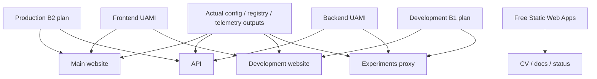

# 🌍 Sites Module

Application hosts and runtime settings for the existing delivery workflows. Provisioning hosts is not releasing their applications.

## 📋 **Overview**

Four App Services and three Free Static Web Apps retain fixed names for pipeline compatibility. Their availability must be checked before a
fresh deployment; another resource group does not isolate globally unique names.

## 🏗️ **Resources Created**

| Resource             | Purpose                      | Plan/identity               | Port / health             |
| -------------------- | ---------------------------- | --------------------------- | ------------------------- |
| `www-arolariu-ro`    | Production website           | Production / frontend UAMI  | 3000 / `/api/health/`     |
| `api-arolariu-ro`    | API                          | Production / backend UAMI   | 8080 / `/health`          |
| `dev-arolariu-ro`    | DEVELOPMENT-labelled website | Development / frontend UAMI | 3000 / `/api/health/`     |
| `exp-arolariu-ro`    | Configuration/feature proxy  | Development / backend UAMI  | 8080 / `/api/health`      |
| `cv-arolariu-ro`     | CV                           | Free SWA, West Europe       | Not an App Service probe. |
| `docs-arolariu-ro`   | Documentation                | Free SWA, West Europe       | Not an App Service probe. |
| `status-arolariu-ro` | Status                       | Free SWA, West Europe       | Not an App Service probe. |

## 📁 **Module Files**

`deploymentFile.bicep` composes the correspondingly named website/SWA leaves, including `exp-arolariu-ro.bicep` and
`status-arolariu-ro.bicep`. Runtime and infrastructure identities are distinct contracts.

## 📊 **Architecture**

## 🔧 **Configuration**

### **Parameters**

Actual plan IDs, UAMI resource/client/principal IDs, App Configuration endpoint, registry login server, telemetry connection string,
generated experiments client ID, regional location, and deployment timestamp.

### **Example Usage**

The facade passes outputs directly. Identity attachment uses resource IDs; `AZURE_CLIENT_ID` and ACR pull selection use client IDs; Easy
Auth caller policies use principal/object IDs.

## 📤 **Outputs**

Site names/default hostnames plus the typed `applicationDnsRecords` list with actual CNAME and verification values. Network owns the
corresponding Azure records; no duplicate record owner is retained in the binding leaves.

## 🌐 **Application Details**

### **Main Website (www-arolariu-ro)**

Linux hosting, frontend identity, production Node runtime, production configuration label, actual registry/telemetry/audience settings.

### **API Service (api-arolariu-ro)**

Backend identity, production ASP.NET environment, actual config/registry inputs, port 8080, authenticated Cosmos database health.

### **Development Site (dev-arolariu-ro)**

Uses `NODE_ENV=production` while retaining the DEVELOPMENT label. Both website labels call the same API and require its signing key.

### **Documentation Portal (docs-arolariu-ro)**

Free Static Web App, independent content delivery. CV/status follow their own existing static-site paths.

### **Experiments Proxy (exp-arolariu-ro)**

Backend identity, actual App Configuration endpoint, explicitly enabled Easy Auth v2, and the generated tenant-only application ID. The
hello-world container remains a pre-release placeholder, not a functioning configuration service.

## 🔒 **Security Features**

### **Network Security**

Preserve each leaf's current access restrictions; experiments remains AzureCloud-allowed/public-denied by its IP rules. Do not equate
control-plane provisioning with end-to-end access or managed-certificate eligibility.

### **Identity & Authentication**

Three approved UAMI object IDs form the experiments caller allowlist. Azure website/API callers require configured
`EXP_ENTRA_APP_CLIENT_ID`; there is no legacy fallback. Local proxy requests do not create Azure credentials.

### **SSL/TLS Configuration**

HTTPS/TLS settings live in the source leaves. App Service and SWA custom-domain certificates are owned by Bindings; apex/www TLS is owned by
Front Door.

## 💰 **Cost Considerations**

Two shared Linux plans, not one paid plan per application. See [current retail meters](../COST_OPTIMIZATION.md); static-site Free tier does
not make the entire platform free.

### **Cost Optimization**

Stopping an app does not stop App Service plan charges. SKU/capacity changes need measured evidence and separate approval.

## 🔧 **Customization Options**

### **Scaling Configuration**

No implicit autoscaling, deployment-slot migration, or paid-tier upgrade is introduced.

### **Custom Domains**

Update the declarative Network/Bindings owners and public prerequisites; do not repair an unapproved target with ad hoc hostname commands.

### **Environment Variables**

App Service runtime settings override baked build values. Existing frontend/backend-named CI-login secrets select infrastructure, not the
actual runtime identity.

## 🛠️ **Maintenance**

### **Deployment**

Existing workflows release experiments, then API, then websites. Infrastructure no longer performs configuration/SQL/bootstrap tasks.

### **Monitoring**

Verify actual health endpoints, image pulls, and telemetry after releases; configured health paths are not observed health.

### **Backup & Recovery**

Application data backup contracts belong to Storage. No resource-group-delete rollback is permitted by this guide.

## 🔄 **Dependencies**

### **Required Dependencies**

Identity, actual Compute/Configuration/Storage/Observability outputs, and scoped grants.

### **Deployment Order**

Resources/grants → hosts/settings → Azure DNS/bindings with public prerequisites → separately configured/released applications.

## 📊 **Deployment Flow**

The facade owns resource composition directly. Operational data seeding and real dependency probes are separate from ARM provisioning.

## 🚨 **Troubleshooting**

### **Common Issues**

| Issue                       | Check                                                          |
| --------------------------- | -------------------------------------------------------------- |
| Container pull denied       | Actual attached UAMI client ID and registry-scoped pull grant. |
| Missing Azure audience      | Required generated application client ID in runtime settings.  |
| Configuration startup fails | Separate store population and required secret availability.    |
| TLS pending                 | Public ownership and actual correct hosting plan.              |

### **Validation Commands**

Use approved read-only site metadata, public health requests, and safe logs. Never print runtime secrets or tokens.

### **Performance Troubleshooting**

Correlate actual plan utilization and application traces before changing shared-plan capacity.

## 📚 **References**

- [App Service](https://learn.microsoft.com/azure/app-service/)
- [Static Web Apps](https://learn.microsoft.com/azure/static-web-apps/)
- [Deployment guide](../DEPLOYMENT_GUIDE.md)

---

**Module Version**: 3.0.0\
**Last Updated**: October 2026
