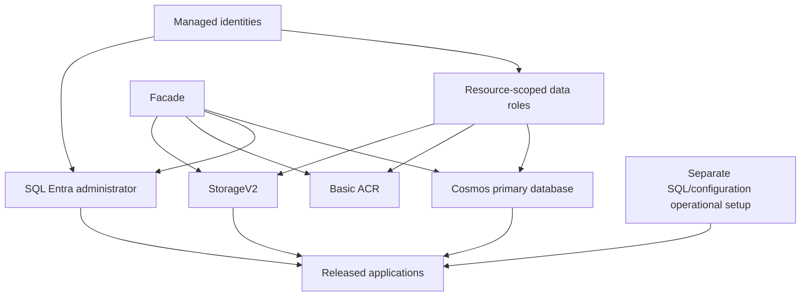

# 💾 Storage Module

Storage, SQL, Cosmos, and container-image infrastructure. The facade wires actual outputs into resources/settings; contained SQL users and
data-plane access probes are separate operational tasks.

## 📋 Overview

- Standard LRS StorageV2 with existing lifecycle/retention/CORS.
- Basic non-admin ACR.
- Entra-only SQL with primary Standard and secondary serverless/free-limit profiles.
- Cosmos `primary` database and invoices/merchants containers.
- Existing encryption, TLS, backups, partitions, and capacity settings are preserved.

## 🏗️ Resources Created

| Owner                     | Current resource set                                                                                  |
| ------------------------- | ----------------------------------------------------------------------------------------------------- |
| `storageAccount.bicep`    | Blob/file/queue/table services, private invoices container, invoice-analysis queue, lifecycle policy. |
| `containerRegistry.bicep` | Basic ACR, admin user disabled.                                                                       |
| `sqlServer.bicep`         | Entra-only server, approved firewall/auditing settings, primary and secondary databases.              |
| `noSqlServer.bicep`       | Cosmos account/database/containers and existing backup/capacity configuration.                        |

## 📁 Module Files

[deploymentFile.bicep](deploymentFile.bicep) composes those four resource-owning leaves and forwards actual endpoints/names. The
[RBAC group](../rbac/README.md) owns resource-scoped grants separately.

## 📊 Architecture

## 🔧 Configuration

### Parameters

`resourceConventionPrefix`, `resourceLocation`, `resourceDeploymentDate`, and the actual infrastructure identity for SQL administration.
Database-user creation is not hidden in this resource deployment.

### Example Usage

The facade passes the identity output object, not a display-name lookup or SQL administrator password.

## 📤 Outputs

Storage name/ID/blob/queue endpoints; registry name/login server; SQL server/FQDN/database names; Cosmos account name/raw endpoint. No
account keys or synthetic keyless connection strings.

## 💾 Storage Account Features

Standard_LRS, Hot StorageV2, HTTPS, TLS 1.2, infrastructure encryption, no blob public access or shared-key authentication. Existing blob
versioning, change-feed/restore/delete-retention, file retention/SMB, lifecycle rules, and CORS are source-defined and unchanged.

The invoices container and invoice-analysis queue are declarative application resources, not temporary bootstrap execution storage. Storage
retains the explicitly approved `2026-06-01` compiler-compatibility API exception.

## 🛡️ Security Practices

Public-network posture is retained; no private endpoint is claimed. Use managed identities and resource-scoped data grants, not shared keys,
broad management roles, or fake secret placeholders.

## 💾 **Storage Components**

### **Azure Storage Account**

#### **Blob Storage**

Private `invoices` container and existing data-protection/lifecycle settings.

#### **Table Storage**

Default service with existing RBAC; no invented application table schema.

#### **Queue Storage**

The declared `invoice-analysis` queue supports durable analysis processing; Brokers do not provision infrastructure at runtime.

#### **File Storage**

Default file service and existing retention/SMB policies.

### **Azure Container Registry**

Basic SKU, managed-identity pull/push. No Premium geo-replication/private endpoint or automatic vulnerability-scanning resource is created.

### **Azure SQL Database**

The infrastructure UAMI principal is the Entra-only administrator. Primary: Standard, capacity 10 DTUs (S0 retail profile), source max size
268435456000 bytes. Secondary: `GP_S_Gen5_2`, 32 GiB max, auto-pause 60 minutes, free-limit requested with exhaustion AutoPause. The
secondary database is independent, not a replica.

Contained backend users/memberships and real identity login must be provisioned/proved separately. The restored manual SQL file is a
reference, not an idempotent bootstrap or a name/SID correctness guarantee. SQL's Azure-services firewall is not subscription isolation.

Use the [standalone SQL ensure tasks and client-ID SID sequence](../../PowerShell/RUNBOOK.md#5-ensure-backend-sql-binding-and-memberships).
The [actual-backend probe](../../PowerShell/RUNBOOK.md#8-obtain-actual-identity-specific-proof) checks login/effective permissions and
optional named tables without fixing them. The uninitialized auth-schema gate remains separate.

### **Access Control**

Cosmos local authentication is disabled. The backend receives native Data Contributor at `/dbs/primary`; management-plane Operator access
does not substitute for data access. Actual SDK metadata/data behavior at this scope remains a live proof requirement.

The [Cosmos metadata probe](../../PowerShell/Test-CosmosDataAccess.ps1) requires the actual expected actor and never grants a wider scope,
reads account keys/documents, or claims metadata checks prove all SDK CRUD.

### **Encryption Standards**

Keep source encryption/TLS/backup contracts; do not add account-key fallbacks or advertise private networking not deployed here.

## 📊 **Data Patterns & Use Cases**

Invoices/merchants retain their actual partition, indexing, and serialization contracts. Infrastructure changes do not migrate schemas or
rewrite business data.

## 💰 **Cost Considerations**

Use the [current retail guide](../COST_OPTIMIZATION.md): Basic ACR and primary S0 have base costs; serverless SQL, Cosmos free-tier
eligibility, storage operations/versions/backups, and traffic require explicit assumptions.

## 🔧 **Development & Integration**

### **Connection String Management**

Azure SQL requires encrypted managed-identity settings with the real database and backend client ID. Cosmos uses the raw HTTPS account
endpoint; Blob/queue use actual service URLs. Do not store account-key connection-string fallbacks.

### **Application Configuration**

Resource creation no longer populates App Configuration/Key Vault. Operational tasks must resolve the actual outputs and preserve real
operator/signing material.

### **Managed Identity Integration**

Runtime credentials select the UAMI client ID; role assignments use its principal ID; attachment dictionaries use its resource ID.

## 🛠️ Maintenance & Operations

### **Backup Strategies**

Preserve SQL auditing/backup configuration, Cosmos continuous 7-day backup/free-tier/capacity settings, and Storage retention/lifecycle. Do
not treat data deletion as bootstrap cleanup.

### **Monitoring & Alerting**

Verify actual authorized SDK/SQL operations and telemetry, not administrator-only SELECT or resource existence.

### **Performance Optimization**

Changes to partition keys, throughput, tiers, retention, or lifecycle need separate approval.

## 🔄 **Dependencies**

### **Required Dependencies**

Identity for SQL administration; resource/identity outputs for scoped grants.

### **Optional Dependencies**

No private endpoints, VNet migration, or added monitoring resources are implicit.

## 📊 **Deployment Flow**

Resources → scoped grants → separately approved contained-user/configuration tasks → normal application delivery and dependency proof.

## 🚨 Troubleshooting

| Issue                               | Check                                                                          |
| ----------------------------------- | ------------------------------------------------------------------------------ |
| SQL resource exists but login fails | Actual contained user, identity binding, memberships, and backend token.       |
| Cosmos 403                          | Native grant/scope and exact metadata/data operation; do not broaden silently. |
| Blob/queue denial                   | Identity client selection, native role, endpoint, and network posture.         |
| ACR pull fails                      | Attached identity's client ID and registry pull grant.                         |
| Unexpected bill                     | Actual SKU/meter, usage, free-tier eligibility, versions, and backups.         |

## 📚 References

- [Azure Storage](https://learn.microsoft.com/azure/storage/)
- [Azure SQL](https://learn.microsoft.com/azure/azure-sql/database/)
- [Cosmos data-plane access](https://learn.microsoft.com/azure/cosmos-db/nosql/security/how-to-grant-data-plane-access)
- [Deployment guide](../DEPLOYMENT_GUIDE.md)

---

**Module Version**: 3.0.0\
**Last Updated**: October 2026
