# 💾 Storage Module

This module provisions secure, enterprise-grade storage resources for the arolariu.ro platform, including Azure Storage Account, SQL
Database, Cosmos DB (NoSQL), and Container Registry.

## 📋 **Overview**

This module provides:

- **Azure Storage Account**: Blob, file, queue, and table storage with advanced security
- **Azure SQL Database**: Relational database for structured data
- **Azure Cosmos DB**: NoSQL database for document storage
- **Azure Container Registry**: Docker image storage and management
- **Lifecycle management** for cost optimization
- **Comprehensive encryption** (at rest, in transit, infrastructure)

## 🏗️ **Resources Created**

| Resource Type          | Name Pattern                      | Purpose                                               |
| ---------------------- | --------------------------------- | ----------------------------------------------------- |
| Storage Account        | `{prefix}sacc`                    | Blob, file, queue, table storage                      |
| Blob Container         | `invoices`                        | Private container for invoice scan uploads            |
| Storage Queue          | `invoice-analysis`                | Durable invoice and merchant analysis work            |
| ManagementPolicy       | default                           | Lifecycle/cost optimization                           |
| Container Registry     | `{prefix}acrprod`                 | Docker container images                               |
| SQL Server             | `{prefix}-sqlserver`              | Azure SQL Server                                      |
| SQL Database           | `{prefix}-sqlserver-db-primary`   | Primary database (Standard, 10 DTU)                   |
| SQL Database           | `{prefix}-sqlserver-db-secondary` | Serverless free-offer database (`GP_S_Gen5_2`)        |
| Cosmos DB Account      | `{prefix}-nosqlserver`            | NoSQL document database                               |
| Cosmos DB SQL Database | `primary`                         | Document database                                     |
| Cosmos DB Container    | `invoices`                        | Invoice documents (partition key `/UserIdentifier`)   |
| Cosmos DB Container    | `merchants`                       | Merchant documents (partition key `/ParentCompanyId`) |

`{prefix}` is the `resourceConventionPrefix` parameter. The storage account and registry names drop any dashes from it
(`replace(resourceConventionPrefix, '-', '')`).

## 📁 **Module Files**

| File                      | Purpose                              |
| ------------------------- | ------------------------------------ |
| `deploymentFile.bicep`    | Orchestrates all storage deployments |
| `storageAccount.bicep`    | Azure Storage Account                |
| `sqlServer.bicep`         | Azure SQL Server & Databases         |
| `noSqlServer.bicep`       | Azure Cosmos DB (NoSQL)              |
| `containerRegistry.bicep` | Azure Container Registry             |

## 📊 **Architecture**

```mermaid
graph TB
    subgraph "Application Layer"
        WEB_MAIN[arolariu.ro<br/>Main Website]
        WEB_API[api.arolariu.ro<br/>API Service]
        WEB_DEV[dev.arolariu.ro<br/>Development Site]
    end

    subgraph "Storage Infrastructure"
        subgraph "Blob & File Storage"
            SA[Storage Account<br/>Standard_LRS<br/>Hot Tier]

            subgraph "Storage Services"
                BLOB[Blob Storage<br/>invoices container]
                TABLE[Table Storage<br/>no tables provisioned]
                QUEUE[Queue Storage<br/>invoice-analysis queue]
                FILE[File Storage<br/>no shares provisioned]
            end
        end

        subgraph "Container Storage"
            ACR[Container Registry<br/>Docker Images<br/>Basic SKU]
        end

        subgraph "Structured Data"
            SQL_SERVER[SQL Server<br/>Azure AD Auth]

            subgraph "SQL Databases"
                DB_MAIN[Primary Database<br/>Standard 10 DTU]
                DB_SECONDARY[Secondary Database<br/>Serverless free offer]
            end
        end

        subgraph "Document Storage"
            COSMOS_ACCOUNT[Cosmos DB Account<br/>NoSQL API<br/>Free tier, 1000 RU/s cap]

            subgraph "Cosmos Database"
                DB_PRIMARY[primary Database<br/>invoices + merchants containers]
            end
        end
    end

    subgraph "Security & Access"
        RBAC[Role-Based Access<br/>Azure AD Integration]
        ENCRYPTION[Encryption<br/>At Rest & In Transit]
        RETENTION[Data Protection<br/>Versioning, Soft Delete<br/>30-Day Restore]
        LIFECYCLE[Lifecycle Policy<br/>Cool 30d, Archive 90d<br/>Delete 365d]
    end

    WEB_MAIN --> SA

    WEB_API --> SA
    WEB_API --> SQL_SERVER
    WEB_API --> COSMOS_ACCOUNT
    WEB_API --> ACR

    WEB_DEV --> SA

    SA --> BLOB
    SA --> TABLE
    SA --> QUEUE
    SA --> FILE

    SQL_SERVER --> DB_MAIN
    SQL_SERVER --> DB_SECONDARY

    COSMOS_ACCOUNT --> DB_PRIMARY

    BLOB --> RETENTION
    BLOB --> LIFECYCLE

    RBAC --> SA
    RBAC --> SQL_SERVER
    RBAC --> COSMOS_ACCOUNT
    RBAC --> ACR

    ENCRYPTION --> SA
    ENCRYPTION --> SQL_SERVER
    ENCRYPTION --> COSMOS_ACCOUNT
    ENCRYPTION --> ACR

    classDef app fill:#e8f5e8,stroke:#1b5e20,stroke-width:2px
    classDef storage fill:#e3f2fd,stroke:#0277bd,stroke-width:2px
    classDef container fill:#fff3e0,stroke:#e65100,stroke-width:2px
    classDef sql fill:#f3e5f5,stroke:#4a148c,stroke-width:2px
    classDef nosql fill:#fce4ec,stroke:#ad1457,stroke-width:2px
    classDef security fill:#e0f2f1,stroke:#00695c,stroke-width:2px

    class WEB_MAIN,WEB_API,WEB_DEV app
    class SA,BLOB,TABLE,QUEUE,FILE storage
    class ACR container
    class SQL_SERVER,DB_MAIN,DB_SECONDARY sql
    class COSMOS_ACCOUNT,DB_PRIMARY nosql
    class RBAC,ENCRYPTION,RETENTION,LIFECYCLE security
```



SQL Database and Cosmos DB roles go only to the backend identity, used by the API and exp. The frontend identity, used by the main and dev
sites, receives storage and registry roles (see [`../rbac/README.md`](../rbac/README.md)). No private endpoints, VNet rules or IP filters
are deployed.

## 🔧 **Configuration**

### **Parameters**

| Parameter                  | Type   | Required | Description                                                                                                                         |
| -------------------------- | ------ | -------- | ----------------------------------------------------------------------------------------------------------------------------------- |
| `resourceConventionPrefix` | string | ✅       | Prefix for resource names, 3-20 chars (generated by `facade.bicep` as `q` + 5 characters of `uniqueString(resourceDeploymentDate)`) |
| `resourceLocation`         | string | ✅       | Azure region (allowed: `francecentral`, `northeurope`, `westeurope`, `swedencentral`)                                               |
| `resourceDeploymentDate`   | string | ✅       | Deployment timestamp (no default; passed by the facade)                                                                             |

`deploymentFile.bicep` derives every resource name from the prefix and passes each name, with the location and date, to its child module.
For example, `storageAccount.bicep` takes `storageAccountName` (3-24 chars), `storageAccountLocation` and `storageAccountDeploymentDate`.

### **Example Usage**

`facade.bicep` declares `param resourceDeploymentDate string = utcNow()` and passes its generated prefix:

```bicep
module storageDeployment 'storage/deploymentFile.bicep' = {
  name: 'storageDeployment-${resourceDeploymentDate}'
  dependsOn: [identitiesDeployment]
  params: {
    resourceLocation: resourceLocation
    resourceDeploymentDate: resourceDeploymentDate
    resourceConventionPrefix: resourceConventionPrefix
  }
}
```

## 📤 **Outputs**

| Output                       | Type   | Description                          |
| ---------------------------- | ------ | ------------------------------------ |
| `storageAccountName`         | string | Name of the created storage account  |
| `storageAccountId`           | string | Resource ID of the storage account   |
| `storageAccountBlobEndpoint` | string | Blob storage endpoint URL            |
| `containerRegistryName`      | string | Name of the Azure Container Registry |
| `sqlServerName`              | string | Name of the SQL Server instance      |
| `cosmosAccountName`          | string | Name of the Cosmos DB account        |

`facade.bicep` passes the storage account, registry, SQL server and Cosmos DB names to the resource-scoped RBAC modules.
`storageAccount.bicep` also outputs `storageAccountFileEndpoint`, `storageAccountQueueEndpoint` and `storageAccountTableEndpoint`, which the
orchestrator does not re-export.

## 💾 **Storage Components**

### **Azure Storage Account**

**General:**

- SKU: Standard_LRS (Locally Redundant)
- Kind: StorageV2
- Access Tier: Hot
- Public Network Access: Enabled (can restrict)
- Allow Cross-Tenant Replication: Disabled
- Minimum TLS: 1.2
- HTTPS Only: Yes
- Tags: Environment, deployment, cost center, etc.

**Security & Encryption:**

- Blob public (anonymous) access: Disabled at the account level
- Shared key access: Disabled; Entra ID (OAuth) is the default authentication
- Encryption at rest: Microsoft-managed keys
- Infrastructure encryption: Enabled
- Network ACLs: AzureServices, Logging, Metrics bypassed; default allow

**Blob Service:**

- Change feed: Enabled (90 days)
- Restore policy: Enabled (30 days)
- Container delete retention: 7 days
- Blob delete retention: 90 days (no permanent delete)
- CORS: Configured for production (`arolariu.ro`, `api.arolariu.ro`), `dev.arolariu.ro` and local development (`localhost`) origins
- Versioning: Enabled
- Last access time tracking: Enabled (1 day)
- Container: `invoices` (private), which holds invoice scans that the website uploads through short-lived user-delegation SAS URLs

**File Service:**

- Share delete retention: 7 days (no permanent delete)
- SMB: 3.0/3.1.1, Kerberos, AES encryption
- No file shares are provisioned

**Queue/Table Service:**

- Queue and table services are enabled.
- The `invoice-analysis` queue is provisioned declaratively for durable invoice and merchant analysis work. Application Brokers consume this
  queue but never create infrastructure at runtime.
- No tables are provisioned.

**Lifecycle Management:**

- Move blobs to cool after 30 days, archive after 90 days, delete after 365 days
- Delete snapshots after 90 days, versions after 365 days

### **Azure Container Registry**

**Configuration:**

- **SKU**: Basic
- **Admin user**: Disabled (managed identity authentication)
- **Public access**: Enabled (no network rule set; AzureServices bypass)
- **Content trust**: Disabled (requires Premium)
- **Anonymous pull**: Disabled

**Features:**

- **Multi-architecture images**: Support for ARM64 and x86
- **Vulnerability scanning**: Not configured
- **Geo-replication**: Not available (requires Premium)
- **Webhook integration**: Not configured

**Container Images:**

- **Frontend applications**: React/Next.js production builds
- **Backend APIs**: .NET Core application containers
- **Experimental service**: exp.arolariu.ro (Python/FastAPI) container

CI pushes these images from `official-website-build.yml`, `official-api-trigger.yml` and `official-exp-trigger.yml` in `.github/workflows/`.

### **Azure SQL Database**

**SQL Server Configuration:**

- **Primary database**: Standard (10 DTU, 250 GB maximum size)
- **Secondary database**: General Purpose serverless `GP_S_Gen5_2` free offer (32 GB, auto-pause after 60 minutes)
- **Authentication**: Azure AD integration
- **TLS**: Minimum version 1.2
- **Firewall**: No firewall rules are defined in Bicep (public network access enabled)

### **Azure Cosmos DB**

**Account Configuration:**

- **API**: NoSQL (`GlobalDocumentDB`)
- **Capacity**: Provisioned throughput on the free tier, capped at 1000 RU/s for the account
- **Consistency**: Session
- **Regions**: Single region (no zone redundancy or automatic failover)
- **Backup**: Continuous (7-day point-in-time restore)
- **Authentication**: Entra ID only (local/key auth disabled)
- **TLS**: Minimum version 1.2
- **Database**: `primary`, with the `invoices` and `merchants` containers (see Cosmos DB Document Patterns below)

### **Access Control**

**Storage Account:**

- **Authentication**: Azure AD and managed identities
- **Authorization**: RBAC and fine-grained permissions
- **Network**: Public endpoint (no private endpoints, VNet rules or IP filters are configured)
- **SAS tokens**: Time-limited for specific operations

**SQL Database:**

- **Authentication**: Azure AD (primary), SQL Auth (fallback)
- **Authorization**: The manually run `../rbac/sql-rbac-uami.sql` adds the `backend` and `infra` database users to `db_datareader`,
  `db_datawriter` and `db_ddladmin`; Bicep assigns only SQL DB Contributor (management) to the backend identity
- **Network**: Public endpoint (no private endpoints, VNet rules or IP filters are configured)
- **Always Encrypted**: Not configured

**Cosmos DB:**

- **Authentication**: Entra ID only (local/key auth disabled)
- **Authorization**: Bicep assigns only Cosmos DB Operator (management, no data access) to the backend identity; no Cosmos DB SQL role
  assignment is defined (see [`../rbac/README.md`](../rbac/README.md#role-ids-that-differ-from-their-constant-names))
- **Network**: Public endpoint (no private endpoints, VNet rules or IP filters are configured)
- **Encryption**: Automatic encryption at rest

### **Encryption Standards**

- **At rest**: All data encrypted with Microsoft-managed keys
- **In transit**: TLS 1.2+ for all connections
- **Application-level**: Not configured
- **Key management**: Not configured (Microsoft-managed keys only; no Key Vault keys)

## 📊 **Data Patterns & Use Cases**

### **Storage Account Usage Patterns**

```csharp
// Example: Blob storage usage
public class FileService
{
    private readonly BlobServiceClient _blobClient;

    public async Task<string> UploadFileAsync(Stream fileStream, string fileName, string containerName)
    {
        var containerClient = _blobClient.GetBlobContainerClient(containerName);
        var blobClient = containerClient.GetBlobClient(fileName);

        await blobClient.UploadAsync(fileStream, overwrite: true);
        return blobClient.Uri.ToString();
    }

    public async Task<Stream> DownloadFileAsync(string fileName, string containerName)
    {
        var containerClient = _blobClient.GetBlobContainerClient(containerName);
        var blobClient = containerClient.GetBlobClient(fileName);

        var response = await blobClient.DownloadStreamingAsync();
        return response.Value.Content;
    }
}
```

### **SQL Database Patterns**

```sql
-- Example: Efficient queries with indexing
CREATE NONCLUSTERED INDEX IX_Products_Category_Price
ON Products (CategoryId, Price)
INCLUDE (Name, Description);

-- Partition function for large tables
CREATE PARTITION FUNCTION DateRangePartition (datetime2)
AS RANGE RIGHT FOR VALUES
('2024-01-01', '2024-02-01', '2024-03-01');
```

### **Cosmos DB Document Patterns**

The `primary` database holds two containers. Both use consistent, automatic indexing of all paths except `/_etag/?` and define no unique
keys.

| Container   | Partition key      | Contents                                                           |
| ----------- | ------------------ | ------------------------------------------------------------------ |
| `invoices`  | `/UserIdentifier`  | Invoice documents, read and written by the API's Cosmos DB broker  |
| `merchants` | `/ParentCompanyId` | Merchant documents, read and written by the API's Cosmos DB broker |

## 💰 **Cost Considerations**

| Component          | Configuration                                      | Monthly Cost Estimate\* |
| ------------------ | -------------------------------------------------- | ----------------------- |
| Storage Account    | Standard_LRS, Hot tier                             | €5-15                   |
| Container Registry | Basic SKU                                          | €15-25                  |
| SQL Database       | Standard 10 DTU primary, serverless free secondary | €20-40                  |
| Cosmos DB          | Free tier (provisioned, 1000 RU/s cap)             | €10-30                  |
| **Data Transfer**  | Egress costs                                       | €2-10                   |
| **Total**          |                                                    | **€52-120**             |

\*Estimates based on moderate usage. Costs scale with data volume and operations.

### **Cost Optimization Strategies**

**Storage Account:**

- **Lifecycle policies**: Automatically move old data to cool/archive tiers
- **Reserved capacity**: Pre-purchase storage for predictable workloads
- **Compression**: Enable compression for blob storage

**SQL Database:**

- **Serverless free offer**: The secondary database auto-pauses after 60 minutes of inactivity and pauses when its free limit is exhausted
- **Query optimization**: Regular performance tuning
- **Backup retention**: Optimize backup retention periods

**Cosmos DB:**

- **Partition design**: Efficient partitioning reduces cross-partition queries
- **TTL policies**: Automatic document expiration
- **Indexing**: Custom indexing policies to reduce RU consumption

**Container Registry:**

- **Image cleanup**: Regular cleanup of unused images
- **Efficient tagging**: Proper image tagging strategy
- **Multi-stage builds**: Optimize Docker image sizes

## 🔧 **Development & Integration**

### **Connection String Management**

Shared-key access is disabled (`allowSharedKeyAccess: false`), so account-key connection strings cannot authenticate. Store or pass only the
blob endpoint (the `storageAccountBlobEndpoint` output) and authenticate with the workload's user-assigned managed identity; its storage
roles come from [`../rbac/storage-rbac.bicep`](../rbac/storage-rbac.bicep).

### **Application Configuration**

The API reads no storage connection strings from `appsettings*.json`. At startup it loads these App Configuration keys through the exp
configuration proxy (`sites/api.arolariu.ro/src/Core/Domain/General/Extensions/WebApplicationBuilderExtensions.cs`):

| Key                        | Value in Azure                               | API option                            |
| -------------------------- | -------------------------------------------- | ------------------------------------- |
| `Endpoints:Database:SQL`   | SQL Database connection string               | `AzureOptions:SqlConnectionString`    |
| `Endpoints:Database:NoSQL` | Cosmos DB account endpoint                   | `AzureOptions:NoSqlConnectionString`  |
| `Endpoints:Storage:Blob`   | Blob endpoint (`storageAccountBlobEndpoint`) | `AzureOptions:StorageAccountEndpoint` |

[`../configuration/appConfiguration.json`](../configuration/appConfiguration.json) declares these keys under the `PRODUCTION` and
`DEVELOPMENT` labels with empty values, so Bicep does not populate them. Resource names are fixed in code: the API uses the `primary` Cosmos
DB database with its `invoices` and `merchants` containers and the `invoice-analysis` queue, and the website's scan Server Actions upload to
the `invoices` blob container.

### **Managed Identity Integration**

```csharp
// Example: Accessing storage with managed identity
public class StorageService
{
    private readonly BlobServiceClient _blobClient;

    public StorageService()
    {
        var credential = new DefaultAzureCredential();
        _blobClient = new BlobServiceClient(
            new Uri("https://<prefix>sacc.blob.core.windows.net/"),
            credential
        );
    }
}
```

## 🛠️ **Maintenance & Operations**

### **Backup Strategies**

**Storage Account:**

- **Blob snapshots**: None are created by the infrastructure; lifecycle management deletes snapshots after 90 days
- **Retention and restore**: Versioning, 90-day blob soft delete and 30-day point-in-time restore
- **Replication**: LRS only (no cross-region copy)
- **Export jobs**: Not configured

**SQL Database:**

- **Automated backups**: 7-day retention with point-in-time restore
- **Backup redundancy**: Local (no geo-restore)

**Cosmos DB:**

- **Continuous backup**: Point-in-time restore capability (7 days)
- **Regions**: Single region

### **Monitoring & Alerting**

```bash
# List resource names to find the generated <prefix> (for example <prefix>sacc)
az resource list --resource-group "arolariu-rg" --query "[].name" --output tsv

# Monitor storage account metrics
az monitor metrics list \
  --resource "/subscriptions/<subscription-id>/resourceGroups/arolariu-rg/providers/Microsoft.Storage/storageAccounts/<prefix>sacc" \
  --metric "UsedCapacity,Transactions,Ingress,Egress"

# Check SQL database usage
az sql db list-usages \
  --name "<prefix>-sqlserver-db-primary" \
  --server "<prefix>-sqlserver" \
  --resource-group "arolariu-rg"

# Monitor Cosmos DB RU consumption
az monitor metrics list \
  --resource "/subscriptions/<subscription-id>/resourceGroups/arolariu-rg/providers/Microsoft.DocumentDB/databaseAccounts/<prefix>-nosqlserver" \
  --metric "TotalRequestUnits"
```

### **Performance Optimization**

**Storage Account:**

- **Hot tier**: Frequently accessed data
- **Parallel uploads**: Multi-part upload for large files

**SQL Database:**

- **Index optimization**: Regular index maintenance
- **Query store**: Query performance monitoring
- **Auto-tuning**: Automatic performance improvements

**Cosmos DB:**

- **Partition key design**: Optimal data distribution
- **Query optimization**: Efficient document queries
- **Indexing policies**: Custom indexing for performance

## 🔄 **Dependencies**

### **Required Dependencies**

- **Identity Module**: Deployment ordering only (`dependsOn: [identitiesDeployment]` in `facade.bicep`)

### **Optional Dependencies**

- None. No private endpoints or diagnostic settings are provisioned, so there is no Network or Observability dependency.

## 📊 **Deployment Flow**

1. **Storage resources**: The storage account, container registry, SQL server (with its two databases) and Cosmos DB account (with the
   `primary` database and its containers) deploy in parallel; `deploymentFile.bicep` declares no dependencies between them
2. **RBAC**: `facade.bicep` then applies role assignments through [`../rbac/storage-rbac.bicep`](../rbac/storage-rbac.bicep),
   [`../rbac/container-registry-rbac.bicep`](../rbac/container-registry-rbac.bicep),
   [`../rbac/sql-server-rbac.bicep`](../rbac/sql-server-rbac.bicep) and [`../rbac/cosmos-db-rbac.bicep`](../rbac/cosmos-db-rbac.bicep)
3. **SQL database users**: Database users for the managed identities are created by manually running `../rbac/sql-rbac-uami.sql`; no Bicep
   module runs it

## 🚨 **Troubleshooting**

### **Common Issues**

| Issue                       | Symptoms                     | Solution                                                                       |
| --------------------------- | ---------------------------- | ------------------------------------------------------------------------------ |
| **Storage access denied**   | 403 Forbidden errors         | Check RBAC assignments and network access                                      |
| **Blob not found**          | 404 errors                   | Check container and blob name                                                  |
| **CORS errors**             | Browser errors               | Check CORS rules in blobServices                                               |
| **SQL connection timeout**  | Database connection failures | Verify firewall rules (none are defined in Bicep) and connection strings       |
| **Cosmos DB throttling**    | 429 Too Many Requests        | Optimize queries and partition key design (the account is capped at 1000 RU/s) |
| **Container registry auth** | Docker push/pull failures    | Verify managed identity and registry access                                    |
| **High storage costs**      | Unexpected billing           | Review lifecycle policies and data retention                                   |

### **Validation Commands**

```bash
# Test storage account access
az storage blob list \
  --account-name "<prefix>sacc" \
  --container-name "invoices" \
  --auth-mode login

# Test SQL connectivity
sqlcmd -S "<prefix>-sqlserver.database.windows.net" \
  -d "<prefix>-sqlserver-db-primary" \
  -G \
  -Q "SELECT @@VERSION"

# Test Cosmos DB access
az cosmosdb sql database list \
  --account-name "<prefix>-nosqlserver" \
  --resource-group "arolariu-rg"

# Test container registry
az acr repository list \
  --name "<prefix>acrprod"
```

### **Performance Diagnostics**

```sql
-- SQL Database: Check expensive queries
SELECT TOP 10
    st.text,
    qs.execution_count,
    qs.total_worker_time / qs.execution_count AS avg_cpu_time,
    qs.total_elapsed_time / qs.execution_count AS avg_elapsed_time
FROM sys.dm_exec_query_stats qs
CROSS APPLY sys.dm_exec_sql_text(qs.sql_handle) st
ORDER BY avg_cpu_time DESC;
```

```bash
# Storage: Monitor transaction metrics
az monitor metrics list \
  --resource "/subscriptions/<subscription-id>/resourceGroups/arolariu-rg/providers/Microsoft.Storage/storageAccounts/<prefix>sacc" \
  --metric "Transactions" \
  --dimension "ResponseType" \
  --start-time "2024-01-01T00:00:00Z"
```

## 📚 **References**

- [Azure Storage Documentation](https://docs.microsoft.com/en-us/azure/storage/)
- [Azure SQL Database](https://docs.microsoft.com/en-us/azure/azure-sql/database/)
- [Azure Cosmos DB](https://docs.microsoft.com/en-us/azure/cosmos-db/)
- [Azure Container Registry](https://docs.microsoft.com/en-us/azure/container-registry/)
- [Storage Security Guide](https://docs.microsoft.com/en-us/azure/storage/common/storage-security-guide)
- [SQL Database Security](https://docs.microsoft.com/en-us/azure/azure-sql/database/security-overview)

---

**Module Version**: 2.0.0  
**Last Updated**: November 2026\
**Maintainer**: Alexandru-Razvan Olariu
