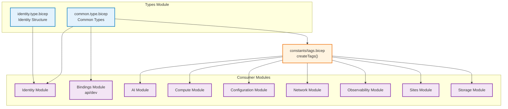

# 🔧 Types Module

This module provides centralized user-defined types for standardized and type-safe Azure Bicep deployments across the entire infrastructure
codebase.

## 📋 **Overview**

The types module defines reusable type definitions that:

- **Enforce consistency** across all infrastructure modules
- **Provide type safety** and IntelliSense support
- **Standardize configurations** for common Azure resources
- **Reduce deployment errors** through compile-time validation
- **Improve maintainability** with centralized type definitions

## 🏗️ **Type Definitions**

| Type File             | Exported Types | Purpose                             |
| --------------------- | -------------- | ----------------------------------- |
| `identity.type.bicep` | `identity`     | Managed identity resource structure |
| `common.type.bicep`   | `resourceTags` | Standardized resource tagging       |

## 📊 **Architecture**



## 🔧 **Type Definitions**

### **Identity Type (`identity.type.bicep`)**

Defines the structure for managed identity resources used across modules.

```bicep
@metadata({ type: 'identity', name: 'identity' })
@export()
type identity = {
  name: string
  displayName: string
  resourceId: string // Azure Resource ID
  principalId: string // Azure Principal ID (GUID)
  clientId: string // Azure Client ID (GUID) — used for DefaultAzureCredential
}
```

**Properties:**

- `name`: Resource name of the managed identity
- `displayName`: Human-readable display name
- `resourceId`: Full Azure resource ID
- `principalId`: Azure Principal ID (GUID) for RBAC assignments
- `clientId`: Azure Client ID (GUID) used by applications for `DefaultAzureCredential`

**Usage Example:**

```bicep
import { identity } from '../types/identity.type.bicep'

param managedIdentities identity[]

output identityList identity[] = [
  {
    name: 'frontend-identity'
    displayName: 'Frontend Application Identity'
    resourceId: '/subscriptions/.../providers/Microsoft.ManagedIdentity/userAssignedIdentities/frontend-identity'
    principalId: '00000000-0000-0000-0000-000000000000'
    clientId: '00000000-0000-0000-0000-000000000000'
  }
]
```

### **Resource Tags Type (`common.type.bicep`)**

Enforces consistent tagging across all Azure resources.

```bicep
@export()
@metadata({ description: 'Resource tagging configuration' })
type resourceTags = {
  @description('Environment tag')
  environment: 'DEVELOPMENT' | 'PRODUCTION'

  @description('Deployment method')
  deploymentType: 'Bicep' | 'ARM' | 'Terraform'

  @description('Deployment date in YYYY-MM-DD format')
  deploymentDate: string

  @description('Deployment author')
  deploymentAuthor: string

  @description('Module or service name')
  module: string

  @description('Cost center for billing')
  costCenter: string

  @description('Project name or identifier')
  project: string

  @description('Version of the deployment')
  version: string
}
```

**Usage Example:**

Modules should not build `resourceTags` by hand. Call `createTags(moduleName, deploymentDate)` from `constants/tags.bicep` instead. It
returns a `resourceTags` value that takes `module` and `deploymentDate` from its arguments and fixes the other six fields (for example
`environment: 'PRODUCTION'` and `version: '2.0.0'`).

```bicep
import { createTags } from '../constants/tags.bicep'

var commonTags = createTags('storage', storageAccountDeploymentDate)
// tags: union(commonTags, { displayName: '...' })
```

The exceptions are `identity/userAssignedIdentity.bicep` and the api/dev bindings files, which still declare
`var commonTags resourceTags = { ... }` directly.

## 💡 **Benefits**

### **Type Safety**

- **Compile-time validation** prevents invalid configurations
- **IntelliSense support** in VS Code and other editors
- **Reduced deployment errors** through early detection

### **Consistency**

- **Standardized structures** across all modules
- **Uniform naming conventions** for resources
- **Consistent tagging** for governance and billing

### **Maintainability**

- **Centralized definitions** reduce code duplication
- **Easy updates** propagate across all consumers
- **Clear documentation** of expected structures

### **Developer Experience**

- **Auto-completion** for type properties
- **Validation feedback** during development
- **Clear error messages** for type mismatches

## 🔄 **Usage Patterns**

### **Importing Types**

```bicep
// Import specific types
import { identity } from '../types/identity.type.bicep'
import { resourceTags } from '../types/common.type.bicep'

// Use imported types in parameters
param identities identity[]
param tags resourceTags
```

### **Type Validation**

The Bicep compiler automatically validates:

- **Required properties** are present
- **Property types** match the definition
- **Allowed values** are within the defined constraints
- **Structure consistency** across the deployment

### **Output Typing**

```bicep
import { identity } from '../types/identity.type.bicep'

// Strongly typed outputs (as in identity/userAssignedIdentity.bicep)
output userAssignedManagedIdentities identity[] = [
  for i in range(0, length(identities)): {
    name: identities[i].name
    displayName: identities[i].displayName
    resourceId: userAssignedManagedIdentities[i].id
    principalId: userAssignedManagedIdentities[i].properties.principalId
    clientId: userAssignedManagedIdentities[i].properties.clientId
  }
]
```

## 🛠️ **Development Guidelines**

### **Creating New Types**

1. **Identify common patterns** across multiple modules
2. **Define clear property names** and descriptions
3. **Use constraints** (`@allowed`, `@minLength`, etc.) where appropriate
4. **Add comprehensive metadata** for documentation
5. **Test with real-world scenarios**

### **Type Evolution**

- **Backward compatibility**: Avoid breaking changes to existing types
- **Versioning**: Consider versioned type files for major changes
- **Documentation**: Update README when adding new types
- **Testing**: Validate types with all consuming modules

### **Best Practices**

```bicep
// Good: Clear, descriptive type definition
@export()
@metadata({ description: 'Database configuration with validation' })
type databaseConfig = {
  @description('Database name (3-64 characters)')
  @minLength(3)
  @maxLength(64)
  name: string

  @description('Database tier')
  tier: 'Basic' | 'Standard' | 'Premium'

  @description('Enable backup (recommended for production)')
  backupEnabled: bool
}

// Avoid: Vague or overly complex definitions
type config = {
  data: object  // Too generic
  settings: {   // Too nested
    deep: {
      nested: {
        value: string
      }
    }
  }
}
```

## 📊 **Usage Statistics**

### **Type Consumption by Module**

| Module                                                             | identity | resourceTags            |
| ------------------------------------------------------------------ | -------- | ----------------------- |
| Identity                                                           | ✅       | ✅ (direct)             |
| Bindings (api/dev)                                                 | ❌       | ✅ (direct)             |
| AI, Compute, Configuration, Network, Observability, Sites, Storage | ❌       | ✅ (via `createTags()`) |
| RBAC                                                               | ❌       | ❌                      |

## 🚨 **Troubleshooting**

### **Common Issues**

| Issue                           | Symptoms                            | Solution                                     |
| ------------------------------- | ----------------------------------- | -------------------------------------------- |
| **Import path errors**          | `Cannot resolve module` errors      | Verify relative path to type files           |
| **Type mismatch errors**        | `Type 'X' is not assignable to 'Y'` | Check property names and types match exactly |
| **Missing required properties** | `Property 'name' is missing`        | Ensure all required properties are provided  |
| **Invalid allowed values**      | `Value 'X' is not allowed`          | Use only values defined in type constraints  |

### **Validation Commands**

```bash
# Validate type definitions
az bicep build --file types/identity.type.bicep
az bicep build --file types/common.type.bicep

# Validate consumer modules
az bicep build --file identity/deploymentFile.bicep
az bicep build --file compute/deploymentFile.bicep

# Check for type usage across modules
grep -r "import.*types" ../
```

### **Debugging Type Issues**

```bicep
// Use explicit typing to debug issues
param debugIdentity identity = {
  name: 'test-identity'        // string ✅
  displayName: 'Test Identity' // string ✅
  resourceId: 'resource-id'    // string ✅
  principalId: 'principal-id'  // string ✅
  clientId: 'client-id'        // string ✅
  // extraProperty: 'value'    // ❌ Not defined in type
}

// Check output types
output debugOutput identity = debugIdentity // Type validation
```

## 🔮 **Future Enhancements**

### **Planned Type Additions**

- **Storage Account Configuration**: Standardize storage account settings
- **Network Security Group Rules**: Type-safe security rule definitions
- **Application Insights Configuration**: Monitoring and alerting types

### **Advanced Features**

- **Union Types**: Support for multiple valid configurations
- **Conditional Properties**: Properties based on other property values
- **Generic Types**: Reusable types with parameters
- **Validation Functions**: Custom validation logic

## 📚 **References**

- [Bicep User-Defined Types](https://docs.microsoft.com/en-us/azure/azure-resource-manager/bicep/user-defined-data-types)
- [Bicep Type System](https://docs.microsoft.com/en-us/azure/azure-resource-manager/bicep/data-types)
- [Bicep Best Practices](https://docs.microsoft.com/en-us/azure/azure-resource-manager/bicep/best-practices)
- [Type Safety in Bicep](https://docs.microsoft.com/en-us/azure/azure-resource-manager/bicep/type-safety)

---

**Module Version**: 2.0.0  
**Last Updated**: November 2026\
**Maintainer**: Alexandru-Razvan Olariu
