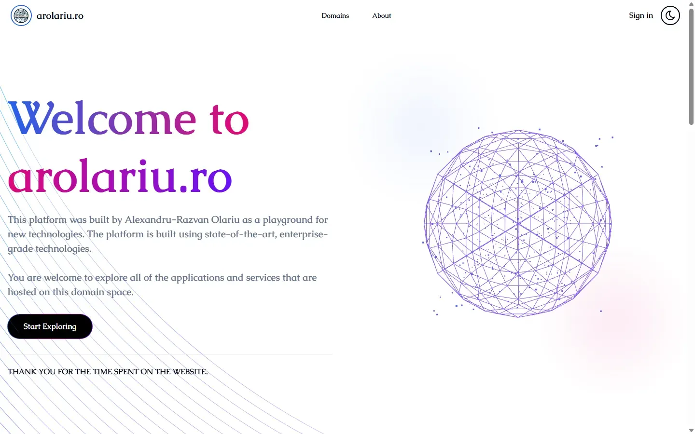
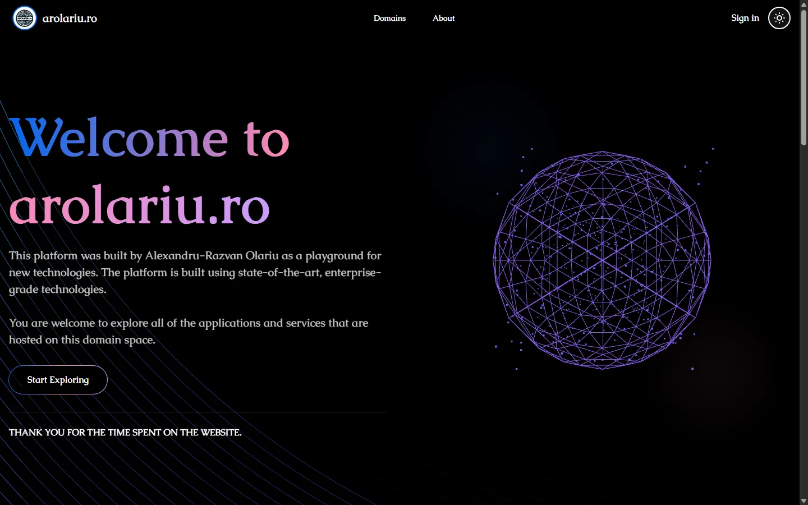
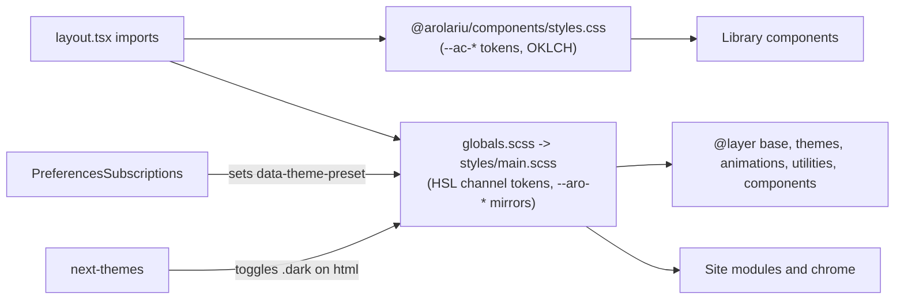
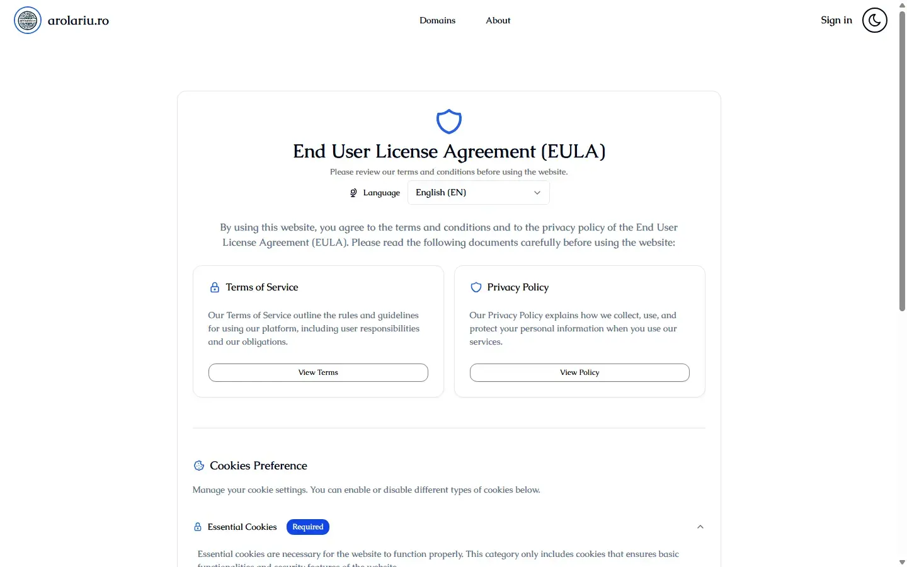
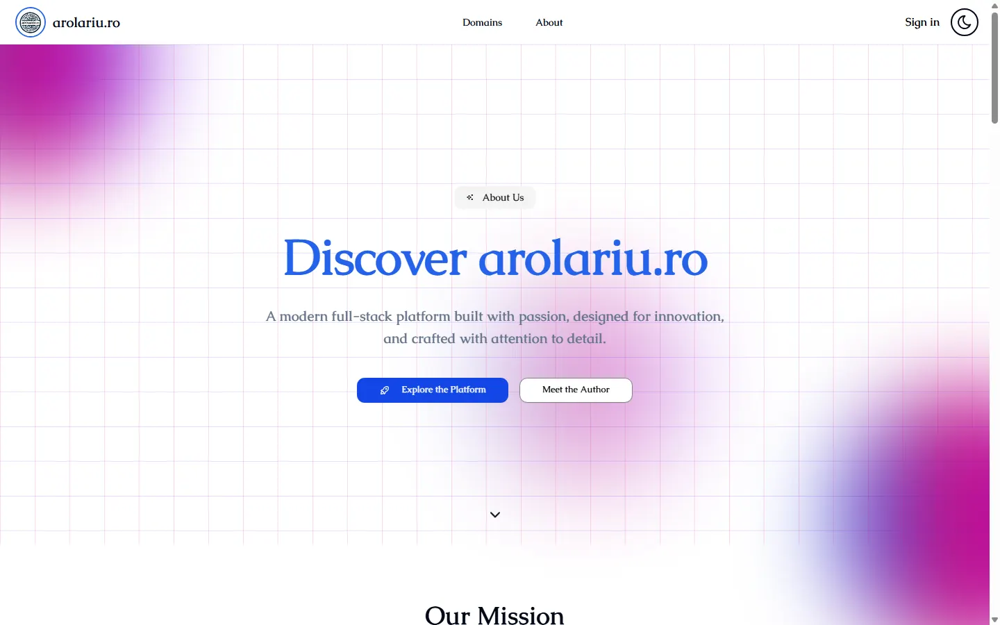
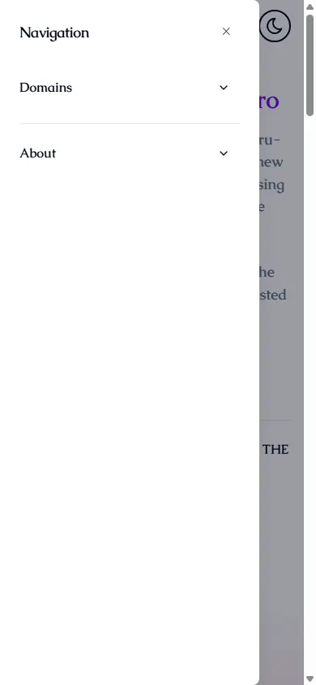

# arolariu.ro — Design System & Frontend Guidelines

> **Audience:** engineers, designers and AI coding agents working on `sites/arolariu.ro/`. **Purpose:** the long-form guide to the visual
> language, the SCSS cookbook, the component patterns and the motion vocabulary of the arolariu.ro website. Source wins: when this guide and
> the stylesheet disagree, fix this guide.

## Document map

| Document                                | Answers                                                                                       |
| --------------------------------------- | --------------------------------------------------------------------------------------------- |
| [`PRODUCT.md`](PRODUCT.md)              | Who the site is for, what it is for, and the principles behind every design decision.         |
| [`DESIGN.md`](DESIGN.md)                | The **token values**, named rules, components, and Do's and Don'ts (the normative reference). |
| `DESIGN_SYSTEM.md` (this file)          | How to _build_ with the system: SCSS cookbook, theming internals, patterns, motifs, motion.   |
| [`UX-FLOWS.md`](UX-FLOWS.md)            | Routes, access rules, global chrome, journeys, cross-cutting mechanics and known UX gaps.     |
| [Root `AGENTS.md`](../../AGENTS.md)     | Versions, commands, repository-wide coding, testing and risk rules (not repeated here).       |
| [`docs/screenshots/`](docs/screenshots) | Reference captures of the live dev site used throughout these documents.                      |

Token values live in `DESIGN.md` and in the stylesheet. This guide explains the system around them and links to the value tables rather than
copying them, so there is one place to update.

---

## 1. Identity — "The Jewel Atelier"

> Formerly "Crystalline Court". The visuals are unchanged; the framing is now a craftsman's studio where a handful of jewel-toned pieces are
> set against a quiet workbench.

arolariu.ro is a personal, full-stack playground that wears its craft on its sleeve: classical serif typography, a jewel-tone gradient used
sparingly, blurred light and crystalline geometry behind the content. It is **not** flat, brutalist, playful or Material. The invoice
domain, where people do real work, stays calmer than the marketing pages (see [`PRODUCT.md`](PRODUCT.md)).





### 1.1 Aesthetic pillars

| Pillar                   | Expression                                                                                                                                                                       |
| ------------------------ | -------------------------------------------------------------------------------------------------------------------------------------------------------------------------------- |
| **One bold serif**       | Caudex ships in a single 700 face and sets the whole UI. Hierarchy comes from size, color and spacing, not from weight changes.                                                  |
| **The jewel triad**      | Blue, then magenta, then violet (`--primary`, `--tertiary`, `--secondary`) as headline text or a thin call-to-action rim, once per view.                                         |
| **Ethereal orbs**        | Large blurred circles tinted with `color-alpha('primary' / 'tertiary', 0.2)` float behind heroes and call-to-action blocks as atmosphere.                                        |
| **Crystalline ornament** | The wireframe `TechSphere`, `BackgroundBeams` and faint 50px grid overlays give a geometric counterpoint to the soft orbs.                                                       |
| **A closing slab**       | The footer is a solid `--footer-bg` slab. `--footer-bg` is `var(--primary)`, so the slab follows the active **theme preset** (blue by default, not always blue).                 |
| **Crafted detail**       | Fluid headings, visible focus rings, dark-mode parity, an opt-in dyslexia-friendly font, a stylesheet-level reduced-motion clamp, and forced-colors and high-contrast overrides. |

### 1.2 Voice in the visual (inferred from the shipped UI)

- **Confident, never loud.** The largest type on the scale appears once, on the hero, with generous empty space around it.
- **Asymmetric balance.** The hero is one column below `lg` and two columns above: words left, ornament right.
- **Atmosphere under content.** Beams sit at `z('behind')`; orbs are `pointer-events: none` and positioned by their section.
- **Color is the emphasis.** Hero wordmarks use gradient text instead of heavier weight, because only one weight exists.

### 1.3 What this site is not

- ❌ **A generic sans-serif UI.** Caudex is the identity; the only sanctioned alternate is the dyslexia-friendly Atkinson Hyperlegible,
  which the user opts into.
- ❌ **Glassmorphism as a hero treatment.** Frosted surfaces exist (code blocks, About pillar cards, invoice overlays and toolbars) but they
  are quiet 2–8px blurs on translucent cards, never the hero. See the Glass Floor Rule in [`DESIGN.md`](DESIGN.md#elevation--depth).
- ❌ **Shadow trees.** Rest state is usually `md` or none; elevation steps up with intent.
- ❌ **A flat purple-on-white gradient.** The triad is blue, magenta, violet, in that order.
- ❌ **Inline style objects** in application code (see the repository rules in [`AGENTS.md`](../../AGENTS.md)).
- ❌ **Reskinning `@arolariu/components`.** The shared library ships pre-themed; consume it and compose around it.

---

## 2. Two token layers and the cascade

Two token sets coexist on every page. Knowing which one a component reads explains most "why is this blue slightly different" questions.

| Layer           | Source                              | Format                                                                          | Read by                                  |
| --------------- | ----------------------------------- | ------------------------------------------------------------------------------- | ---------------------------------------- |
| **Library**     | `packages/components/src/index.css` | `--ac-*` custom properties in OKLCH (no `@layer`)                               | Every `@arolariu/components` component   |
| **Site (SCSS)** | `src/styles/base/_globals.scss`     | Unprefixed HSL channels (`--primary: 221.2 83.2% 53.3%`), mirrored as `--aro-*` | Site CSS Modules, global chrome, presets |



- **Import order.** `src/app/layout.tsx` imports `@arolariu/components/styles.css` first and `./globals.scss` second. `globals.scss` is a
  single `@use "../styles/main"`.
- **Layer order.** `main.scss` declares `@layer base, themes, animations, utilities, components;` and loads each partial inside its layer
  through the `load-system-layer` mixin, so a later layer deterministically beats an earlier one without `!important`. The library
  stylesheet is not layered.
- **Config switches** live in `src/styles/abstracts/_config.scss`: `$enable-fluid-type`, `$enable-logical-properties`,
  `$enable-reduced-motion`, `$enable-high-contrast`, `$enable-print-styles` and `$enable-css-layers` are all `true`, and `$css-prefix` is
  `aro`.
- **The Two-Blues caveat.** Site components read the HSL tokens (Royal Blue, `221.2 83.2% 53.3%`); library components read `--ac-primary`
  (`oklch(0.488 0.243 264.376)`), a deeper indigo. Likewise the library radius (`--ac-radius`, `0.875rem`) differs from the site radius
  scale. Do not "fix" one to match the other in a component; see the Two-Blues and Two-Radius-Layers rules in [`DESIGN.md`](DESIGN.md).

### 2.1 Provider stack and the EULA gate

`src/app/providers.tsx` nests, from the outside in: `TranslationProvider` → `AuthProvider` (Clerk) → `FontProvider` → `ThemeProvider`.
Inside it sit `PreferencesSubscriptions`, the page children, `GlobalToaster`, and the feature-flagged `Commander`.

The root `layout.tsx` renders the **EULA screen instead of the page** until the `eula-accepted` cookie exists, on every route. In that
layout, analytics tracking mounts only after acceptance; `global-error.tsx` is the exception and mounts it unconditionally (see
[`UX-FLOWS.md`](UX-FLOWS.md#known-gaps)). Design consequence: the very first thing a new visitor sees is the EULA surface, so it must carry
the identity on its own. See [`UX-FLOWS.md`](UX-FLOWS.md#first-visit-and-the-eula-gate).



---

## 3. Design tokens (SCSS accessors)

SCSS helpers in `src/styles/abstracts/` return values from the token maps. **Use the accessor; never hardcode the underlying value.** The
actual values, contrast measurements and rules are in [`DESIGN.md`](DESIGN.md); this section is the cookbook.

| File               | Defines                                                                                                                                    |
| ------------------ | ------------------------------------------------------------------------------------------------------------------------------------------ |
| `_config.scss`     | Feature switches and `$css-prefix`.                                                                                                        |
| `_colors.scss`     | `color('name')`, `color-alpha('name', $alpha)`, `static-color('white')`.                                                                   |
| `_typography.scss` | `font-size()`, `font-weight()`, `line-height()`, `letter-spacing()`, `$font-family-default`, `$font-family-dyslexic`, `$font-family-mono`. |
| `_variables.scss`  | `space()`, `breakpoint()`, `z()`, `radius()`, `shadow()`, `duration()`, `easing()`, `blur-size()`, `opacity()`.                            |
| `_functions.scss`  | Utility functions: `rem()`, `em()`, `strip-unit()`, `map-deep-get()`, `list-contains()`, `str-replace()`.                                  |
| `_mixins.scss`     | Layout, responsive, visual, accessibility and utility mixins (see [section 5.5](#55-mixins-that-exist)).                                   |
| `_index.scss`      | Forwards the files above, so one `@use "…/styles/abstracts" as *;` pulls in everything.                                                    |

### 3.1 Color

Semantic colors are HSL-channel custom properties consumed through SCSS helpers. The channel format lets `color-alpha()` produce
`hsl(var(--primary) / 0.2)` without losing theme reactivity. The full palette (brand triad, neutrals, intent colors, dark counterparts,
`--link`, `--footer-bg`) is in [`DESIGN.md`](DESIGN.md#colors).

```scss
// ✅ Semantic tokens: theme-reactive
color: color("foreground");
background: color("card");
border: 1px solid color("border");
background: color-alpha("primary", 0.1); // 10% tint of the primary

// ✅ Static colors only when they must never theme
background: static-color("white");

// ❌ Literal colors bypass presets and dark mode
color: #3b82f6;
background: rgb(59, 130, 246);
```

Two usage facts worth knowing:

- `--link` is `var(--tertiary)` in light mode and `var(--secondary)` in dark mode.
- Measured on the live site, `--muted-foreground` on the Slate Wash (`--muted`) surface is about 4.3:1, below the AA 4.5:1 floor for body
  text. Use `--foreground` on `--muted` surfaces, and re-check any translucent surface over orbs and beams.

#### The signature gradient

`@include gradient-bg($direction: to right)` emits `linear-gradient($direction, primary, tertiary, secondary)` in that order, each from the
semantic tokens, so it re-skins with every named preset. The `custom` preset only replaces `--primary`, so only the first stop follows the
custom colors; tertiary and secondary keep their default values (see [section 4.1](#41-how-a-preset-reaches-the-page)). It takes a direction
only; there is no alpha argument.

| Use                       | Pattern                                                                                                                                                              |
| ------------------------- | -------------------------------------------------------------------------------------------------------------------------------------------------------------------- |
| **Gradient text**         | `@include gradient-bg(); -webkit-background-clip: text; background-clip: text; color: transparent;` (hero wordmark, one key phrase)                                  |
| **Gradient rim**          | A pseudo-element with `padding: 1px` and the `mask-composite: exclude` trick (see the footnote on global BEM in [section 5.4](#54-modules-versus-global-bem)).       |
| **Call-to-action glow**   | A `position: relative` wrapper and an absolute gradient sibling inset by -1px behind the pill, forming a 1px rim with no blur (see `ctaGlow` in `Hero.module.scss`). |
| **Background atmosphere** | Only on a large blurred orb, never as a flat fill on a section.                                                                                                      |

Do not use the gradient as a body, page or section background; it dilutes the signature (the One Gradient Rule).

### 3.2 Typography

| Variable                | Resolves to                                              | Loaded by                                                      | Use                                     |
| ----------------------- | -------------------------------------------------------- | -------------------------------------------------------------- | --------------------------------------- |
| `$font-family-default`  | `var(--font-default)`, Caudex, Georgia, Times, serif     | `next/font/google` in `FontContext.tsx`, weight 700, preloaded | The whole UI: body, headings, controls. |
| `$font-family-dyslexic` | `var(--font-dyslexic)`, Atkinson Hyperlegible, system-ui | `next/font/google`, weight 400, **not** preloaded              | Opt-in accessibility swap.              |
| `$font-family-mono`     | ui-monospace, SF Mono, Menlo, Consolas                   | System stack                                                   | `code`, `pre`, build SHA, tech content. |

`FontContext` (`src/contexts/FontContext.tsx`) persists the choice in `localStorage["selectedFont"]` and syncs other tabs through the
`storage` event. It is switched from the Commander palette (Accessibility group). Because Caudex ships in a single bold face, **every
`font-weight` renders as that face**: do not try to build hierarchy with weight, and test layouts after swapping to Atkinson Hyperlegible,
whose metrics differ.

**Type scale** (`$font-sizes`, in px): `xs` 12 · `sm` 14 · `base` 16 · `lg` 18 · `xl` 20 · `2xl` 24 · `3xl` 30 · `4xl` 36 · `5xl` 48 · `6xl`
60 · `7xl` 72 · `8xl` 96 · `9xl` 128.

With `$enable-fluid-type` on (the default), `font-size('xl')` and larger return a `clamp()` that interpolates between a 320px and a 1280px
viewport; `xs` through `lg` are static. Up to `5xl` each fluid minimum is the previous step's maximum (for example `5xl` goes from 36px to
48px); from `6xl` up the minimums are 44, 52, 64 and 80px:

```scss
font-size: font-size("base"); // 1rem (static)
font-size: font-size("5xl"); // clamp(2.25rem, 2rem + 1.25vw, 3rem)
```

**Element defaults** (`base/_elements.scss`): `body` is `base`, weight `normal`, line height `normal` (1.5). `h1` to `h6` use `5xl`, `4xl`,
`3xl`, `2xl`, `lg` and `base`, weight `semibold`, line height `tight` (1.25). The home hero overrides the `h1` upward because it is the
storefront. Other line heights: `none` 1, `snug` 1.375, `relaxed` 1.625, `loose` 2. Letter spacing runs from `tighter` (-0.05em) to `widest`
(0.1em, used for uppercase labels).

### 3.3 Spacing

`space($key)` maps a Tailwind-style key to rem. Keys are **not** every integer: `0`, `0.5`, `1`, `1.5`, `2`, `2.5`, `3`, `3.5`, then every
integer from `4` to `12`, then `14`, `16`, `20`, `24`, `28`, `32`, `36`, `40`, `44`, `48`, `52`, `56`, `60`, `64`, `72`, `80` and `96` (`4`
= 1rem, `96` = 24rem). An unknown key is a Sass compile error, which is the point.

```scss
padding: space(6) space(8); // 24px / 32px
gap: space(4); // 16px
padding-block: space(20); // 80px, marketing section breathing room
```

Marketing sections use 5rem (`space(20)`) or more of vertical padding; the invoice operating surfaces are tighter so data stays on screen.

### 3.4 Breakpoints

`2xsm` 320 · `xsm` 480 · `sm` 640 · `md` 768 · `lg` 1024 · `xl` 1280 · `2xl` 1440 · `3xl` 1976 (ultra-wide). Mobile first.

```scss
@include respond-to("lg") {
  grid-template-columns: repeat(2, 1fr);
} // min-width
@include respond-below("md") {
  display: none;
} // max-width
```

### 3.5 Radius

`none` 0 · `sm` 2px · `md` 6px · `lg` 8px (the base) · `xl` 12px · `2xl` 16px · `3xl` 24px · `full` 9999px. Cards default to `xl`; pills,
the logo and social icons use `full`. This is the **site** scale; library components derive their radius from `--ac-radius` (see section 2).

### 3.6 Elevation

Separate `$shadows` (light) and `$shadows-dark` maps with levels `none`, `sm`, `md`, `lg`, `xl`, `2xl`. The `shadow()` **mixin** emits the
light value plus a `.dark &` override; the bare `shadow()` function is light-only. That override, like `@include dark`, only works in global
partials: in a CSS Module the `.dark` class is hashed and never matches `<html class="dark">`, so `@include shadow`, `hover-lift` and
`card-hover` render the light shadow in both modes. In a module, write the dark value under `:global(.dark) &`.

```scss
@include shadow("md"); // light value, plus a .dark & override (global partials only)
box-shadow: shadow("md"); // light mode only

// In a *.module.scss (with @use "sass:map")
:global(.dark) & {
  box-shadow: map.get($shadows-dark, "md");
}
```

| Level  | Typical use                                        |
| ------ | -------------------------------------------------- |
| `none` | Flat                                               |
| `sm`   | Subtle depth, input rest state                     |
| `md`   | Card rest state                                    |
| `lg`   | Hover-lifted cards, desktop nav dropdown, popovers |
| `xl`   | Mobile nav panel, modals                           |
| `2xl`  | Maximum elevation, the code-block surface          |

### 3.7 Motion tokens

- **Durations:** `instant` 0ms · `fast` 100ms · **`normal` 150ms** (default) · `moderate` 250ms · `slow` 350ms · `slower` 500ms · `slowest`
  700ms.
- **Easings:** `linear`; `ease` `cubic-bezier(0.4, 0, 0.2, 1)` (default); `ease-in` and `ease-out`; `ease-in-out`; and `spring`
  `cubic-bezier(0.34, 1.56, 0.64, 1)`, a gentle overshoot. It is defined but currently unused in SCSS; hover-lift uses `ease`.

```scss
@include transition((border-color, box-shadow)); // normal / ease
@include transition(transform, "moderate", "spring"); // 250ms with overshoot
```

### 3.8 Z-index

Never write a raw z number. `behind` -1 · `base` 0 · `raised` 1 · `content` 10 · `content-high` 20 · `overlay-subtle` 50 · `dropdown` 1000 ·
`sticky` 1020 · `fixed` 1030 · `modal-backdrop` 1040 · `modal` 1050 · `popover` 1060 · `tooltip` 1070 · `toast` 1080.

Examples in use: orbs and beams at `behind`; the desktop header at `sticky`; the mobile header at `fixed`; the mobile navigation overlay at
`modal`; the desktop nav dropdown at `dropdown`.

### 3.9 Opacity and blur

- **Opacity** (`opacity()`): `subtle` 0.05 · `light` 0.1 · `medium` 0.2 · `semi` 0.5 · `heavy` 0.8 · `near` 0.9 · `full` 1.
- **Blur** (`blur-size()`): `sm` 2px · `md` 4px · **`lg` 8px** · `xl` 12px · `2xl` 16px. Orbs use larger blurs (about 24 to 72px) outside
  the scale because they are atmosphere, not surface.

---

## 4. Theming

Two orthogonal axes:

1. **Light versus dark.** `next-themes` (`attribute="class"`, `defaultTheme="system"`, `enableSystem`) toggles `class="dark"` on `<html>`.
   The `.dark` block in `_globals.scss` re-declares the tokens that change: a true-black page background and lifted brand colors.
2. **Theme preset.** `data-theme-preset="<name>"` on `<html>` overrides the brand triad, its foreground, the ring and the elevated surface.

### 4.1 How a preset reaches the page

The runtime path is `src/app/_components/PreferencesSubscriptions.tsx`. On every `themePreset` or `customThemeColors` change it writes
`document.documentElement.dataset.themePreset` and, for the `custom` preset only, sets `--gradient-from`, `--gradient-via`, `--gradient-to`,
`--primary`, `--primary-foreground`, `--accent-primary` and `--footer-bg` on the root. No stylesheet reads `--gradient-from`,
`--gradient-via` or `--gradient-to`, and `gradient-bg()` is built from primary, tertiary and secondary, so a custom preset changes only the
gradient's first stop. For named presets all colors come from `src/styles/themes/_presets.scss`, which generates
`[data-theme-preset="name"]` and the matching `.dark` selectors in an `@each` loop.

The choice is stored in the preferences store (IndexedDB, key `account-preferences`) and synced across tabs; see
[`UX-FLOWS.md`](UX-FLOWS.md#persistence). It is chosen in the appearance settings on **My Profile** (`SettingsAppearance.tsx`): a presets
card lists every `THEME_PRESETS` entry plus a "custom" option, and the custom color editor appears only when "custom" is selected.

### 4.2 The six named presets

Each preset overrides primary, secondary, tertiary, `--ring` and `--surface-elevated`. Every light preset sets `--primary-foreground` to
`0 0% 100%` and every dark preset to `0 0% 0%`. Values are `H S% L%` HSL channels.

| Preset (feel)                       | Light: primary / secondary / tertiary               | Dark: primary / secondary / tertiary           |
| ----------------------------------- | --------------------------------------------------- | ---------------------------------------------- |
| **default** (blue, violet, magenta) | `221.2 83.2% 53.3%` / `262 94% 52%` / `330 92% 46%` | `214 100% 47%` / `268 96% 80%` / `336 94% 76%` |
| **midnight** (indigo to blue)       | `243 84% 58%` / `276 90% 56%` / `208 88% 43%`       | `241 88% 68%` / `276 94% 82%` / `208 90% 74%`  |
| **ocean** (sky, teal, cool)         | `199 96% 35%` / `168 94% 27%` / `220 95% 50%`       | `199 98% 62%` / `168 94% 76%` / `220 94% 70%`  |
| **sunset** (orange, red, pink)      | `24 98% 39%` / `338 92% 46%` / `8 90% 44%`          | `24 98% 68%` / `338 92% 78%` / `8 90% 72%`     |
| **forest** (green, emerald, teal)   | `142 78% 30%` / `168 90% 27%` / `118 84% 29%`       | `142 88% 64%` / `168 90% 76%` / `118 84% 70%`  |
| **rose** (rose, violet, magenta)    | `350 92% 46%` / `286 94% 48%` / `330 90% 44%`       | `336 92% 70%` / `286 94% 80%` / `356 92% 74%`  |
| **monochrome** (graphite)           | `0 0% 26%` / `0 0% 40%` / `0 0% 34%`                | `0 0% 74%` / `0 0% 88%` / `0 0% 80%`           |

The default row is the `:root` and `.dark` defaults from `_globals.scss`, not a preset block. The `surface-elevated` values per preset are
in `_presets.scss`. Because the footer slab, links, focus ring and gradient all read these tokens, **verify any new screen under at least
the default, `sunset` and `monochrome` presets in both modes.**

### 4.3 Adding a preset

1. Add the entry, with both `light` and `dark` maps, to `$theme-presets` in `src/styles/themes/_presets.scss`. The loop generates the
   selectors.
2. Add the matching metadata (`name`, `description`, `preview` colors) to `THEME_PRESETS` in `src/lib/theme-presets.ts`. `ThemePresetName`
   is derived from its keys, so no type edit is needed. The store accepts `ThemePresetName | "custom"`.
3. Be aware that the settings card renders `preset.name` and `preset.description` straight from `THEME_PRESETS`: they are plain English
   strings, not `next-intl` messages (see the drift list below).

### 4.4 Known theming drift (documented, not yet fixed)

- **Preview mismatch.** `THEME_PRESETS.default.preview` is cyan, purple and pink (`#06b6d4`, `#8b5cf6`, `#ec4899`) with the description
  "Cyan, purple, and pink — the signature look", but the real default is blue, violet and magenta.
- **Unlocalized preset labels.** The preset names and descriptions shown in the settings card are hard-coded English in `THEME_PRESETS`; the
  "custom" option, by contrast, is translated.
- **Stale `useThemePreset` references.** Comments in `main.scss`, `_presets.scss`, `_index.scss` and `theme-presets.ts` mention a
  `useThemePreset` hook and "no runtime JS for named presets". No such hook exists; `PreferencesSubscriptions` does the work.

---

## 5. SCSS architecture

Entry point: `src/styles/main.scss`, loaded once through `app/globals.scss`.

```text
src/styles/
├─ main.scss          # declares @layer order, loads each layer
├─ abstracts/         # no CSS output: _config, _colors, _typography, _variables, _functions, _mixins, _index
├─ base/              # _reset, _elements, _globals (:root and .dark custom properties)
├─ themes/            # _presets (data-theme-preset overrides)
├─ animations/        # _keyframes, _transitions
├─ utilities/         # _colors, _display, _effects, _layout, _sizing (atomic helpers)
└─ components/        # _header, _navigation, _footer, _buttons, _cards, _badges (global BEM)
```

Layer order, lowest to highest: `base`, `themes`, `animations`, `utilities`, `components`. Style tests exist for `_elements`, `_reset`,
`_footer` and `_header` (`*.styles.test.ts`).

### 5.1 Naming and selector conventions

| Context                                      | Convention                             | Example                                    |
| -------------------------------------------- | -------------------------------------- | ------------------------------------------ |
| **CSS Modules** (next to the `.tsx`)         | camelCase keys                         | `styles.cardWrapper`, `styles["section"]`  |
| **Global components** (`styles/components/`) | kebab-case BEM                         | `.footer__wave`, `.mobile-nav__panel`      |
| **Utility classes** (`styles/utilities/`)    | kebab-case                             | `.flex`, `.items-center`                   |
| **CSS custom properties**                    | `--` prefix, no SCSS prefix in `var()` | `var(--primary)`, `hsl(var(--ring) / 0.3)` |
| **SCSS map keys, functions and mixins**      | kebab-case                             | `'tertiary'`, `space()`, `flex-center`     |

### 5.2 Module template

```scss
// MyComponent.module.scss
@use "../../styles/abstracts" as *; // pulls in every helper as a bare name

.section {
  position: relative;
  padding: space(20) 0;
  background-color: color("background");
  @include shadow("md");

  @include respond-to("lg") {
    padding: space(24) 0;
  }
}

.title {
  font-size: font-size("5xl");
  font-weight: font-weight("semibold");
  letter-spacing: letter-spacing("tight");
  @include text-balance; // avoids orphan words in headings
}

.titleGradient {
  @include gradient-bg();
  -webkit-background-clip: text;
  background-clip: text;
  color: transparent;
}
```

### 5.3 Reach for the library first

Compose pages from `@arolariu/components` (imported by subpath, for example `@arolariu/components/accordion`) and style the glue with a CSS
Module. Only write a custom primitive when the library has no equivalent.

### 5.4 Modules versus global BEM

- **CSS Modules** (`app/<route>/_components/<Name>.module.scss`, imported as `import styles from "./Name.module.scss"`) hold nearly all
  page-, route- and feature-scoped styling. This is the default.
- **Global BEM is only really used for chrome:** `.header*` (`Header`), `.footer*` (`Footer`), and `.desktop-nav*` and `.mobile-nav*`
  (`Navigation`).
- **Defined but currently unused.** `_buttons.scss` (`.btn-gradient`, `.btn-outline-gradient`, `.btn-icon`, `.btn-link`), `_cards.scss`
  (`.card--featured`, `.card-grid`) and `_badges.scss` (`.badge--*`) have **no consumers** in any TSX, message file or other SCSS. Do not
  assume they are the sanctioned path. Prefer a library `Button` or `Card` plus a module. If you revive one, start by checking that it still
  matches this guide, or delete it. The gradient-rim technique they contain (a pseudo-element with a mask) remains a valid reference.

### 5.5 Mixins that exist

Layout: `flex`, `flex-between`, `flex-center`, `flex-column`, `flex-column-center`, `grid`, `responsive-grid`, `stack`, `spaced-children`,
`container`. Responsive: `respond-to`, `respond-below`. Visual: `gradient-bg`, `backdrop-blur`, `glass`, `shadow`, `card-hover`,
`hover-lift`, `orb`, `image-drop-shadow`, `icon-size`. Typography and utility: `text-balance`, `text-muted`, `truncate`, `line-clamp`,
`visually-hidden`, `transition`. Accessibility: `focus-ring`, `reduced-motion`, `reduced-transparency`. Theming: `dark` (global partials
only; see [section 3.6](#36-elevation)).

`glass` is defined but **no stylesheet uses it**; the frosted surfaces on the site call `backdrop-blur` directly (2px on the code block, 4px
on the biography and auth panels, 8px on About pillar cards and invoice overlays and toolbars).

Accessor functions in use: `color`, `color-alpha`, `static-color`, `font-size`, `font-weight`, `line-height`, `letter-spacing`, `space`,
`breakpoint`, `z`, `radius`, `shadow`, `duration`, `easing`, `blur-size`, `opacity`, plus the utilities in `_functions.scss`.

---

## 6. Component patterns

### 6.1 The island pattern (Next.js App Router)

```text
page.tsx            ← Server Component: data, metadata, SEO
  └─ island.tsx     ← Client Component ("use client"): the interactive boundary
       └─ _components/   ← route-local sub-components
            └─ _effects/ ← decorative client visuals (TechSphere, and so on)
```

The page renders on the server; the island is the only interactive boundary. CSS Modules live next to the component that owns them. The
rules for what may be a Server versus a Client Component are in [`AGENTS.md`](../../AGENTS.md).

### 6.2 The hero anatomy (the storefront)

Reference: `src/app/_components/Hero.tsx` and `Hero.module.scss`.

```tsx
<section className={styles.section}>
  {/* section: tall, generous vertical padding */}
  <article className={styles.article}>
    {/* article: 1 column, 2 columns from lg */}
    <motion.div className={styles.content}>
      {/* content (left): scale 0.8 → 1, duration 0.8, delay 0.3 */}
      <h1 className={styles.title}>
        <span className={styles.titleGradient}>{title}</span>
      </h1>
      <p className={styles.subtitle}>{subtitle}</p>
      <div className={styles.ctaWrapper}>
        {/* relative wrapper: the gradient rim sibling, then the pill call to action */}
        <div className={styles.ctaGlow} />
        <Link
          href='/domains'
          className={styles.ctaButton}>
          {/* ctaButton: relative, opaque pill that sits above the absolute glow */}
          {cta}
        </Link>
      </div>
    </motion.div>
    <motion.div className={styles.visual}>
      {/* visual (right): opacity 0 → 1 and scale 0.8 → 1 */}
      {/* orbs pulse: primary 8s, purple 6s */}
      <motion.div className={styles.orbPrimary} />
      <motion.div className={styles.orbPurple} />
      {/* desktop only (lg and up) */}
      <TechSphere />
      {/* below sm only */}
      <div className={styles.mobileAnimation}>{/* a small pulsing orb, 4s */}</div>
    </motion.div>
  </article>
</section>
```


**Hero rules**

- One `<h1>` with one gradient span. The live copy is "Welcome to arolariu.ro" (`m.pages.home.title`), and the call to action is "Start
  Exploring" (`m.pages.home.cta`), linking to `/domains`.
- The subtitle uses `--muted-foreground`, never the gradient. Body copy over beams or orbs must still clear 4.5:1 (see the Orb Contrast
  Rule).
- Two orbs sit at opposite corners (top-left and bottom-right) with different loop times (8s and 6s) so they never move in lockstep.
- `BackgroundBeams` from `@arolariu/components` come from the home `island.tsx` (a page-wide instance plus a header-overflow instance faded
  with `mask-image: linear-gradient(to bottom, #000 0%, transparent 90%)`) at `z('behind')`.
- The container scales while the text is already visible at first paint. Never hide primary content behind an opacity-0 entrance.
- The about hero and call to action add a 50px grid overlay; The Platform page reuses beams in its hero and call to action.

### 6.3 Section rhythm

The About page (`about/island.tsx`) shows the established marketing rhythm: **Hero → Mission → Values → Stats → Navigation ("explore
further") → FAQ → Call to action.** Each is a route-local component with its own module. The FAQ uses the library `Accordion`
(`AccordionItem`, `AccordionTrigger`, `AccordionContent`) (the `accordion-down` and `accordion-up` keyframes exist globally but the FAQ does
not consume them). Treat this as a familiar template, not a mandate; new editorial pages should feel related.



### 6.4 Cards

1. **Library `Card`** (`CardHeader`, `CardTitle`, `CardContent`, `CardFooter`): the first choice for a generic card.
2. **Route-local module card** for one-off visuals (for example `Features.module.scss`). Use `@include card-hover('xl', 0.3, 'primary')` to
   animate the border, shadow and background together.
3. The global `.card--*` classes are unused (see [section 5.4](#54-modules-versus-global-bem)).

### 6.5 Buttons and links

- `@arolariu/components` **Button** (a Base UI wrapper). Variants: `default`, `destructive`, `outline`, `secondary`, `ghost`, `link`. Sizes:
  `default`, `xs`, `sm`, `lg`, `icon`, `icon-xs`, `icon-sm`, `icon-lg`. **There is no `asChild`.** Button always has button semantics, so it
  is for actions, not navigation; never pass a link (`<a href>`) through its `render` prop. For a link that looks like a button, style a
  native `<a>` or Next `<Link>` with `className={buttonVariants({variant, size})}`. Imported from the package root, `buttonVariants` can be
  called from a Server Component.
- Icon-only buttons need a localized `aria-label`.
- Use **one** filled primary action per view; make a second one an outline or ghost (The One Primary Rule).
- Every interactive element needs a visible `:focus-visible` ring (`@include focus-ring` is a 2px `--ring` outline with a 2px offset).

### 6.6 Icons

Icons are **Tabler** icons from `react-icons/tb` (`Tb*` components), used across the app. `lucide-react` is not used. One icon per card
header or action; no decorative emoji or icon noise.

### 6.7 Header, navigation, footer

- **Header** (`.header*`): `header__start` (brand), `header__center` (desktop navigation), `header__end` (authentication controls and the
  theme toggle). Relative with `z('sticky')` on desktop; the mobile navigation is fixed at `z('fixed')`.
- **Desktop navigation:** hover-reveal dropdowns (`z('dropdown')`, min width 200px, radius `xl`, shadow `lg`, opacity transition).
- **Mobile navigation:** a 20rem panel anchored left, with right-side radius `lg` and the `xl` shadow, a backdrop at
  `color-alpha('foreground', 0.4)` and `z('modal')`. The CSS has **no slide animation** despite older comments; only the expand icon
  rotates. There is no Escape handler or focus trap yet (a gap listed in [`UX-FLOWS.md`](UX-FLOWS.md#known-gaps)).
- **Footer:** a solid `--footer-bg` slab with an SVG wave on top, a three-column responsive grid (the brand spans two columns at `lg`) and
  `--primary-foreground` text. It shows the build date and commit SHA. Under a preset the slab changes color with `--primary`.
- **Print:** the header and footer are hidden when `$enable-print-styles` is on.



### 6.8 Feedback and overlays

`GlobalToaster` (mounted by the provider stack) shows toasts through `@/lib/notify` and has a localized close label. Success, info and
neutral toasts auto-dismiss after `DEFAULT_CONFIRMATION_TIMEOUT_MS` (5000 ms); errors, warnings and loading toasts stay until closed unless
the caller passes a `timeout`. The library `Dialog` takes a `closeLabel`. Overlays take their layer from the z-index scale above.

---

## 7. Decorative motif library

Reach for these before inventing something new:

| Motif                   | Source                                                                                                    | Usage                                                                                                             |
| ----------------------- | --------------------------------------------------------------------------------------------------------- | ----------------------------------------------------------------------------------------------------------------- |
| **Orb**                 | `@include orb($size, $blur, $color)`                                                                      | Behind heroes and calls to action. `position: absolute`, `pointer-events: none`, color `color-alpha(…, 0.2–0.3)`. |
| **Pulsing orb**         | `motion.div` animating `{scale: [1, 1.2, 1], opacity: [0.3, 0.5, 0.3]}`, looping 4 to 8 seconds           | Hero accent.                                                                                                      |
| **Background beams**    | `<BackgroundBeams />` from `@arolariu/components`                                                         | Page-wide or header-overflow ambient lines at `z('behind')`, bottom masked for a fade.                            |
| **Grid pattern**        | Two 1px `linear-gradient`s tinted with `secondary` and `tertiary` alpha over `background-size: 50px 50px` | About hero and call to action, structural sections.                                                               |
| **Gradient text**       | `gradient-bg` plus `background-clip: text`                                                                | Wordmark, hero title, one key phrase.                                                                             |
| **Call-to-action glow** | Absolute gradient sibling at `inset: -1px`, `radius('full')`, behind a contrasting pill                   | Hero call to action.                                                                                              |
| **Frosted surface**     | `@include backdrop-blur(2px–8px)` on a translucent card                                                   | Code block, About pillar cards, invoice overlays and toolbars. Check text over the busiest thing behind it.       |
| **TechSphere**          | `<TechSphere />` (`app/_effects/`, Three.js WebGL)                                                        | Home hero ornament, `lg` and up. Honors reduced motion.                                                           |
| **Footer wave**         | `.footer__wave` SVG                                                                                       | Top edge of the footer slab.                                                                                      |

**Anti-motifs:** drop shadows on text (use gradient text); several gradient runs in one visual block; white panels on a white page without a
border or elevation; decorative emoji.

---

## 8. Motion vocabulary

### 8.1 Principles

1. **Stagger, do not fire everything at once.** Hero panels start at `delay: 0.3`; inner visuals start later.
2. **Loop atmosphere, transition state.** Orbs loop forever (`repeat: Infinity, repeatType: "reverse"`); hover and focus transitions use
   `normal` (150ms) with `ease`.
3. **Translate small, scale gently.** Hover-lift is `-2px` to `-4px`; scale changes are modest. No flips or full spins except loaders.
4. **Spring is for delight.** It is defined but not yet used in SCSS; use it sparingly if adopted.

### 8.2 Library choice

- **CSS and SCSS** for hover, focus and single-state transitions (`@include transition()`).
- **`motion/react`** for entrance animations, looping atmosphere, staggered reveals and scroll reveals. Scroll reveals use `useInView` with
  `once: true` and a `-100px` margin; a few of The Author's sections re-trigger.

### 8.3 Reduced motion: what is and is not covered

- **Covered:** `animations/_transitions.scss` applies `animation-duration: 0.01ms !important`, `animation-iteration-count: 1 !important`,
  `transition-duration: 0.01ms !important` and `scroll-behavior: auto !important` to `*`, `*::before` and `*::after` under
  `prefers-reduced-motion: reduce`. `TechSphere` also respects the preference.
- **Not covered:** `motion/react` JavaScript animations (orb pulses, entrance scales, scroll reveals). The app has no global
  `MotionConfig reducedMotion`, so they still run. When adding one, gate it with `useReducedMotion()` or never let the content depend on the
  animation finishing.
- **Unwired preference:** My Profile exposes an `animationsEnabled` toggle, but nothing reads it globally.

---

## 9. Accessibility

| Concern                    | Provision                                                                                                                                                                                                                                                                                                                                                                                                                                             |
| -------------------------- | ----------------------------------------------------------------------------------------------------------------------------------------------------------------------------------------------------------------------------------------------------------------------------------------------------------------------------------------------------------------------------------------------------------------------------------------------------- |
| **Reduced motion**         | CSS clamp in `_transitions.scss`; see section 8.3 for what it misses.                                                                                                                                                                                                                                                                                                                                                                                 |
| **High contrast**          | `@media (prefers-contrast: more), (forced-colors: active)` overrides in `_globals.scss`; `color-scheme: light dark` is declared.                                                                                                                                                                                                                                                                                                                      |
| **Reduced transparency**   | `@include reduced-transparency` exists for frosted surfaces; apply it wherever a translucent surface carries text.                                                                                                                                                                                                                                                                                                                                    |
| **Dyslexia-friendly type** | `FontContext` swaps to Atkinson Hyperlegible, stored in `localStorage["selectedFont"]` and synced across tabs.                                                                                                                                                                                                                                                                                                                                        |
| **Focus**                  | A visible `:focus-visible` ring on every interactive element (`@include focus-ring`).                                                                                                                                                                                                                                                                                                                                                                 |
| **Icon-only controls**     | A localized `aria-label` (including the toaster and dialog close buttons).                                                                                                                                                                                                                                                                                                                                                                            |
| **Landmarks**              | `<header>`, `<main>`, `<nav>`, `<section>`, `<article>`, `<footer>`; sequential headings, one `<h1>` per page.                                                                                                                                                                                                                                                                                                                                        |
| **Contrast floor**         | 4.5:1 for text against what is really behind it. Measured: Royal Blue on white 5.17:1; Violet on white about 7.0:1; footer text on the slab 4.94:1; magenta link on white 4.67:1; `--muted-foreground` on white 4.76:1. **Fails:** `--muted-foreground` on `--muted` is about 4.34:1; light-mode intent pairs measure 3.70:1 (success), 3.29:1 (warning), 4.36:1 (info) and 3.59:1 (destructive), so keep them to large text and non-text indicators. |
| **Print**                  | Chrome hidden under `$enable-print-styles`.                                                                                                                                                                                                                                                                                                                                                                                                           |
| **Automated checks**       | `src/accessibility/full-site.spec.tsx` and `src/app/aria-snapshots.spec.tsx`; the component library's own guide is `packages/components/ACCESSIBILITY.md`.                                                                                                                                                                                                                                                                                            |

---

## 10. Building a new surface

The repository-wide workflow, commands, testing targets and risk boundaries are in [`AGENTS.md`](../../AGENTS.md); do not copy them here.
The design-specific checklist:

1. **Scope.** Route-local component plus a CSS Module by default; promote to a shared component only on a third consumer.
2. **Server or client.** Interactivity goes in `island.tsx`; `page.tsx` stays a thin Server Component.
3. **Tokens, not values.** `@use '../../styles/abstracts' as *;` and only accessors. No literal colors, spacing, radii or z numbers.
4. **Existing motifs first.** Orb, gradient text, frosted surface, `card-hover`, `hover-lift`.
5. **Responsive through mixins.** `respond-to` and `respond-below`, never a raw `@media (min-width: 768px)`.
6. **Motion.** `motion/react` for entrance and loop, `@include transition()` for state; gate JS motion on reduced-motion preference.
7. **Verify dark mode and presets.** The `.dark` class flips tokens; add a dark override only when a property does not follow a token. In a
   CSS Module write it as `:global(.dark) & { … }`, because `@include dark` emits a hashed `.dark` class there that never matches. Check the
   default, `sunset` and `monochrome` presets.
8. **Accessibility.** Focus rings, localized names for icon-only controls, landmarks, contrast over translucent surfaces.
9. **Copy.** All user-facing text through `next-intl` for `en`, `ro` and `fr`.
10. **Tests and stories.** Colocate `Foo.test.tsx` and `Foo.stories.tsx` next to `Foo.tsx`.

Worked example: adding a section to the About page.

```text
sites/arolariu.ro/src/app/about/_components/NewSection.tsx
sites/arolariu.ro/src/app/about/_components/NewSection.module.scss
sites/arolariu.ro/src/app/about/_components/NewSection.stories.tsx
sites/arolariu.ro/src/app/about/_components/NewSection.test.tsx
```

Then render it in `src/app/about/island.tsx`, add the message keys to every locale file in `messages/`, and regenerate with
`npm run generate:i18n`.

---

## 11. Cheat sheet

```scss
// Top of every *.module.scss
@use "../../styles/abstracts" as *;

// Accessors
color("primary")        color-alpha("primary", 0.1)   static-color("white")
font-size("5xl")        font-weight("semibold")       line-height("tight")      letter-spacing("tight")
space(8)                breakpoint("lg")              z("content")              radius("xl")
shadow("md")            duration("normal")            easing("ease")            blur-size("lg")
opacity("semi")

// Mixins
@include respond-to("lg")             @include respond-below("md")
@include flex-center                  @include flex-between
@include grid(3, space(6))            @include responsive-grid(1, 2, 3, space(8))
@include shadow("md")                 @include transition((border-color, box-shadow))
@include hover-lift(-2px)             @include card-hover("lg", 0.3, "primary")
@include gradient-bg()                @include backdrop-blur(8px)
@include text-balance                 @include truncate                @include line-clamp(3)
@include focus-ring                   @include orb(10rem, 48px, color-alpha("primary", 0.2))
@include reduced-motion { … }         @include reduced-transparency { … }

// Dark overrides in a *.module.scss (@include dark only works in global partials)
:global(.dark) & { … }
```

```tsx
// The signature pulsing orb
<motion.div
  className={styles.orb}
  animate={{scale: [1, 1.2, 1], opacity: [0.3, 0.5, 0.3]}}
  transition={{duration: 8, repeat: Infinity, repeatType: "reverse"}}
/>
```

---

## 12. Known design-system gaps

These are documented facts about the current build, not source changes. Each is a candidate follow-up.

| Gap                                                                                                  | Where                                                            |
| ---------------------------------------------------------------------------------------------------- | ---------------------------------------------------------------- |
| `THEME_PRESETS.default.preview` shows cyan, purple, pink; the real default is blue, violet, magenta. | `src/lib/theme-presets.ts`                                       |
| Preset names and descriptions are hard-coded English (not localized).                                | `src/lib/theme-presets.ts`, `SettingsAppearance.tsx`             |
| Stale `useThemePreset` comments and a "no runtime JS for named presets" note.                        | `main.scss`, `_presets.scss`, `_index.scss`, `theme-presets.ts`  |
| `.btn-*`, `.card--featured`, `.card-grid` and `.badge--*` have no consumers.                         | `styles/components/_buttons.scss`, `_cards.scss`, `_badges.scss` |
| The `glass` mixin has no consumers (surfaces call `backdrop-blur` directly).                         | `styles/abstracts/_mixins.scss`                                  |
| `--muted-foreground` on `--muted` is about 4.3:1, below AA for body text.                            | `styles/base/_globals.scss`                                      |
| `motion/react` animations ignore `prefers-reduced-motion`; `animationsEnabled` is unwired.           | `Hero.tsx`, scroll reveals, `SettingsAppearance.tsx`             |
| Body text can cross orbs on `/about/the-platform` and beams on the home hero.                        | Orb Contrast Rule in `DESIGN.md`                                 |
| The mobile navigation has no Escape handling and no focus management.                                | `src/components/Navigation.tsx`                                  |
| Homepage technology cards and the architecture card disagree on framework and runtime versions.      | `messages/en.json`, `Technologies.tsx` (see `UX-FLOWS.md`)       |

---

## 13. References

- **SCSS abstracts:** `src/styles/abstracts/`. **Base layer:** `src/styles/base/_globals.scss` (custom properties), `_elements.scss` (HTML
  defaults). **Themes:** `src/styles/themes/_presets.scss` and `src/lib/theme-presets.ts`. **Animations:** `src/styles/animations/`.
  **Global components:** `src/styles/components/`.
- **Hero reference:** `src/app/_components/Hero.tsx` and `Hero.module.scss`. **Effects:** `src/app/_effects/` and `BackgroundBeams` from
  `@arolariu/components`.
- **Font wiring:** `src/contexts/FontContext.tsx`. **Providers:** `src/app/providers.tsx`. **Preferences:** `src/stores/preferencesStore.ts`
  and `src/app/_components/PreferencesSubscriptions.tsx`.
- **Library tokens and accessibility:** `packages/components/src/index.css` and `packages/components/ACCESSIBILITY.md`.
- **RFCs** (repository root, `docs/rfc/`): `1003-internationalization-system.md`, `1005-state-management-zustand.md`,
  `1006-component-library-architecture.md`, `1007-advanced-frontend-patterns.md`, `1008-scss-system-architecture.md`.
- **Project conventions:** root [`AGENTS.md`](../../AGENTS.md) and [`sites/arolariu.ro/AGENTS.md`](AGENTS.md).
- **Provenance:** reference screenshots were captured from the live dev build (footer "Built on 2026-11-16", commit `1fce0ee1b`) with
  reduced motion enabled.

When the SCSS source and this document disagree, **the source wins**; update this document so the drift is recorded.
