# arolariu.ro - UX Flows

How people move through `sites/arolariu.ro`: which routes exist, who may open them, what the shared chrome does, how each journey unfolds,
and where the experience still has rough edges. It is the behavioral companion to the visual guide in
[`DESIGN_SYSTEM.md`](DESIGN_SYSTEM.md).

| Read this alongside                    | For                                                          |
| -------------------------------------- | ------------------------------------------------------------ |
| [`PRODUCT.md`](PRODUCT.md)             | Who the site serves, its purpose, and the product principles |
| [`DESIGN.md`](DESIGN.md)               | Normative tokens, named rules, and Do's and Don'ts           |
| [`DESIGN_SYSTEM.md`](DESIGN_SYSTEM.md) | SCSS architecture, theming runtime, component patterns       |
| [`../../AGENTS.md`](../../AGENTS.md)   | Versions, commands, testing and security rules               |

## How this document was produced

- **Visual truth** is the live dev site (`https://dev.arolariu.ro`), build `1fce0ee1b` (footer: "Built on 2026-11-16"). Screenshots live in
  [`docs/screenshots/`](docs/screenshots/) and were captured with reduced motion enabled, so entrance animations are not shown.
- **Behavioral truth** is the source under `src/`. Local `HEAD` is one tooling-only commit ahead of that build.
- **Authenticated screens** (scan upload, scan library, create, detail, edit, My Profile) cannot be captured on the live site without
  credentials. Their flows below are **source-grounded only**: they cite code and tests and carry no screenshots. Capturing them against a
  local Aspire environment with the seeded scenarios is a sensible follow-up.
- Everything here is descriptive. Where the code does not enforce a behavior, the document says so instead of promising it.

## Routes and access

Access is decided on the server, not by the edge matcher. The Clerk middleware in `src/proxy.ts` calls `auth.protect()` only for paths that
start with `/admin`; the app currently has no `/admin` pages. Every other gate is a server-page check or a per-action check.

| Route                                                       | Guest                                                                                               | Signed in                                                                      |
| ----------------------------------------------------------- | --------------------------------------------------------------------------------------------------- | ------------------------------------------------------------------------------ |
| `/`                                                         | Open                                                                                                | Open                                                                           |
| `/about`, `/about/the-author`, `/about/the-platform`        | Open                                                                                                | Open                                                                           |
| `/domains`                                                  | Open                                                                                                | Open                                                                           |
| `/domains/invoices` (hub)                                   | Open; hero and feature calls to action adapt to sign-in state                                       | Open                                                                           |
| `/domains/invoices/view-invoices`                           | Open; an empty state and a guest greeting once the fetch resolves (see [Persistence](#persistence)) | Own invoices, statistics, live analysis once the fetch resolves                |
| `/domains/invoices/upload-scans`                            | Redirect to sign-in                                                                                 | Open                                                                           |
| `/domains/invoices/view-scans`                              | Redirect to sign-in                                                                                 | Open                                                                           |
| `/domains/invoices/create-invoice`                          | Redirect to sign-in                                                                                 | Open; sends you to upload scans if you have no ready scan                      |
| `/domains/invoices/view-invoice/[id]`                       | Only publicly shared invoices; otherwise the forbidden screen                                       | Owner, shared-with, or public; otherwise forbidden                             |
| `/domains/invoices/edit-invoice/[id]`                       | The forbidden screen (no redirect, no return path)                                                  | Owner, shared-with, or any public invoice; only the owner can save (see below) |
| `/my-profile`                                               | Redirect to sign-in                                                                                 | Open                                                                           |
| `/auth`                                                     | Sign-up and sign-in chooser                                                                         | Redirect to `/`                                                                |
| `/auth/sign-in`, `/auth/sign-up`                            | Clerk sign-in and sign-up                                                                           | Clerk handles the signed-in state                                              |
| `/acknowledgements`, `/privacy-policy`, `/terms-of-service` | Open                                                                                                | Open                                                                           |
| `/playground/workers`                                       | 404 in production; renders only in development and staging                                          | Same                                                                           |

Details that matter:

- **Redirect shape.** Protected pages redirect to `/auth/sign-in?redirect_url=<the page>`. The return hop after sign-in is owned by Clerk
  and is not verified here.
- **Public means publicly shared.** An invoice is public when its `sharedWith` list contains the reserved `LAST_GUID`. A fetched invoice
  that is soft-deleted goes to `notFound()`. Every failed fetch, including an API `404`, shows the forbidden screen: the pages branch on
  `error.status === 404`, but `fetchInvoice` wraps the response in a plain `Error`, so `createErrorResult` never sets `status`.
- **Edit is not owner-only.** `edit-invoice/[id]` checks that the user is signed in and that `fetchInvoice` succeeds, and does not compare
  the owner identifier. The API read handler admits public invoices and invoices shared with the caller, so any signed-in user can open a
  public invoice's edit screen, and a sharing recipient can open a privately shared one. Writes are scoped: the update (`PUT`) handler reads
  the invoice in the caller's own partition, so only the owner's save succeeds.
- **The playground is not part of the product.** `/playground/workers` is `noindex`, is not linked from any navigation, and answers `404`
  unless `NODE_ENV` is `development` or `SITE_ENV` is `DEV` or `STAGING`.
- **API routes** (`/api/health`, `/api/user`, `/api/auth/clerk`) are machine-facing: an aggregated health report, the current user (with a
  guest fallback), and a Clerk webhook.

## Global chrome

Every page is wrapped by the same shell. The root layout renders `ContextProviders`, the header, the page (or the EULA), the footer, and the
tracker (only after the EULA is accepted).

| Piece              | Behavior                                                                                                                                                                                                                     | Source                                  |
| ------------------ | ---------------------------------------------------------------------------------------------------------------------------------------------------------------------------------------------------------------------------- | --------------------------------------- |
| Header             | Brand link, desktop navigation, authentication controls and the theme toggle; on mobile a hamburger menu replaces the desktop navigation.                                                                                    | `src/components/Header.tsx`             |
| Desktop navigation | Domains (Invoices: Upload Scans, View Scans, My Invoices) and About (The Platform, The Author). My Profile appears only when signed in.                                                                                      | `src/components/Navigation.tsx`         |
| Mobile navigation  | A toggle with `aria-expanded` and `aria-controls="mobile-navigation"`, an overlay, and a backdrop button that closes it.                                                                                                     | `src/components/Navigation.tsx`         |
| Footer             | Sibling sites (`cv`, `api`, `docs`, and a cross-link between `arolariu.ro` and `dev.arolariu.ro`), About and legal links, social links, build date and commit link.                                                          | `src/components/Footer.tsx`             |
| Commander          | Command palette, opened with Ctrl or Cmd plus K. Feature-flagged; the code default is on.                                                                                                                                    | `src/components/Commander.tsx`          |
| Toaster            | Global toast region with a localized close label; success, info and neutral toasts auto-dismiss after 5 s (`DEFAULT_CONFIRMATION_TIMEOUT_MS` in `src/lib/notify.ts`); errors, warnings and loading toasts stay until closed. | `src/app/_components/GlobalToaster.tsx` |
| Theme and font     | `next-themes` (light, dark, system) and an opt-in dyslexia-friendly font, remembered in `localStorage["selectedFont"]`.                                                                                                      | `src/contexts/FontContext.tsx`          |

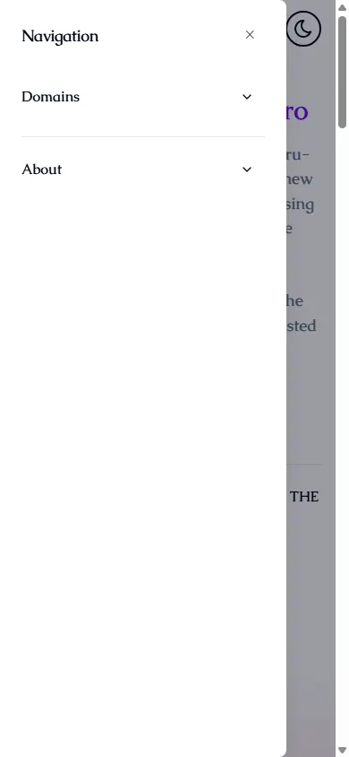

### Keyboard and Commander

| Where          | Keys            | Result                                       |
| -------------- | --------------- | -------------------------------------------- |
| Anywhere       | Ctrl or Cmd + K | Open Commander (when enabled)                |
| Invoice domain | Ctrl or Cmd + N | Go to create invoice                         |
| Invoice domain | Ctrl or Cmd + U | Go to upload scans                           |
| Invoice domain | `?`             | Open the shortcut help                       |
| Invoice domain | Esc             | Close the open surface                       |
| Inline edits   | Esc             | Cancel an invoice item edit or a scan rename |

Invoice shortcuts are ignored while the user types in an input. Commander groups its commands as **Navigation**, **Theme** (light, dark,
system), **Language**, **Accessibility** (normal or dyslexic font), **Fun**, and **Links**. The Fun effects (Rainbow, Disco, Matrix) are
timed DOM effects and are not persisted.

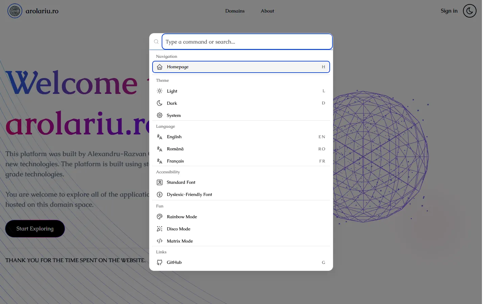

## First visit and the EULA gate

The first thing a new visitor sees on **any** page is not the page. Until the `eula-accepted` cookie exists, the root layout renders the
EULA screen in place of the route's children. Header and footer stay visible; the analytics tracker does not mount yet.

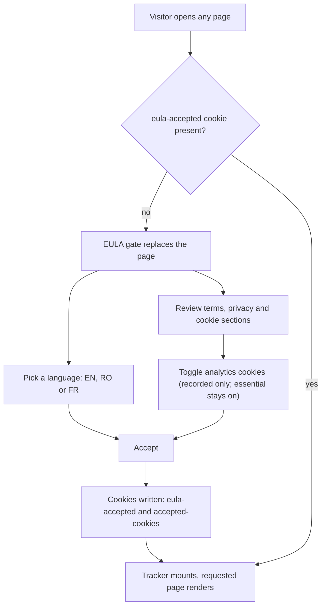

- The gate offers two cookie categories. **Essential** is always on. **Analytics** is optional and starts enabled; accepting stores the
  choice in the `accepted-cookies` cookie.
- The language select applies immediately: it updates the preferences store, which writes the `locale` cookie and refreshes the route (see
  [Internationalization](#internationalization)).
- While the cookie check resolves, the gate shows a shimmer placeholder instead of flashing the page.

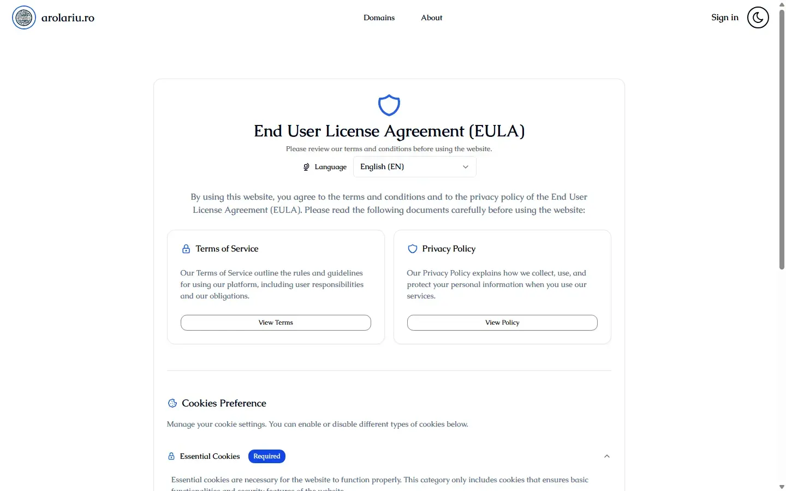

## Home, About and Domains

These are the Persuade surfaces: first impression, credibility, and routing into the product.

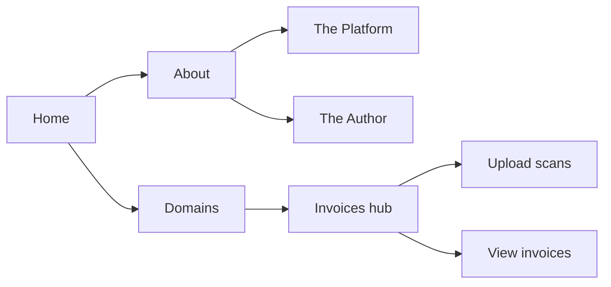

- **Home** is a server page that composes a hero, a technologies section (with the architecture card) and a features section over decorative
  background beams. The hero animates on load and the Technologies section reveals once on entering the viewport; About and The Platform
  sections reveal once when 100px inside the viewport. See [Known gaps](#known-gaps) for stale technology-card copy.
- **About** composes, in order, Hero, Mission, Values, Stats, Navigation, FAQ and CTA. The Author and The Platform are deeper dives; some
  Author sections re-trigger their reveal each time they scroll into view.
- **Domains** lists the product areas as service cards. Today there is one: the Invoice Management System.

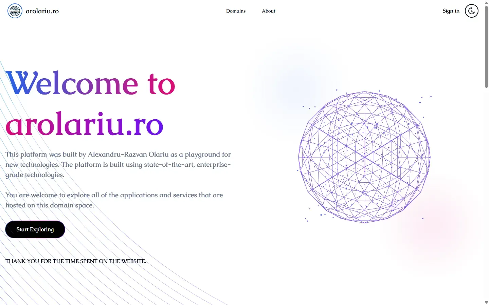

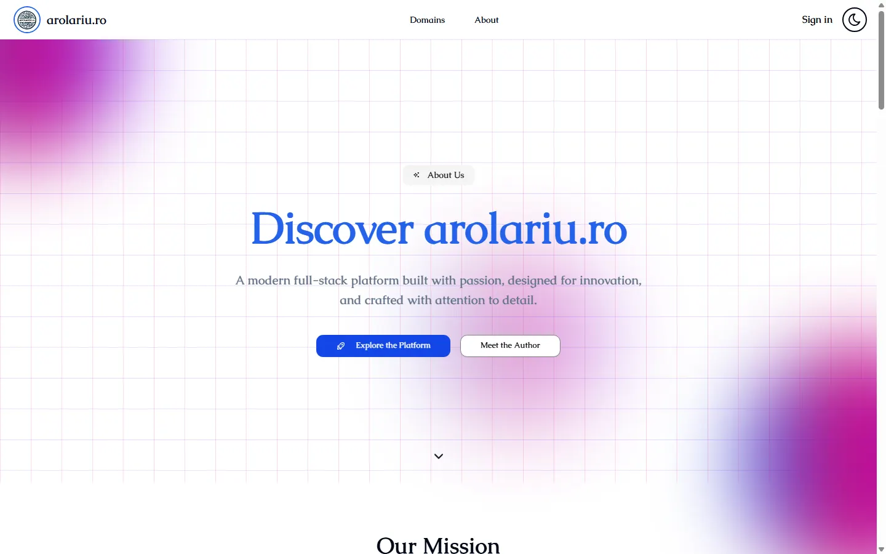

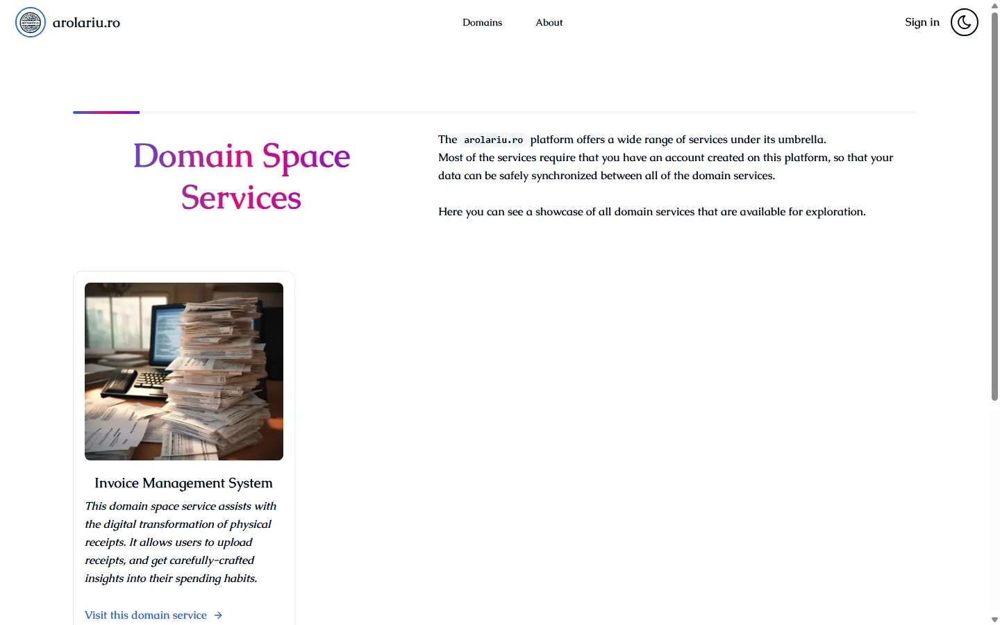

## Signing in and returning

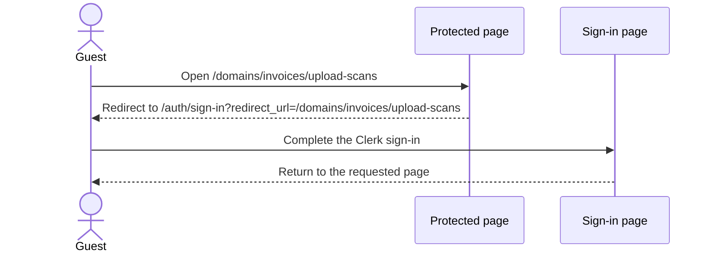

- Sign-in and sign-up render Clerk's UI, localized through the app locale, behind a skeleton while it loads.
- `/auth` is a friendly chooser with sign-up and sign-in cards and short trust points; a signed-in user who opens it is redirected to `/`.
- The final "Return to the requested page" hop is Clerk behavior driven by `redirect_url`. It is not asserted by any test in this
  repository.

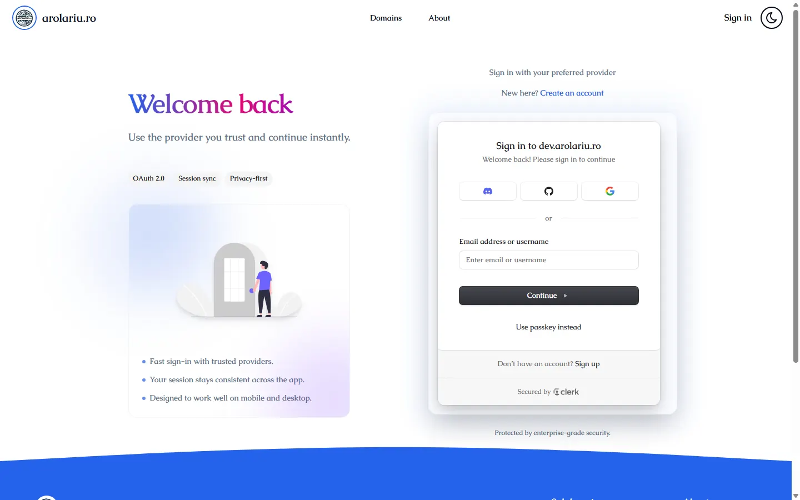

## The invoice journey

This is the Operate surface: guests can look, signed-in users finish tasks. Atmosphere recedes; scanability and predictable next steps lead.

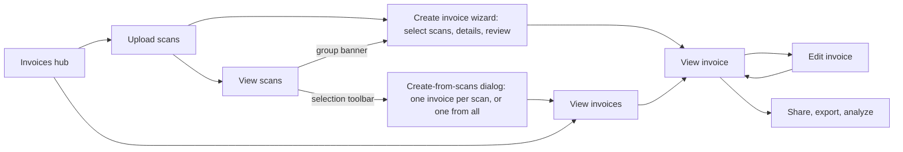

Below `md`, every invoice route shows a four-item bottom bar: **Home** (`/domains/invoices`), **Scan** (upload scans), **Invoices** (view
invoices) and **Profile** (`/my-profile`). The active item follows the pathname.

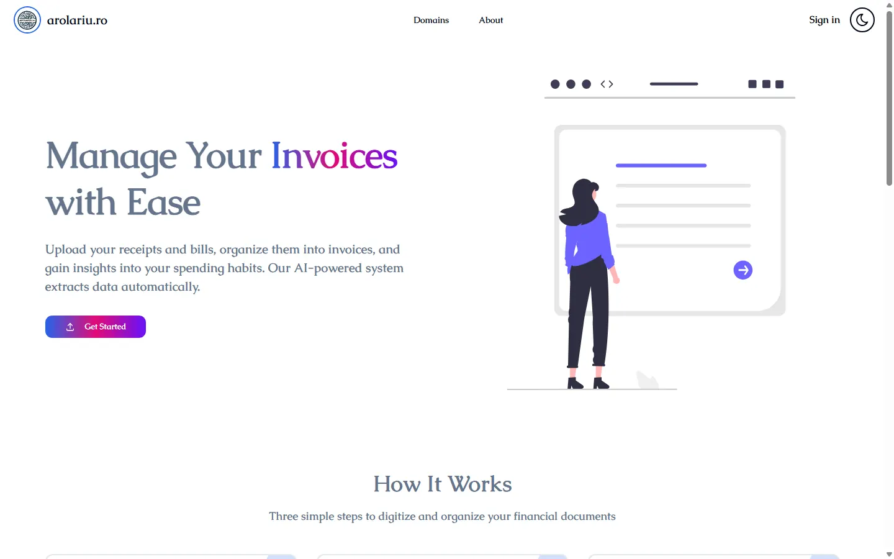

### Upload scans

| Aspect         | Behavior                                                                                                                                                                         |
| -------------- | -------------------------------------------------------------------------------------------------------------------------------------------------------------------------------- |
| Inputs         | File picker, drag and drop, and paste share one validation path.                                                                                                                 |
| Accepted types | `jpg`, `jpeg`, `png`, `bmp`, `tif`, `tiff`, `heif`, `pdf`.                                                                                                                       |
| Limits         | 10 MB per file; up to 3 upload attempts per file.                                                                                                                                |
| Rejections     | `unsupported-extension`, `unsupported-type`, `file-too-large`, each with a localized message.                                                                                    |
| Progress       | A workflow progress bar, per-file preview, and a loading skeleton route segment.                                                                                                 |
| After success  | A prompt offers **Create invoice** or **View scans**; a "next steps" card and a formats card sit in the sidebar.                                                                 |
| First run      | An onboarding overlay (Upload, Analyze, Track). Completion and permanent dismissal are stored in `localStorage` (`invoice-onboarding-complete`, `invoice-onboarding-dismissed`). |

### View scans

A grid of scans with selection, rename (Esc cancels), rotation and delete. An empty library offers an upload action. Two separate paths lead
from scans to invoices:

- **Selection toolbar.** Selecting scans reveals a toolbar whose **Create invoice** action (**Create invoices** for several scans) opens a
  dialog, not the wizard. With more than one scan selected, the dialog asks for a mode: one invoice per scan, or one invoice from all the
  selected scans. It creates the invoices in place, shows progress and any partial failures, and ends with a link to **View invoices**.
- **Group banner.** When 2 to 5 ready scans were uploaded within five minutes of each other, a banner (dismissible for the session) offers
  to combine them. Its action selects that group in the scans store and opens the three-step **Create invoice** wizard below.

### Create invoice

Three steps in order: `select-scans`, `details`, `review`. Back is hidden on the first step and Next is hidden on review. The wizard keeps
its own scan selection and starts empty, even when the View scans group banner opened it. Creating the invoice navigates to
`view-invoice/<id>`. The flow has its own notes in
[`src/app/domains/invoices/create-invoice/README.md`](src/app/domains/invoices/create-invoice/README.md).

### View invoices

Tabs for **Invoices**, **Statistics** and **Live analysis**. The invoices tab switches between grid and table views, filters and sorts, and
offers bulk actions. **Import** is a placeholder: it accepts `csv`, `pdf` and `xlsx` (or `xls`) files up to 10 MB, then only simulates
success; no file is processed. **Export** offers `csv`, `json` and `pdf`, but only JSON produces a file (or copies to the clipboard); CSV
and PDF throw a not-implemented error. Single-invoice export on the detail page works in every format. Guests see an empty state that points
to upload once the fetch resolves. Until then the list shows whatever the shared local cache holds, which can be another account's invoices
on the same browser profile (see [Persistence](#persistence)).

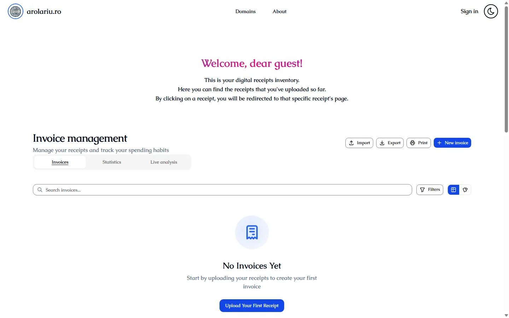

### Invoice detail and edit

- **Detail** has **Recipes** and **Info** tabs, export to PDF, CSV or JSON (or copy a summary; the Edit button, the share,
  shopping-calendar, budget and seasonal cards are owner-only, and other viewers see a guest banner), a share-analytics dialog, a receipt
  scan card, an item analytics card, and related invoices. Edit is one click away from the header.
- **Edit** opens with a guided-edit banner, an items table with inline edit (Esc cancels), a sharing card, and metadata and recipes tabs.
  Destructive actions (for example delete) go through confirmation dialogs.

## My Profile

Guests are redirected to sign-in. Signed-in users get a profile header and a two-column settings layout: a sidebar of seven sections on
desktop, replaced by a select menu on mobile. One panel shows at a time and swaps with a short fade.

| Section       | Panel                                                                                                       |
| ------------- | ----------------------------------------------------------------------------------------------------------- |
| Profile       | Quick stats                                                                                                 |
| Appearance    | Theme, font, the seven named theme presets plus Custom, custom colors (only for "custom"), locale, advanced |
| AI            | AI settings                                                                                                 |
| Analytics     | Analytics settings                                                                                          |
| Notifications | Notification settings                                                                                       |
| Security      | Security settings                                                                                           |
| Data          | Export, and a **Delete account** danger zone                                                                |

- **Appearance** also holds the **compact mode** and **animations** toggles. See [`DESIGN_SYSTEM.md`](DESIGN_SYSTEM.md#4-theming) for the
  preset runtime.
- While the user record loads, a profile skeleton stands in for the page.
- The animations toggle is stored but not yet wired to the UI (see [Known gaps](#known-gaps)).

## Cross-cutting mechanics

### Loading

Route segments ship `loading.tsx` skeletons at the root, About (and The Author and The Platform), Domains, Acknowledgements, Auth, My
Profile, and the invoice hub, upload, create, view-invoices and view-scans routes. Invoice detail and edit have no segment skeleton of their
own and rely on the invoices layout `Suspense` fallback. Clerk forms use their own `ClerkSkeleton` fallback.

### Errors, not found and forbidden

| Situation                    | What the visitor gets                                                                                                                                                                                                                                                                     |
| ---------------------------- | ----------------------------------------------------------------------------------------------------------------------------------------------------------------------------------------------------------------------------------------------------------------------------------------- |
| Unknown URL                  | `global-not-found.tsx`, which sits outside the root layout (no EULA gate): header and footer, a 404 hero, a diagnostics QR code, a submit-error action and a return-to-homepage link. The root `not-found.tsx` covers `notFound()` raised inside a route without its own `not-found.tsx`. |
| Deleted invoice              | The segment's `not-found.tsx` (view and edit), with a link back to the invoice list. Reached when the fetched invoice is soft-deleted.                                                                                                                                                    |
| Missing invoice or no access | The forbidden screen, with a call to action that links to `/auth`. It carries no return path. A missing invoice lands here instead of `not-found.tsx` (see [Known gaps](#known-gaps)).                                                                                                    |
| Runtime error in a segment   | The segment `error.tsx` (root, domains, about, auth, my-profile) renders a shared alert with **Try again** and **Return home**, plus the error digest when present.                                                                                                                       |
| Error in the root layout     | `global-error.tsx`, which also sets a localized document title. It mounts the analytics tracker without checking `eula-accepted` (see [Known gaps](#known-gaps)).                                                                                                                         |

There is no `forbidden.tsx` or `unauthorized.tsx`; forbidden is a rendered component, not a framework status page.

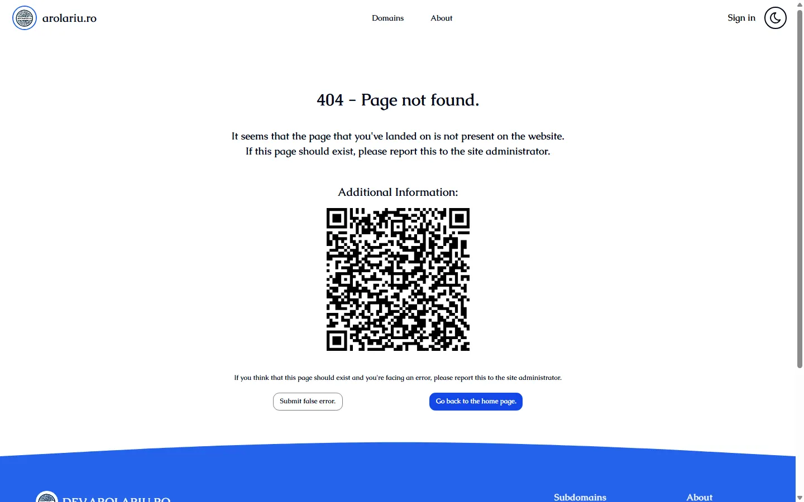

### Empty states

Empty states are first-class: an invoice `EmptyState` with a primary and a secondary action is used by the scan grid, invoice grid and table
(each points to upload), and guests on **View invoices** get an empty state instead of a redirect (observed on staging; it depends on the
API returning an empty list and appears only after that fetch replaces the shared local cache).

### Dialogs and toasts

Invoice dialogs go through a shared `DialogContainer` and context. Non-blocking feedback uses the global toaster through `@/lib/notify`.
Errors, warnings and loading toasts stay until closed; success, info and neutral toasts auto-dismiss after 5 s.

### Motion and reveal

Reveals use `motion/react` (`useInView`, once). See [`DESIGN_SYSTEM.md`](DESIGN_SYSTEM.md#8-motion-vocabulary) for durations and the
reduced-motion coverage; note that motion driven by `motion/react` is not covered by the CSS reduced-motion clamp.

## Persistence

| What                                                                        | Where                                                                                |
| --------------------------------------------------------------------------- | ------------------------------------------------------------------------------------ |
| EULA and cookie choice                                                      | Cookies `eula-accepted` and `accepted-cookies`                                       |
| Locale                                                                      | Cookie `locale`, written from the preferences store                                  |
| Preferences (locale, compact mode, animations, theme preset, custom colors) | IndexedDB: Dexie database `zustand-store`, key `account-preferences`                 |
| Invoices, merchants, scans                                                  | IndexedDB tables in the same database                                                |
| Font choice                                                                 | `localStorage["selectedFont"]`                                                       |
| Invoice onboarding state                                                    | `localStorage` keys `invoice-onboarding-complete` and `invoice-onboarding-dismissed` |
| Color mode                                                                  | `next-themes` storage, default `system`                                              |

`PreferencesSubscriptions` keeps tabs in step: a `BroadcastChannel("zustand-preferences-sync")` pushes changes across tabs, a
`visibilitychange` handler rehydrates from IndexedDB, a locale change writes the cookie through the `setCookie` server action and then calls
`router.refresh()`, and a theme-preset change writes `dataset.themePreset` plus the CSS variables.

The storage keys are **not** per-user, and no reset on sign-out was found. Signing out and signing in as someone else on the same browser
profile reuses the same local database. That is a display risk, not only a storage detail: `useInvoices` returns the cached invoices as soon
as the store hydrates and replaces them only when the current account's fetch succeeds (a failed fetch keeps them). A guest or a different
account can therefore see the previous account's invoices until that fetch resolves (see [Known gaps](#known-gaps)).

## Internationalization

- Supported locales: English, Romanian, French. The default is `en`.
- The `locale` cookie is the single source for the server: `src/i18n/request.ts` reads it, validates it, loads `messages/<locale>.json` and
  fixes the time zone to `Europe/Bucharest`.
- Changing language anywhere (EULA select, My Profile, Commander) calls `setLocale` on the preferences store, which writes the cookie and
  refreshes the route. Clerk's UI is localized through the same locale.
- All user-facing strings come from translations. The theme presets' names and descriptions, the EULA Required/Optional badges and two
  edit-invoice tab labels ("Possible Recipes", "Additional Info") are the exceptions (see [Known gaps](#known-gaps)).
- A `locale` cookie with an unsupported value makes the request config throw instead of falling back to English.

## Accessibility and reduced motion

- Landmarks, heading structure, document title and `lang` are asserted in the Playwright accessibility specs for the critical public pages.
- The mobile menu toggle exposes `aria-expanded` and `aria-controls`; the error alert uses `role="alert"`.
- The dyslexia-friendly font and light, dark and system color modes are available from Commander and the appearance settings.
- Reduced motion is honored by the CSS layer. Motion driven by `motion/react` is not covered by that clamp, and the `animationsEnabled`
  preference is not wired (see [Known gaps](#known-gaps)).
- Contrast figures and the full accessibility table live in [`DESIGN_SYSTEM.md`](DESIGN_SYSTEM.md#9-accessibility).

## Known gaps

Recorded, not fixed: this documentation pass is docs-only, so none of these were changed in source, messages or configuration.

| Area                | Gap                                                                                                                                                                                                                                                                                                                                                                                                                                                   |
| ------------------- | ----------------------------------------------------------------------------------------------------------------------------------------------------------------------------------------------------------------------------------------------------------------------------------------------------------------------------------------------------------------------------------------------------------------------------------------------------- |
| Analytics consent   | The analytics toggle is stored in `accepted-cookies` but nothing reads it. Clarity, Google Analytics and Hotjar mount whenever `eula-accepted` is set. `global-error.tsx` also mounts `Tracking` without checking `eula-accepted`, so a root-layout error loads analytics even before the EULA is accepted.                                                                                                                                           |
| Content accuracy    | Home technology cards (`messages/en.json`) say "Next.JS 15" and ".NET 8 LTS". The architecture card (`src/app/_components/Technologies.tsx`) names Next.js 16, Relay GraphQL and .NET 10, and Relay is not a dependency of this site.                                                                                                                                                                                                                 |
| Console noise       | On first load of dev, the Hotjar websocket (`wss://ws.hotjar.com`) is blocked by the Content Security Policy, and Clerk logs its development-keys warning.                                                                                                                                                                                                                                                                                            |
| Headings            | View invoices renders two `h1` elements on the default tab and three on Statistics.                                                                                                                                                                                                                                                                                                                                                                   |
| Overlap             | The decorative orb overlaps body copy on `/about/the-platform`, and the hero beams cross body text on Home. The Orb Contrast rule in `DESIGN.md` exists for this.                                                                                                                                                                                                                                                                                     |
| Contrast            | `muted-foreground` on the Slate Wash surface measures about 4.3:1, below AA for body text. In light mode the intent pairs also fall short for normal text: white on success 3.70:1, on warning 3.29:1 and on info 4.36:1, and the destructive pair 3.59:1 (used by the delete button in `DeleteScanDialog.module.scss`).                                                                                                                              |
| Mobile navigation   | No Escape handler and no focus trap or restore; the drawer has no slide animation.                                                                                                                                                                                                                                                                                                                                                                    |
| Access flow         | Edit-invoice and the invoice forbidden screen do not carry a return path to sign-in; `/auth` is reached without `redirect_url`. Edit has no owner comparison in the page, so sharing recipients, and any signed-in user for a public invoice, reach an edit screen whose saves the API rejects. A missing invoice shows the forbidden screen instead of `not-found.tsx`, because `fetchInvoice` errors carry no `status` for the pages' `404` branch. |
| Scan grouping       | The View scans group banner selects its scans in the scans store, but the create-invoice wizard keeps its own selection, so the grouped scans are not preselected when the wizard opens.                                                                                                                                                                                                                                                              |
| Import and export   | On View invoices, the import dialog only simulates success (`ImportDialog.tsx`), and the collection exporter throws for CSV and PDF (`view-invoices/_utils/export.ts`); only JSON export works.                                                                                                                                                                                                                                                       |
| Account isolation   | Invoices, merchants and scans share one IndexedDB database with no per-user key and no sign-out reset. `useInvoices` (`_hooks/invoice/useInvoices.tsx`) returns the cached invoices after hydration while the current account's fetch is pending, and keeps them if it fails, so a guest or another account can see the previous account's invoices on the same browser profile.                                                                      |
| Preferences         | `animationsEnabled` and `compactMode` are stored and toggled but not read anywhere. Only Appearance preferences persist; the other profile panels hold in-memory state, Quick stats are placeholder values, the Data panel's export and delete buttons are inert and Delete Account links out to Clerk. Storage keys are not per-user and no sign-out reset was found.                                                                                |
| Theme presets       | `THEME_PRESETS.default.preview` shows cyan, purple and pink, but the real default is blue, violet and magenta. Preset names and descriptions are English-only strings. The custom preset writes `--gradient-from`, `--gradient-via` and `--gradient-to`, but no stylesheet reads them, so custom gradient colors only reach the first stop through `--primary`.                                                                                       |
| i18n                | An unsupported `locale` cookie throws instead of falling back.                                                                                                                                                                                                                                                                                                                                                                                        |
| Test coverage       | Playwright specs cover Home, About, Auth, Domains landmarks, the legal pages, routing, header, footer, and the global error and not-found pages. No Playwright spec exercises an invoice journey; invoice flows are covered by colocated Vitest suites only.                                                                                                                                                                                          |
| Documentation drift | Comments in `main.scss`, `_presets.scss`, `_index.scss` and `theme-presets.ts` still mention a `useThemePreset` hook that does not exist. See [`DESIGN_SYSTEM.md`](DESIGN_SYSTEM.md#4-theming).                                                                                                                                                                                                                                                       |
| Unused styles       | Global `.btn-*`, `.card--featured`, `.card-grid`, `.badge--*` and the `glass` mixin have no consumers.                                                                                                                                                                                                                                                                                                                                                |

## Tests and related documentation

| Evidence                                                                                | Covers                                                                                |
| --------------------------------------------------------------------------------------- | ------------------------------------------------------------------------------------- |
| `src/app/page.spec.tsx`                                                                 | Home load, hero, navigation, auth link, accessibility, headings, responsive viewports |
| `src/app/aria-snapshots.spec.tsx`                                                       | Landmark structure for home, about, auth, domains and legal pages                     |
| `src/accessibility/full-site.spec.tsx`                                                  | WCAG 2.1 AA scans of Home, About, Auth, Privacy, Terms and Acknowledgements           |
| `src/app/routing.spec.tsx`, `src/app/about/page.spec.tsx`, `src/app/auth/page.spec.tsx` | Routing and page-level journeys                                                       |
| `src/components/Header.spec.tsx`, `Footer.spec.tsx`                                     | Global chrome                                                                         |
| `src/app/global-error.spec.tsx`, `global-not-found.spec.tsx`                            | Error and not-found surfaces                                                          |
| Colocated Vitest suites under `src/app/domains/invoices/**`                             | Upload, create, scans, list, detail, edit, dialogs and hooks                          |
| [`tests/README.md`](tests/README.md), [`DEBUGGING.md`](DEBUGGING.md)                    | Playwright setup, fixtures and debugging                                              |
| [RFC 1003](../../docs/rfc/1003-internationalization-system.md)                          | Internationalization system                                                           |
| [RFC 1005](../../docs/rfc/1005-state-management-zustand.md)                             | Zustand state and persistence                                                         |
| [RFC 1007](../../docs/rfc/1007-advanced-frontend-patterns.md)                           | Advanced frontend patterns                                                            |
| [RFC 1008](../../docs/rfc/1008-scss-system-architecture.md)                             | SCSS architecture                                                                     |

## Screenshot index

Captured from `https://dev.arolariu.ro` (build `1fce0ee1b`) with reduced motion. Sizes are 1440x900 unless noted.

| File                                   | Shows                                         |
| -------------------------------------- | --------------------------------------------- |
| `01-eula-gate-desktop-light`           | First-visit EULA gate                         |
| `02-home-desktop-light`                | Home, first viewport                          |
| `03-home-fullpage-desktop-light`       | Home, full page (1425x3230)                   |
| `04-home-architecture-desktop-light`   | Home, architecture section                    |
| `05-home-desktop-dark`                 | Home, dark mode                               |
| `06-home-mobile-light`                 | Home on a phone (390x844)                     |
| `07-mobile-nav-open-light`             | Mobile navigation open (390x844)              |
| `08-about-desktop-light`               | About                                         |
| `09-the-author-desktop-light`          | The Author                                    |
| `10-the-platform-desktop-light`        | The Platform                                  |
| `11-domains-desktop-light`             | Domains overview                              |
| `12-invoices-hub-desktop-light`        | Invoices hub                                  |
| `13-view-invoices-guest-desktop-light` | View invoices as a guest                      |
| `14-sign-in-redirect-desktop-light`    | Sign-in reached by a protected-route redirect |
| `15-not-found-desktop-light`           | 404 page                                      |
| `16-commander-palette-desktop-light`   | Commander palette                             |
